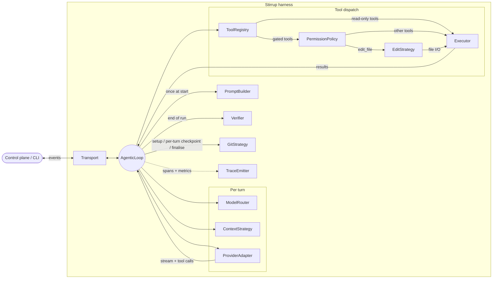

# Architecture

Stirrup is a coding-agent harness designed as a short-lived job. It is
started by a control plane (or a developer) per task, runs the agentic
loop to completion, and exits — there is no in-process session store
and no cross-tenant memory. The core loop is a pure function of its
interfaces; every concrete implementation is injected by the factory
from a single `RunConfig`.

This document is the technical reference. For the operator-facing
deployment posture see [`safety-rings.md`](safety-rings.md); for the
configuration surface see [`configuration.md`](configuration.md).

## Design principles

- **Use the LLM only when judgement is needed.** The loop is a state
  machine with LLM calls at decision points, not an LLM with code
  bolted on. File I/O, command dispatch, edits, permission gates, git,
  and telemetry are deterministic Go.
- **Pure-function core.** The agentic loop depends only on interfaces.
  Every component is injected via `core.BuildLoop` /
  `core.BuildLoopWithTransport`, which constructs concrete types from
  a `RunConfig`. The provider, executor, or edit strategy can be
  swapped without touching the loop.
- **Short-lived job.** No persistent state across tasks. The control
  plane is responsible for conversation history, scheduling, and any
  multi-task continuity.
- **Minimal dependency surface.** Provider adapters and the container
  executor are written against documented REST APIs using the Go
  standard library, not vendor SDKs. Every line is auditable.
- **Cost is a control-plane concern.** The harness tracks tokens for
  budget enforcement but does not maintain pricing tables.

## The thirteen components

Every run is fully described by a `RunConfig` — a declarative
specification that names a concrete implementation for each of the
thirteen interfaces below.

| # | Interface | Implementations | Source |
|---|---|---|---|
| 1 | `ProviderAdapter` | `anthropic`, `bedrock`, `openai-compatible`, `openai-responses`, `gemini` | `harness/internal/provider/` |
| 2 | `ModelRouter` | `static`, `per-mode`, `dynamic` | `harness/internal/router/` |
| 3 | `PromptBuilder` | `default` (per-mode templates, composed) | `harness/internal/prompt/` |
| 4 | `ContextStrategy` | `sliding-window`, `summarise`, `offload-to-file`, `clear-tool-results` | `harness/internal/context/` |
| 5 | `ToolRegistry` | seven built-in tools + remote MCP servers | `harness/internal/tool/` |
| 6 | `Executor` | `local`, `container` (Docker/Podman), `api` (GitHub) | `harness/internal/executor/` |
| 7 | `EditStrategy` | `whole-file`, `search-replace`, `udiff`, `multi` | `harness/internal/edit/` |
| 8 | `Verifier` | `none`, `test-runner`, `llm-judge`, `composite` | `harness/internal/verifier/` |
| 9 | `PermissionPolicy` | `allow-all`, `deny-side-effects`, `ask-upstream`, `policy-engine` (Cedar) | `harness/internal/permission/` |
| 10 | `Transport` | `stdio`, `grpc` (outbound bidi streaming), `null` (sub-agents) | `harness/internal/transport/` |
| 11 | `GitStrategy` | `none`, `deterministic` | `harness/internal/git/` |
| 12 | `TraceEmitter` | `jsonl`, `otel` (OTLP/gRPC or OTLP/HTTP) | `harness/internal/trace/` |
| 13 | `GuardRail` | `none`, `granite-guardian` (vLLM), `cloud-judge`, `composite` | `harness/internal/guard/` |

The core loop knows nothing about which implementation it received;
it only invokes the interface methods. That is what makes every
component independently swappable and testable, and what lets the
eval framework substitute replay doubles for the provider and
executor without touching the loop.

## The agentic loop



The `PromptBuilder` runs once at start. The `GitStrategy` sets up
before the loop, checkpoints after each turn that ran tools, and
finalises at end-of-run (see [Git strategy](#git-strategy)). Each turn
the loop asks the `ModelRouter` which provider+model to use and the
`ContextStrategy` for the message history (compacting if the budget is
tight), then streams the request through the chosen `ProviderAdapter`.
Tool calls in the response are resolved by the `ToolRegistry`; the
`PermissionPolicy` interprets each tool's `WorkspaceMutating` and
`RequiresApproval` flags before dispatch. Read-only tools with neither
flag go straight to the `Executor`. The `edit_file` tool dispatches
through the `EditStrategy`, which uses the Executor for file I/O (and
is transparently wrapped by the post-edit code scanner). At
end-of-run, a final answer is first checked against `outputSchema` when
one is set, and the `Verifier` then validates the output (see
[Structured output and
verification](#structured-output-and-verification)). The `Transport`
carries events to and from the control plane; the `TraceEmitter`
records spans and metrics throughout.

Lifecycle hooks (issue #461) run around this loop, not inside it. A
configured `hook.Runner` (`hook.Noop` when the run has none) executes
`preRun` hooks first, under the run's own wall-clock context. The
repository guidance load, the `PromptBuilder` and `GitStrategy.Setup`
follow in that order, so a clone hook runs before all three. The
guidance load, the workspace listing in the system prompt and the
deterministic git strategy, which commits into whatever repository the
workspace holds, all see the workspace the hooks produced. A failed `preRun` hook, or a guidance file that cannot be
loaded, ends the run as `setup_failed`.

`postRun` hooks execute after outcome classification and the final git
checkpoint, so edits a hook makes are not committed. They run before
the run reports `done`, on a context detached from the run's own
cancellation and deadline (`context.WithoutCancel`) and bounded by the
sum of the configured `postRun` timeouts plus a 30 s margin, so an
artifact upload can still finish after the run's wall-clock timeout has
expired (see [Terminal sequence](#terminal-sequence)). Hook output
never enters the model's context; it is trace-only, recorded via the
optional `trace.HookRecorder` capability the same way
`trace.SystemInstructionsRecorder` is. Sub-agent loops always get
`hook.Noop`: hooks are parent-run-only. Full schema, defaults, and
failure-semantics reference: [`configuration.md`
"Lifecycle hooks"](configuration.md#lifecycle-hooks).

Post-edit checks (`tools.postEdit`, `harness/internal/postedit/`) are a
different mechanism with a different audience. Hooks run once before
and once after the whole run, and their output never reaches the model.
A post-edit check runs after each successful edit whose path matches
the check's glob, through the same `Executor`, and its failure is shown
to the model. When a check exits non-zero, its scrubbed, size-capped
output is appended to the edit's tool result inside a data fence marked
as untrusted, so the model can repair the problem on its next turn. The
edit is never reverted and never turned into an error. The command is
operator-authored, so it runs outside the permission policy, which
gates only the edit itself, and the model-chosen path reaches the shell
only as the value of the `STIRRUP_EDITED_PATH` variable. Hooks suit
environment preparation and artifact delivery; post-edit checks suit
fast feedback such as formatters and linters. Each check execution is
recorded as a `post_edit_check` trace event.

### Structured output and verification

`Run` repeats the inner loop until the run succeeds or fails. When the
inner loop ends with a final answer, two checks run before the run
succeeds, in this order.

1. When `outputSchema` is set, the answer must be a JSON document that
   validates against the schema. An answer that does not validate never
   reaches the verifier. The loop sends a corrective user message and
   re-enters the inner loop, at most twice per run. A third failing
   answer, or a document that satisfies the schema only before secrets
   are scrubbed from it, ends the run as `structured_output_failed`. A
   correction needs a free turn, and a run with none left ends as
   `max_turns`.
2. The `Verifier` verifies the run. A failure appends its feedback as a
   synthetic user message and re-enters the inner loop, at most three
   times. A verifier error ends the run as `verification_error`.

`maxTurns` is one run-scoped budget. The turn counter continues across
inner-loop re-entries, so corrective attempts and verification repair
turns spend the same turns as the first pass, and the turn number seen
by the model router and by the wind-down threshold does not reset. A
failed verification with no turn left, like a failure of the last
permitted retry, ends the run as `verification_failed`. The stall
detector is created per inner loop, so a re-entry starts with no
repetition history and no nudge spent.

### Synthetic messages

The loop adds harness-authored text to the history in six situations:
verifier feedback after a failed verification, a corrective prompt for
a final answer that fails `outputSchema`, the prompt of a tool-choice
escalation, the instruction of an output-limit recovery, the stall
nudge, and the wind-down notice. Each is announced on the transport as
a `user_message` event whose `source` names the situation.

New text joins the trailing user message as extra text when the
history ends on one, which is the case after a tool-using turn.
Otherwise it becomes a new user message marked `Synthetic`. A merged
message keeps the mark it had, so the stall nudge and the wind-down
notice, which follow a tool-result message, do not carry `Synthetic`.

`Message.Origin` is independent of `Synthetic`. It names the component
whose output a message carries when that output can echo content from
outside the harness. Verifier feedback carries the origin
`verifier_feedback`, on the message or, when it merged into another user
message, on its text block. Test-runner output can contain workspace
content, so feedback is untrusted on the turn it arrives and passes the
screening tool results get: the Rule-of-Two scan reads it under the
source `verifier_feedback`, it is scrubbed for secrets in the history,
and a configured pre-turn guard reads it under the source
`verifier_feedback:n=<k>`. A guard deny replaces the feedback with a
placeholder and the run continues. The origin appears on the messages
of a turn's `modelInput` in the trace.

The wind-down notice is sent at most once per run, only when `windDown`
is enabled (it is off by default), at the start of a turn that crosses
a threshold: two or fewer turns remaining, 90% of `maxTokenBudget` used
by the loop's own turns, or 90% of the wall-clock window elapsed. The
turn threshold never fires on the run's first turn. Read-only modes get
a variant that asks for a summary of findings and no further tool calls
unless essential. The turn that received the notice records its trigger
as `windDown`.

### Turn failures and recovery

A model turn that fails or stops early does not always end the run.

**Retryable provider failures.** A turn that fails with a retryable
provider error is re-issued before the run ends with `error`. The
`anthropic`, `gemini`, `openai-compatible` and `openai-responses`
adapters mark an error retryable for the HTTP statuses 408, 409, 429,
500, 502, 503, 504 and 529 (except a 429 that names an exhausted quota
or billing limit) and for transport faults such as an idle stream, a
reset connection, a truncated body or a network timeout. The `bedrock`
adapter marks none. The retry settings are those of the provider the
router selected for the turn. A turn is retried at most twice and never
more often than `provider.retry.maxAttempts` less one, so a
`maxAttempts` of 1 disables turn retry. Turn retries wrap the
pre-stream HTTP retry, so one turn can make several requests. The wait
before retry *n* is equal-jitter backoff: a random duration between
half of and all of `min(initialDelayMs * 2^n, maxDelayMs)`. The
`wallClockBudgetMs` budget is measured from the turn's first failure
and bounds the start of the last retry. A batch-mode turn is never
retried. Tools run only after a stream completes and a failed attempt
appends nothing to the history, so a retry cannot repeat a workspace
side effect. Each retry emits a `warning` event, after which a control
plane discards the `text_delta` and `tool_call` events of the failed
attempt. Usage reported by failed attempts is charged to the token
budget, so a turn can overshoot `maxTokenBudget` by up to two retried
attempts.

**Output limit.** The first two `max_tokens` stops of a run are
continued instead of ending the run, unless the stop ends the last
turn. Tool calls in the truncated turn are dropped, because a call cut
off mid-arguments cannot run and every `tool_use` in the history needs
a result. Any text is kept, and the loop appends a synthetic
instruction asking the model to continue its answer, to re-issue the
dropped call in smaller pieces, or, when the turn produced no text, to
keep its reasoning brief. Each recovery emits a `warning` event. A
later `max_tokens` stop ends the run with that outcome. Tool-choice
escalation never treats a `max_tokens` turn as a missed tool call. A
final answer continued after an output-limit stop is reported as the
joined text.

**Context overflow.** A request rejected as larger than the model's
context window is compacted and retried once; see [Context
strategies](#context-strategies).

### Tool dispatch

`planAndDispatch` (`harness/internal/core/dispatch.go`) runs the tool
calls of one assistant turn in three phases and returns the results in
call order.

1. **Resolve, gate and run synchronous calls.** For each call in order,
   the loop resolves the tool, opens its span, runs preflight and then
   the `pre_tool` guard. A synchronous tool is then permission-checked
   and run inline. A call to an asynchronous handler
   (`tools.controlPlane`) is queued. Preflight is deterministic and
   model-free, and checks in this order: unknown tool, deferred tool
   not yet loaded, malformed arguments, prototype-pollution keys,
   JSON Schema validation, and the tool-input tripwires.
2. **Fan out asynchronous calls.** Queued calls run concurrently under a
   semaphore sized by `toolDispatch.maxParallel` (default 4, ceiling
   16), and the phase waits for all of them.
3. **Close out in call order.** Each result is bounded, recorded,
   emitted and fed to the stall detector, in the order the model made
   the calls.

Phase 3 is the single place where a result's size is bounded before it
reaches the history, the trace and the transport. A result longer than
`tools.maxResultBytes` (default 100 KiB, at most 1 MiB) is cut to its
head, ends in a marker that gives the original size and the offset
where the omitted part starts, and loses its structured envelope, which
would repeat the omitted data. Tools marked `SelfBoundedResult` are
exempt because their handlers bound their own text and record exactly
the text delivered: `run_command`, `read_command_output` and
`tool_search`. MCP text goes through the same budget. Independently,
`read_file` and `grep_files` cap any single line at 4 KiB.

A tool call whose streamed arguments are not a JSON object does not
fail the stream. The provider adapter marks the call, the stream emits
a `warning` event, and preflight rejects the call ahead of schema
validation with the category `invalid_arguments`. The tool error quotes
the parse error and the first 200 characters of the scrubbed
arguments, and the raw arguments reach the trace only scrubbed and
capped at 4 KiB. The model sees an ordinary failed tool call and can
re-issue it. A model that keeps sending malformed arguments is bounded
by the stall detector, which compares the raw arguments, and by the
consecutive-failure limit.

### Terminal sequence

When the last inner loop ends, `Run` maps a cancelled or expired run
context onto `cancelled`, `timeout` or `control_stream_lost` from the
context's cause. It then does the end-of-run work in a fixed order.

1. **Git final checkpoint.** `GitStrategy.Finalise` commits outstanding
   work and reports the git result, recorded as `RunTrace.Git`. A failed
   checkpoint, or a working tree still dirty after it, turns an
   otherwise-successful run into `handoff_failed`. An earlier failure
   outcome is kept.
2. **`postRun` hooks.** A hook failure turns an otherwise-successful run
   into `hook_failed`.
3. **Command-output archive.** The archive of captured `run_command`
   output is finalised. A capture or archive failure turns an
   otherwise-successful run into `command_output_capture_failed` or
   `command_output_archive_failed`, unless the best-effort posture is
   configured.
4. **Workspace handoff.** The loop holds a `core.WorkspaceHandoff`,
   an interface that the `stirrup harness` and `stirrup job` entry
   points inject, so destination resolution and the exporter stay out
   of the loop. The handoff reads the workspace through the executor's
   `WorkspaceArchiver` capability. It runs for every outcome of a run
   whose executor has a workspace (every executor except `none` and
   `api`), including a `setup_failed` run, and records an export
   receipt on the trace. A failed export is a `warning` event. It turns
   an otherwise-successful run into `handoff_failed` when the export is
   required, which is the default whenever a destination is configured
   and which `executor.workspaceExportRequired` can relax.
5. **Trace finish and `done`.** The loop records the run's error text
   (`RunTrace.Error`, scrubbed and capped at 1 KiB), finishes the trace,
   and emits `done`. Its `stop_reason` is the run outcome, and its trace
   summary carries the turn count, token usage, `git`,
   `workspace_export`, `error`, the structured output and the
   degraded capabilities.

Every step above precedes `done`, so a control plane that acts on
`done` observes the git result, the export receipt and the error text. A
run that fails during setup (a `preRun` hook, the guidance load, the
prompt build or git setup) skips steps 1 and 2 and still performs steps
3 to 5.

Steps 1, 2, 4 and 5 run on contexts detached from the run's
cancellation and deadline, so a run that ended by timeout or
cancellation can still persist its result. Each has its own budget: 30 s
for the git checkpoint, the sum of the `postRun` timeouts plus 30 s for
hooks, 5 min for the handoff, and 90 s for the trace finish. Each
detached context also ends when `AgenticLoop.Shutdown` is done. The
`stirrup harness` and `stirrup job` entry points cancel `Shutdown` on a
second SIGINT or SIGTERM. The first signal ends the run, and these
steps keep running within their budgets. The shutdown watchdog closes
the loop, and so tears down the executor, the transport and the trace
emitter, 5 s after the first signal for `stirrup job` and 5 s after the
second signal for `stirrup harness`. A single signal therefore lets a
`stirrup harness` run finish its git checkpoint, `postRun` hooks and
trace finish within their budgets.

## Modes

Five run modes ship as partial `RunConfig` presets that select
mode-appropriate tools, permissions, and prompt templates. One is
editable (`execution`); the other four are read-only, structurally
enforced by `ValidateRunConfig` to exclude `write_file`,
`edit_file`, and `run_command`.

| Mode | Tools | Default permission | Output shape |
|---|---|---|---|
| `execution` | read, write, shell, search, web fetch, sub-agent | `allow-all` | Code changes |
| `planning` (CLI default) | read-only | `deny-side-effects` | Structured plan |
| `review` | read-only | `deny-side-effects` | Structured review |
| `research` | read-only + web fetch | `deny-side-effects` | Research brief |
| `toil` | read-only + web fetch | `deny-side-effects` | Structured briefing |

`planning` is the CLI default so a bare `stirrup harness --prompt
"..."` invocation has no write or shell capability and passes Rule
of Two (Ring 4) without operator-supplied overrides. Operators who
need editing or shell access opt in explicitly via `--mode
execution`; finer-grained tool and permission selection is
available through `--config` or the individual CLI flags. Modes
are not special — they are saved configurations, and any field can
be overridden per-task via `RunConfig`.

## Prompt builder

The `PromptBuilder` runs once per run, after the pre-run hooks, and
builds the system prompt. The default builder renders the shipped mode
template, the working directory, the turn budget, the output schema, the
repository guidance and the dynamic context (wrapped in
`untrusted_context` tags). The `composed` builder, an operator template
(`promptBuilder.template`) and `systemPromptOverride` add a workspace
tree and a git status section to those. See
[`configuration.md`](configuration.md#system-prompt-templating) for the
operator-facing surface.

Those two sections are read through the run's `Executor`, never from
the harness host. They describe the sandbox the agent works in for the
`local`, `container`, `k8s` and `k8s-sandbox` executors alike, and an
agent-controlled `.git/config` in the workspace is never interpreted by
host git while the prompt is built.

- **Workspace tree.** The top-level entries of the workspace, capped at
  200 entries and 8 KiB. A marker line ends the list when entries were
  left out. Names containing control characters are left out. The
  section is omitted when the executor cannot read, when listing fails
  or when the workspace is empty. Sandbox executors list with `ls -p`,
  so the sandbox image needs it.
- **Git status.** The short status of the workspace, from git run
  inside the executor with the harness hardening flags, capped at 200
  entries and 8 KiB with a truncation marker. The section appears only
  when the executor can run commands and the workspace is the top level
  of a repository, so the file names of an enclosing repository never
  appear. It is omitted for the `api` executor (GitHub and GitLab
  backends) and `none`, and when git fails or is missing from the
  sandbox image.

## Provider adapters

Five adapters ship; all are hand-rolled HTTP+SSE against documented
REST APIs.

| Adapter | Wire format | Auth |
|---|---|---|
| `anthropic` | Messages SSE (`net/http` + `bufio.Scanner`) | API key, Anthropic WIF |
| `bedrock` | Bedrock `ConverseStream` (`aws-sdk-go-v2`) | IAM SigV4, IRSA |
| `openai-compatible` | Chat Completions streaming | API key, Azure WIF |
| `openai-responses` | Responses API (`POST /v1/responses`) — distinct wire format from Chat Completions | API key, Azure WIF |
| `gemini` | Vertex AI `:streamGenerateContent` with `?alt=sse` | GCP IAM (ADC) |

The two OpenAI adapters are selected explicitly: there is no
auto-detection between Chat Completions and Responses. The
`openai-compatible` adapter is the entry point for OpenAI itself,
LiteLLM, vLLM, Ollama, and Azure OpenAI when the deployment exposes
Chat Completions; `openai-responses` is for Azure OpenAI Foundry and
any deployment that requires the Responses wire format.

The four `net/http` adapters (`anthropic`, both OpenAI dialects,
`gemini`) each get their own client from `newStreamingHTTPClient`
(`provider/provider_util.go`), with explicit transport timeouts (30 s
dial, 10 s TLS handshake, 30 s response header), `ForceAttemptHTTP2`
so the custom dialer does not disable HTTP/2, and no
`http.Client.Timeout`, because a total deadline would also cap the
streamed body and cut long turns mid-stream. The streamed body is
bounded instead by a 120 s idle-read deadline (`idleTimeoutBody` in
`provider/streamidle.go`): a stream that keeps delivering bytes runs
for as long as the model generates, and one that goes silent fails
with `stream idle for 120s`. `bedrock` uses the AWS SDK client,
which applies no read timeout to Bedrock Runtime, so the adapter sets
a 120 s per-connection read deadline through the SDK's
`WithReadTimeout`. The effect is the same but the error differs: a
silent Bedrock stream fails with the SDK's `ResponseTimeoutError`
(`read on body reach timeout limit, 2m0s`), not `stream idle`. Neither
path has a total cap. The idle bound assumes the endpoint sends bytes
or keep-alives while the model works; a hidden-reasoning stream at
`high`, `xhigh` or `max` effort from an endpoint that stays silent
while it reasons could exceed it, and `defaultStreamIdleTimeout` is
the knob to revisit. Error-body reads are bounded via
`io.LimitReader`. Tool JSON is accumulated across delta events;
context cancellation is respected.

Per-adapter configuration including base URLs, API-key headers, query
params, and credential federation lives in
[`providers.md`](providers.md).

**Cross-provider confidentiality invariant.** `types.ContentBlock` is
a shared carrier type across all provider adapters, and accumulates
new fields over time to hold opaque per-provider round-trip state
(for example, a thought-signature field some providers require to be
echoed back on the next turn). Because the carrier is shared, a field
one provider populates for its own benefit could otherwise be
forwarded to a different provider by accident — for instance if a
model router passes a message translated for one provider's SDK
through to another provider's wire call. Each adapter therefore
defines its own local, provider-specific wire type (e.g.
`anthropicContentBlock`) as an explicit allowlist of the fields that
provider's API documents support, and a dedicated translation
function copies from `types.ContentBlock` into that local type field
by field. Any field on `types.ContentBlock` not explicitly mirrored
onto the local type is dropped at translation time, rather than
relying on call sites to scrub egress. Extending an adapter's local
wire type is an active decision: add a field only when that
provider's API documents support for it.

The same rule covers block types. `ContentBlock.ThoughtSignature`
carries Gemini's thought signature on `text` and `tool_use` blocks
and Anthropic's signature (or redacted `data`) on `thinking` and
`redacted_thinking` blocks; each adapter reads it only from the block
types it owns, and only the Anthropic adapter's wire type has a
thinking block, so the others drop thinking blocks at translation.

## Credential federation

The `harness/internal/credential/` package separates *who you are*
from *what credential you need*:

- **TokenSource** fetches identity tokens from the runtime
  environment. Implementations: `gke-metadata` (GKE Workload
  Identity), `file` (k8s projected volumes), `env`, `aws-irsa` (EKS),
  `azure-imds` (AKS), `github-actions-oidc`.
- **`credential.Source`** exchanges tokens (or resolves static
  secrets) into provider-specific credentials. Implementations:
  `StaticSource`, `WebIdentityAWSSource`, `AnthropicWIFSource`,
  `AzureWorkloadIdentitySource`, plus GCP-native paths (ADC, JWT
  service-account flow).

`Source.Resolve()` returns `Resolved.BearerToken`, a refresh-aware
closure each adapter calls per request. Tokens refresh without
restarting the run. `apiKeyRef` and `credential.type` are mutually
exclusive on the same provider; the validator rejects the
combination.

Operator walkthroughs:
[`credential-federation.md`](credential-federation.md),
[`anthropic-wif.md`](anthropic-wif.md),
[`azure-workload-identity.md`](azure-workload-identity.md).

## Executor tiers

The `Executor` interface abstracts where commands run and how files
are accessed. Four tiers ship, selected per-task:

- **`api`** — read-only, backed by the GitHub Contents endpoint over
  stdlib `net/http`. `WriteFile` and `Exec` return errors; URL paths
  are escaped via `url.PathEscape`.
- **`local`** — workspace-scoped local process execution with
  symlink-aware path containment via `filepath.EvalSymlinks`. Used
  for trusted environments (local dev, internal CI).
- **`container`** — Docker Engine REST API directly over a Unix
  socket, with no SDK dependency. Both Docker and Podman are
  supported through the same Engine API; socket auto-detection order
  is `DOCKER_HOST` → `/var/run/docker.sock` →
  `$XDG_RUNTIME_DIR/podman/podman.sock` →
  `/var/run/podman/podman.sock`.
- **`none`** — no execution surface at all: `ReadFile`, `WriteFile`,
  `ListDirectory`, and `Exec` all return errors, and
  `Capabilities()` reports every capability false. For MCP-only /
  server-side-tool runs where the agent needs no local filesystem
  or shell access. Not to be confused with
  `executor.network.mode: "none"` (deny-all egress on a
  filesystem-capable executor) — see the callout in
  [`docs/configuration.md`](configuration.md#components).

The `k8s` and `k8s-sandbox` executors run the agent in a Kubernetes
sandbox Pod; see [`docs/executors/k8s.md`](executors/k8s.md) and
[`docs/executors/k8s-agent-sandbox.md`](executors/k8s-agent-sandbox.md).

The container executor's Docker Engine API client (`container_api.go`)
carries no blanket `http.Client.Timeout`: exec output attach and
archive transfer are long-lived streaming reads that can legitimately
outlast any single short window, and a client-level `Timeout` would
bound the entire round trip including the body. Instead, every
short control-plane call (create/start/stop/remove/ping/exec-create/
exec-inspect) applies its own `context.WithTimeout`
(`containerControlPlaneTimeout`, 30s), while the streaming calls
(`startExec`, `getArchive`/`putArchive`) are bounded only by the
caller's own command/file-I/O deadline. The `Transport`'s
`ResponseHeaderTimeout` still gives an explicit, connection-level
bound (catching a daemon that accepts a connection but never answers
at all) independent of whether a per-call context deadline was set.

`classifyControlPlaneErr` reclassifies a Docker API call that failed
because `containerControlPlaneTimeout` elapsed through the shared
`ErrTimeout` sentinel, so callers matching `errors.Is(err,
ErrTimeout)` see a wedged daemon identically to a command timeout.

Filesystem executors enforce a 10 MB file size cap, a 1 MB command
output cap, a 30 s default command timeout, and symlink-aware
workspace containment. The container executor is hardened with
`CapDrop: ALL`, `no-new-privileges`, and `NetworkMode: none` by
default; API keys never enter the container.

Executors implement optional capabilities beyond the `Executor`
interface, and callers detect them with a type assertion:

- `TreeLister` enumerates the workspace tree for an executor whose
  workspace has no counterpart on the harness host (`api`).
- `HostPathWorkspace` marks an executor whose workspace is a directory
  on the harness host (`local`), so host filesystem APIs may be applied
  to a resolved path. Sandboxed executors do not implement it, even
  when the workspace is bind-mounted from the host.
- `StreamingExecutor` streams full stdout and stderr into the
  command-output store for `run_command`.
- `WorkspaceArchiver` streams the whole workspace as a tar archive
  produced inside the executor's own boundary. `local` walks the host
  directory, `container` runs `tar` through the exec API, and `k8s` and
  `k8s-sandbox` run it through `pods/exec`, so the archive reflects the
  sandbox's view rather than a host bind mount. The workspace handoff
  reads it (see [Terminal sequence](#terminal-sequence)). A missing
  workspace root and an archive past the byte cap each fail with their
  own sentinel error.

Two independent timeout ceilings apply to command execution, and they
are deliberately decoupled. The shared `Executor.Exec` hard cap the
`local`, `container`, `k8s`, and `k8s-sandbox` executors clamp
against — 30 minutes as of issue #461, raised from 5 minutes so a
`preRun` lifecycle hook can run a cold `bundle install` — bounds
every real command execution uniformly. The agent-reachable
`run_command` tool clamps independently at 300 s (5 minutes) inside
`builtins/shell.go`, not derived from the executor constant, so
raising the executor's ceiling for hooks does not hand the model a
longer exec budget. The eval-only `ReplayExecutor` ignores its
timeout argument entirely (it replays a recorded output instantly)
and reports its own fixed 5-minute `Capabilities().MaxTimeout`,
unaffected by the raised cap — see [Eval framework](#eval-framework)
below for the resulting hooks-under-replay gap.

A `run_command` timeout is a soft outcome, not a tool error: the
handler returns whatever partial stdout/stderr the executor captured
before the kill, plus a `TimedOut` flag and a `[timed out after Ns]`
marker appended to the text fallback, so the model can act on partial
output or rerun with a longer timeout. `ExitCode` is meaningless on a
timeout (executor-dependent — `local` leaves it `0`, `container` and
`k8s` set `-1`) since the process never ran to completion; callers
must gate on `TimedOut` rather than reading `ExitCode` as a real exit
status in that case.

When a command times out or its context is cancelled, the executors
stop everything the command started, not only the shell. The `local`
executor starts each command in its own process group, sends SIGTERM to
the group, waits up to 500 ms and then sends SIGKILL to what remains.
The `container`, `k8s` and `k8s-sandbox` executors run each command
through a wrapper that starts it in its own session when `setsid` is
available and records the leader's pid in a per-call file under
`/tmp`; a follow-up exec then sends SIGTERM to the group, polls for up
to one second and sends SIGKILL. Without `setsid`, only the recorded
shell and the descendants found by walking `/proc` are signalled. A
process that moves into its own session or process group is outside the
group and is not signalled. A timed-out call therefore returns after
the grace period, and on the sandbox executors after the follow-up
exec, which has its own 15 s bound. The image needs `sh`, `kill` and a
writable `/tmp`.

The Engine API path was chosen deliberately: the official Docker Go
SDK pulls in moby, containerd, and OCI specs, which conflicts with
the minimal-dependency philosophy. The hand-rolled client is a few
hundred lines of stdlib HTTP per operation.

## Edit strategies

Edit format is one of the highest-leverage harness decisions —
disabling fuzzy patching has been measured at a 9× error increase
on Aider benchmarks, and edit format choice can shift model accuracy
by 30–50 percentage points. Four strategies ship:

- **`whole-file`** — model writes entire file content. Used for new
  files and small files.
- **`search-replace`** — model emits `old_string`/`new_string`
  pairs. The Claude Code default.
- **`udiff`** — model produces a unified diff. Applied with multi
  fallback: exact match, then whitespace-insensitive, then fuzzy
  Levenshtein with a configurable similarity threshold (default
  0.80).
- **`multi`** — unified `edit_file` tool that accepts fields from all
  three other strategies, routes based on which fields are present,
  and falls back to the next applicable strategy if the primary
  fails.

The factory wraps whichever strategy is selected with the post-edit
code scanner (`edit/scanned.go`). A `block` finding rolls the write
back without the inner strategy needing to know; a `warn` finding
emits a `code_scan_warning` event and continues.

When the `search-replace` strategy finds no exact match for
`old_string`, the failure message says why instead of only reporting
the miss. The diagnosis reads the file text the edit already
read. If a match exists once trailing whitespace is trimmed, or once
runs of whitespace are collapsed, the message names the lines and how
they differ (line endings, tabs against spaces, indentation width,
trailing whitespace or spacing within lines) and counts any further
matches. Otherwise it reports the closest region by token similarity,
with its line range and similarity percentage, and quotes up to three
lines from the first line that differs, each cut at 160 bytes. When no
region is at least 60% similar, the message says so. The whole message
is bounded at 2 KiB. Quoting is withheld for paths that the tool guard
treats as credential material, such as `.env`, `.ssh` entries and
`*.pem` or `*.key` files. The withholding is best-effort and based on
the path alone: it reuses the guard's rules, so it covers `.env` but
not variants such as `.env.local`, and line numbers and similarity
percentages are still reported for those paths.

## Tools

Twelve built-in tools ship in `harness/internal/tool/builtins/`:

- `read_file`
- `list_directory`
- `grep_files`
- `find_files`
- `edit_file` (registered when any of `edit_file`, `write_file`,
  `search_replace`, or `apply_diff` is in `tools.builtIn`)
- `run_command`
- `git_status`
- `git_changed_files`
- `git_diff`
- `git_show`
- `web_fetch`
- `spawn_agent`

The four `git_*` tools are read-only: they neither mutate the
workspace nor require approval, so the read-only modes (`planning`,
`review`, `research`, `toil`) enable them by default, enabling
inspection of a change set without `run_command`. The executor runs commands
through `sh -c`, so each tool builds its git invocation from a fixed
verb plus single-quoted arguments and validates any `path` (against
the workspace root) or `ref` (rejecting shell metacharacters and a
leading `-`) before it reaches the shell. Output is bounded — `git_diff`
and `git_show` cap on bytes and lines with a truncation sentinel, and
the status/changed-file lists cap on entry count — so a large worktree
cannot exhaust model context. A non-git workspace returns a clear
deterministic error rather than a raw git failure.

`web_fetch` enforces SSRF protection: scheme allowlist (`http`,
`https`), private-IP/reserved-range blocking (RFC 1918, loopback,
link-local, multicast), DNS resolution validation, and a 100 KB
response cap.

### Structured tool results

A `ToolResult` always carries a canonical text rendering in `Content`;
that text is the fallback every provider can accept and is never
dropped. Tools that can describe their output as stable fields
additionally populate an optional typed envelope — `Structured`
(a `json.RawMessage`) plus a `Kind` discriminator naming the payload's
shape. The built-in producers emit nine shapes: `command_result`
(`stdout`, `stderr`, `exit_code`, timeout metadata), `search_result`
(per-match `path`/`line`/`column`/`text`, where `column` is a
1-indexed byte offset present only on the ripgrep path), `find_result`
(workspace-relative paths), `file_excerpt` (line window with
truncation state), `git_status` (current branch plus porcelain
entries with per-path staged/unstaged status letters), `git_changed_files`
(name-status letters per path), `git_diff` (bounded unified-diff text
with a truncation flag), `git_show` (bounded revision output), and
`command_output_chunk` (a byte range of spilled command output with
its stream, EOF flag, and content digests).
Each shape is a concrete Go struct in
`harness/internal/tool/builtins/structured.go`, not a `map[string]any`,
so the JSON contract is reviewable and stable.

Whether the structured envelope reaches the model on the wire is a
per-provider decision, gated by the `StructuredToolResults` capability
resolved through the [provider-quirks layer](#provider-quirks-layer).
The capability is a cross-provider concept the loop reasons about
uniformly even though each family encodes a structured result
differently:

- **Anthropic** — the Messages API's `tool_result` `content` accepts a
  content-block array. The adapter emits the canonical text part plus a
  text part carrying a lean view of the structured JSON that omits the
  body fields the text already renders.
- **Gemini** — `functionResponse.response` is a free-form JSON object.
  The adapter embeds the same lean view under `structured`/`kind`
  alongside the canonical `content` key.
- **OpenAI (Chat Completions and Responses)** — the tool message /
  `function_call_output` is a plain string on the wire, so these
  adapters carry no capability and send the text fallback only.

What reaches the model is a lean view of the envelope
(`types.ToolResultWireEnvelope`), not the full payload. History and
trace keep the full envelope. For the built-in kinds the view drops the
body fields the text already renders and keeps the scalar metadata:

| Kind | Fields sent |
|---|---|
| `file_excerpt` | `path`, `start_line`, `end_line`, `truncated`, and `past_eof` when set |
| `search_result` | `truncated`, and `columns` (the per-match byte columns, in the order of the text's match lines) when the search reported any |
| `find_result` | `truncated` |
| `command_result` | `exit_code`, `timed_out`, `timeout_seconds`, `capture_complete`, and when present the spill fields: `spilled`, `archive_id`, `stdout_ref`, `stderr_ref`, and the raw and scrubbed byte counts and SHA-256 digests of each stream |
| `command_output_chunk` | `ref`, `stream`, `offset`, `end_offset`, `eof`, the raw and scrubbed byte counts and digests, and `redaction_count` when non-zero |
| `git_status` | `branch`, `clean`, `truncated` |
| `git_changed_files` | `staged`, `truncated` |
| `git_diff` | `staged`, `path` when set, `truncated` |
| `git_show` | `ref`, `path` when set, `truncated` |

An empty envelope, or one byte-identical to the text, is not sent, so
the same content never goes out twice. A kind the harness does not know,
such as the `mcp_tool_result` kind of an MCP result, and a payload that
does not decode as its kind's object pass through unchanged. The
capability gates this lean view, not the full envelope. The context
estimate counts the wire view only for providers that send structured
results.

The default is text-only and fail-safe: when the capability is unset or
false — every provider with no rule, including Bedrock — the adapter
sends `Content` verbatim and the wire body is byte-identical to the
pre-structured shape. Structured data is purely additive; an adapter
that has not opted in never sees it. Trace output includes the
structured payload, scrubbed on the same footing as the text (the
secret scrubber runs over `Structured` wherever it appears — the tool
record and the message history).

### MCP

The MCP client (`harness/internal/mcp/client.go`) connects to remote
MCP servers via Streamable HTTP transport (JSON-RPC 2.0 over HTTP
POST). Remote-only by design — there is no stdio subprocess
management. Tool names are namespaced as `mcp_{serverName}_{toolName}`
to avoid collisions. Tools default to `sideEffects: true`.

A server is required unless its configuration marks it `optional`. The
factory connects every server after the transport is built, so an
optional server's failure can be announced as a `warning` event. A
required server that is unreachable, rejects its credentials, fails
`tools/list` or does not advertise every name in its `allowedTools`
fails construction, and the run stops before the first model request.
An optional server that fails is skipped (or kept with the tools it did
advertise), the failure is logged and announced, and it is recorded in
`degradedCapabilities` on the run result and trace. Allowlisted tools
dropped by the per-server cap of 64 tools are a logged warning for
either kind of server, never a failure.

A `tools/call` result is mapped into the
[structured-result envelope](#structured-tool-results): text content
becomes the canonical `Content` fallback, `structuredContent` is
preserved verbatim into `Structured`, and every non-text content item
(resource link, embedded resource, image, audio, or an unrecognised
type) is represented as an explicit typed descriptor — kind, URI,
mime type, and a bounded text prefix for inlined resources — rather
than being silently discarded. The envelope's `Kind` is
`mcp_tool_result`. MCP `annotations` (audience/priority hints on
content items per the 2025-06-18 spec) are intentionally not decoded or
forwarded; they are client-filtering metadata, not model-facing payload.

MCP server output is untrusted, so the preserved structure is bounded
at the trust boundary: `structuredContent` larger than the size cap is
dropped (with a marker noting the omission), embedded-resource text is
truncated to a per-resource limit, and image/audio bytes and binary
blobs are never inlined — the URI is the durable handle the model uses
to re-fetch them. Markers for content omitted by a bound carry kind
`dropped`, and content of a type the bridge does not recognise is
recorded with kind `unsupported`. The preserved content is not scrubbed in the bridge;
it rides the same dispatch path as every other tool result, so it
passes through the secret scrubber before reaching a trace or the model
history.

### Provider-facing tool name normalization

Provider tool/function names have stricter constraints than what the
registry enforces — MCP-derived names with hyphens, dots, spaces or
non-ASCII can be registered locally but rejected by a provider on the
wire. The `harness/internal/tool/toolname` package centralises a
per-provider naming policy and is applied by a `NormalizingAdapter`
that wraps every `ProviderAdapter` at factory time (the outermost
wrap, outside any batch wrapper). The wrapper rewrites tool
definitions, `tool_use` block names and the references in
`tool_search_result` blocks on egress, and reverse-maps inbound
`tool_call` events and `tool_search_result` references back to the
registry-side name so dispatch continues to resolve by the original
identifier.

Effective rules per provider type:

- **Anthropic / OpenAI (Chat Completions and Responses) / Bedrock** —
  `[A-Za-z0-9_-]{1,64}`. Leading digits allowed.
- **Gemini (Vertex AI)** — `[A-Za-z_][A-Za-z0-9_]{0,63}`. Hyphens are
  not allowed and a leading digit is replaced with `_<digit>`.
- **Unknown providers** — fall through to the strictest policy
  (Gemini's) so a new adapter cannot regress until its policy is
  added.

The Bedrock entry is the conservative union of the Anthropic and
OpenAI-compatible rules — chosen because Bedrock fronts both
Anthropic-backed and Mistral/Llama-backed models — not a validated
Converse API guarantee. Per-model constraints land in Wave 2 (#221).

Substitution replaces every disallowed character with `_`. Names that
exceed the length cap are hard-truncated; names that collide after
sanitization gain a deterministic six-hex-character SHA-256 suffix
derived from the internal name so two long names that share a common
prefix stay distinguishable. A collision that cannot be resolved
(e.g. the same internal name registered twice) fails the stream
before any request is issued — silent aliasing would route a
tool_call to the wrong handler.

### Provider-quirks layer

Beneath the tool-name normalization layer, each concrete adapter
resolves a per-(provider, model) `ProviderQuirks` value, keyed also on
the endpoint profile for OpenAI-wire providers, at the top of every
`Stream()` call. The layer handles wire-shape and
behaviour divergences that the canonical `ProviderAdapter`
interface cannot express: OpenAI reasoning-class sampling-param
omissions, Z.ai GLM legacy field names, Gemini 3.x
`thoughtSignature` capture, DeepSeek `reasoning_content` capture
and replay. The `NormalizingAdapter` wraps the concrete adapter
from the outside; the quirks resolution sits inside the adapter's
`Stream()` body. Both layers compose without either knowing about
the other.

Full reference: [`provider-quirks.md`](provider-quirks.md).

### Lazy tool loading

With `tools.lazyLoading.enabled`, the factory registers the built-in
`tool_search` tool and builds a `tool.LazyLoader` over the profile
presenter once every tool is registered. The loader splits the tools
into an eager set and a deferred set and tracks which deferred tools a
search has loaded; it keys on internal tool IDs and returns
model-facing definitions. Each turn the loop asks it for the
definitions to send. Where the quirks registry gives the routed
(provider, model) a native tool search, the definitions are every tool, with the
deferred ones flagged and `StreamParams.ToolSearch` set, and the
adapter adds the provider's search tool. Elsewhere the definitions are the eager and
loaded tools plus `tool_search`.

A native search arrives as `tool_search` and `tool_search_result`
stream events. The loop persists them as content blocks for replay
(a failed search keeps the provider's error code in `Name` and its
message in `Content`) and, once the attempt is accepted, loads the
referenced tools, keeping only registered deferred tools and only on a
turn that offered the native search. A harness search loads through
the `tool_search` handler, which finds the loader on the dispatch call
context. Preflight rejects a call to a deferred tool that is not
loaded as `tool_not_loaded`, before the `pre_tool` guard and the
permission policy. `AgenticLoop.Tools` stays the full registry,
so dispatch and sub-agents see every tool; each sub-agent gets a fresh
loader over its own registry. Operator reference:
[`configuration.md`](configuration.md#lazy-tool-loading).

### Sub-agent spawning

The `spawn_agent` tool creates a fresh `AgenticLoop` with its own
message history, running synchronously as a tool call. The sub-agent
reuses the parent's provider, executor, and tools (except
`spawn_agent` itself — preventing infinite recursion). A planning,
review, research or toil sub-agent also loses every workspace-mutating
tool, and a read-only parent cannot spawn an `execution` sub-agent. It uses a
`NullTransport` (no streaming to the control plane), `NoneVerifier`,
`NoneGitStrategy`, and a `captureTransport` that records text deltas
for output extraction. Max turns defaults to 10 and is capped at the
smaller of 20 and the parent's `maxTurns`.

Any child mode may be requested from a run that is not read-only. A
read-only run can spawn only read-only children, and a request for any
other mode returns an error to the model. A read-only child has every
workspace-mutating tool removed, and a spawn that would leave it no
read-only built-in tool is refused. A side-effect gate in front of the
permission chain the child inherits denies the removed tools, so an
`allow-all` parent, or an `allow-all` policy-engine fallback, is
enforced as `deny-side-effects` for the child. Under `ask-upstream`,
mutating tools never prompt the control plane for a read-only child,
while a tool such as `web_fetch` still does. A Cedar policy is cloned
per child, so `principal.mode` is the child's mode. The child records
the configuration it enforces: its effective `tools.builtIn`, a
`sliding-window` context strategy, the enforced permission policy and,
on its `RunTrace`, `effectiveTools`. That trace is returned only to
`SpawnSubAgent`; it is not written to the parent's trace file.

A child's run ID is `<parentRunID>/sub-<n>`, where `n` counts the
sub-agents the parent has started, from 1. The child charges the parent
run's token ledger. It is admitted with the budget remaining at spawn
time as a ceiling on its own spending, not a reservation, and a spawn
is refused with an error the model can read once nothing remains. A run
admits at most 8 sub-agents. A nested trace emitter forwards the
child's turns and tool calls to the parent's emitter, tagged with the
child's and the parent's run IDs. A parent emitter that implements the
optional `SubRunRecorder` capability also receives the child's start
and finish, which the JSONL emitter writes as `subrun_started` and
`subrun_finished` events.

The `SubAgentSpawner` function type in `tool/builtins` decouples the
tool from the `core` package, avoiding circular imports. The factory
provides the concrete closure.

## Permission policies

Four implementations gate side-effecting tool calls:

- **`allow-all`** — every tool call proceeds. Default for
  `execution` mode.
- **`deny-side-effects`** — workspace-mutating tools (`write_file`,
  `run_command`, `edit_file`) are blocked outright. Read-only tools
  with network or budget exposure (`web_fetch`, `spawn_agent`) are
  still allowed; choose `ask-upstream` when those tools should prompt.
  Default for read-only modes.
- **`ask-upstream`** — tools whose `RequiresApproval` flag is set
  prompt the control plane via a `permission_request` event before
  dispatch. Only useful with the `grpc` transport; `stdio` has no
  upstream to ask and hangs on the first side-effecting tool call.
- **`policy-engine`** — Cedar policy file evaluated per tool call as
  `(principal=User::"<runId>", action=Action::"tool:<name>", resource=Tool::"<name>", context={input, workspace, dynamicContext})`.
  Falls back to a configured non-policy-engine policy on no-decision.
  Starter policies live in [`examples/policies/`](../examples/policies/).

The `policy-engine` policy is one of the five safety rings; see
[`safety-rings.md`](safety-rings.md) for the safety walkthrough and
[`configuration.md#tool-permission-flags`](configuration.md#tool-permission-flags)
for the operator-facing flag matrix.

## Context strategies

Four strategies manage message history as it approaches the token
limit. Every strategy keeps the task (the first message) and compacts
only at exchange boundaries. An exchange is an assistant message
together with the user message that answers its tool calls, so each
`tool_use` stays paired with its `tool_result` and roles keep
alternating. The smallest history a strategy sends is the task plus the
last complete exchange. The task counts toward the token budget.

- **`sliding-window`** — drops the oldest exchanges beyond the token
  budget.
- **`summarise`** — replaces old exchanges with a rolling summary
  produced by a model call on the default provider, using the run's
  configured router model rather than a cheaper one. The summary is
  appended to the task message and not sent as a separate message. The
  six most recent messages, moved forward to an exchange boundary, stay
  verbatim. Exchanges that age out are re-sent verbatim until six have
  accumulated or they no longer fit, and are then folded into the
  previous summary. Each call's input is therefore the previous summary
  plus the newly aged messages, within a bound derived from the summary
  model's context window (32k tokens when none is known). A summary call
  that fails falls back to the sliding window, reports a warning through
  `CompactionEvent.Warnings`, which the loop emits as a `warning` event,
  and is retried after six more exchanges have aged out. The call's
  usage is charged to the run's token ledger as auxiliary usage.
- **`offload-to-file`** — writes full tool results to workspace
  files and replaces the in-context message with a pointer. Because it
  writes into the workspace, it is rejected in the read-only modes
  (`planning`, `review`, `research`, `toil`), where `sliding-window`,
  `summarise` and `clear-tool-results` remain available.
- **`clear-tool-results`** — replaces old tool results with a fixed
  placeholder in occasional batches, so the prompt cache stays valid
  between batches. A batch runs only when the request exceeds the fit
  limit. It clears the oldest eligible results first, until the request
  fits and at least `clearAtLeast` estimated tokens (by default 25% of
  the fit limit) are reclaimed. Between batches the same results are
  cleared with the same placeholder, so the prompt cache is missed only
  on batch turns. The `keep` most recent results (default 3), the
  results in a trailing user message and the results of tools named in
  `excludeTools` are never cleared. When the eligible results cannot
  reclaim the batch minimum, or clearing all of them still does not fit,
  the strategy drops the oldest exchanges as the sliding window does and
  warns once; every such drop invalidates the cache. The first rewrite
  strips thinking blocks for the rest of the run, as described below,
  at a one-time cache cost.

Strategies compact to the fit limit, which is 90% of the room left
after the response reserve, not to the full room. The margin absorbs
part of the error of the token estimate. After `Prepare`, the loop
enforces the fit limit as a postcondition on every prepared request.
When the estimate of the messages, system prompt and tool definitions
is still above it, tool-result content is truncated in the copy that is
sent, large results before small ones and oldest first. The stored
history is never touched. Each cut keeps a head and a tail around a
`[...truncated N bytes...]` marker and drops the result's structured
envelope. Because a cut rewrites the history the model sees, thinking
blocks are stripped from then on. When even full truncation does not
fit, the run ends as `context_exhausted`, with a message that names
the estimated sizes and the setting to change.

The window a turn is budgeted against is the smaller of
`contextStrategy.maxTokens` and the window registered for the routed
model in the provider-quirks registry, and 200,000 tokens when neither
is set. A `maxTokens` above the registered window is capped, with a
warning. The estimate is calibrated against the provider's own count:
when a response reports the input tokens of a request estimated at
1,000 tokens or more, the ratio of reported to estimated tokens
(clamped to 0.5 to 2.0 and smoothed, the newest sample weighing half)
scales the room the next request is budgeted against.

A request therefore passes three steps in order. `prepareRequest`
(`core/turnrequest.go`) runs the strategy and the fit check, and
`requestProvider` sends the request and applies turn retry. If the
provider rejects the request as larger than the model's context window,
or the response fills the window, the loop compacts again and retries
the turn once. The forced compaction targets 70% of the rejected
request's estimate, which after the fit margin means at most 63%. A
response that filled the window is discarded although its streamed text
and tool-call events already reached the transport, and the retry
warning says so. A second overflow ends the run as `context_exhausted`.
A recovered overflow is not counted in `provider_errors` or
`tool_failures` and records no `error` turn, though `provider_requests`
counts every attempt.

A native tool search's `tool_search` and `tool_search_result` blocks
are never rewritten: `clear-tool-results` and `offload-to-file` touch
only tool results. The estimate counts the tool names a search result
references, and `summarise` records each search and the tools it
loaded (or its error code) in the summary input. A strategy that drops
a search exchange leaves its tools loaded, and the next native-search
request sends them in full; see
[`configuration.md`](configuration.md#lifetime-of-the-loaded-set).

The loop and every strategy share one token estimate. It counts each
field of a block separately at four characters per token, plus 4
tokens per message and 3 per block. It includes the wire view of a
structured tool result (for providers that send one), provider replay
state, the tool names a native tool search result references, the
system prompt, the tool definitions (a deferred definition only once a
search has loaded it), and the reasoning text of thinking blocks but not
their signatures. Once a strategy rewrites history on any
turn, the loop strips thinking blocks from that request and every later
one in the run: Anthropic's preserved-thinking documentation binds a
block to the exact history that preceded it, and the API enforces that
check by default only for accounts created on or after 2026-08-31
00:00 UTC. See [thinking-block replay](providers.md#thinking-block-replay).

## Verifiers

The `Verifier` adds an outer loop around the agentic loop: run until
the model says done, verify, and if verification fails, feed feedback
back as a synthetic user message. Feedback is untrusted content, so it
is classified and scrubbed before it reaches the model (see [Synthetic
messages](#synthetic-messages)). Repair turns share `maxTurns` with the
rest of the run, and a run whose verification fails with no turns left
ends as `verification_failed` (see [Structured output and
verification](#structured-output-and-verification)). Three
implementations ship:

- **`test-runner`** — runs a shell command, parses exit code and
  output.
- **`llm-judge`** — calls a cheap model (default Haiku) with a
  structured prompt and parses a JSON verdict
  `{"reasoning": string, "nonce": string, "passed": bool, "feedback": string}`
  (reasoning first; the shape without `reasoning` is also accepted)
  from the top-level JSON object whose `nonce` equals the per-call
  fence nonce. The transcript is fenced as untrusted data, with each
  tool result in its own fence (see [`security.md` § Judge and
  classifier prompts](security.md#judge-and-classifier-prompts)).
  Malformed responses, including a verdict without the nonce or one
  from a stream that ended other than at `end_turn` or
  `stop_sequence` (for example at the 1024-token cap), are treated as
  failures with the raw response preserved in details. A well-formed
  verdict's string `reasoning` is kept, scrubbed, in details.
- **`composite`** — chains multiple sub-verifiers.

## Git strategy

`GitStrategy` has two implementations, `none` and `deterministic`. The
deterministic strategy runs every git command inside the executor
through `Exec`, never on the harness host. Each command carries the
hardening flags (`core.hooksPath=/dev/null`, `core.fsmonitor=false`,
`commit.gpgsign=false`, `gc.auto=0`, `maintenance.auto=false`) and the
identity `stirrup <stirrup@noreply.local>`. The flags keep the
harness's own git operations deterministic against repository-local
configuration the agent can rewrite. They are not a security boundary,
because the agent holds the same authority inside the sandbox. The
strategy needs an executor that can run commands (`local`, `container`,
`k8s` or `k8s-sandbox`; `ValidateRunConfig` rejects the others) and a
sandbox image that contains git.

- **Setup** creates the branch `stirrup/<runID>` and records the HEAD at
  that moment as the base SHA. A workspace that is not a repository is
  initialised, and its initial state becomes the base commit. A
  workspace nested inside another repository is refused, so no branch or
  commit lands outside it. A workspace whose `.git` entry git cannot
  open inside the sandbox, such as a worktree or submodule that names a
  gitdir on the host, is refused too: the workspace must be a
  self-contained repository.
- **Checkpoint** runs after each turn that ran tools. It stages
  everything and commits when something changed. A failed checkpoint is
  reported as a `warning` event and does not stop the run.
- **Finalise** makes a last commit named for the run's outcome and
  reports the branch, HEAD SHA, base SHA and whether the working tree is
  still dirty. A detached HEAD is an error, because there is no branch
  to report. See [Terminal sequence](#terminal-sequence) for how a
  failure changes the outcome.

The agent can rewrite history inside the sandbox, so a control plane
diffs against the base SHA it already knows rather than trusting the
history it finds there.

A `--dry-run` reports a `git-strategy` construction step and a
`git-strategy-probe` step, which runs `git --version` through the
executor and fails with a hint when git is missing. For the `container`
executor the probe is skipped, because a dry-run does not start the
container. A sandbox image without git then surfaces at run setup rather
than in the dry-run. See [`configuration.md`](configuration.md#dry-run-preflight).

## Transport

- **`stdio`** — NDJSON to stdout, reads stdin. Used for local and
  interactive development.
- **`grpc`** — Bidi streaming client implementing the `Transport`
  interface. The harness connects *outbound* to the control plane,
  not the other way around. Proto definitions in
  [`proto/harness/v1/harness.proto`](../proto/harness/v1/harness.proto),
  generated with Buf (`buf generate`). See
  [`deployment.md`](deployment.md) for the K8s job entrypoint and
  the control-plane handshake.
- **`null`** — no-op transport used by sub-agents.

## Trace emitters

- **`jsonl`** — newline-delimited JSON to a file path. Used for
  local development and replay.
- **`otel`** — OpenTelemetry traces via OTLP/gRPC (default) or
  OTLP/HTTP (`http/protobuf`). Default endpoint: `localhost:4317` for
  gRPC. The trace emitter creates a root `invoke_agent stirrup`
  span with a `chat {model}` span per provider request (its
  `provider.stream` attempts beneath it), an `execute_tool {name}`
  span per tool call, and child spans for context compaction,
  verification, permission checks, guardrails, and git operations. A
  sub-agent run is an `invoke_agent stirrup.subagent` span beneath
  its `execute_tool spawn_agent` span. See
  [`observability-cloud.md`](observability-cloud.md#span-tree) for the
  tree and cloud backend setup.

The `jsonl` emitter writes one event per line, discriminated by `kind`:
`run_started`, `system_prompt`, `turn_record`, `tool_call_record`,
`hook_record`, `command_output_record`, `post_edit_check`,
`subrun_started`, `subrun_finished` and `run_finished`. The
`system_prompt` event carries the run's rendered system prompt, scrubbed,
and the digest of the prompt as built. It follows `run_started` because
the prompt is built after the trace starts. Readers skip kinds they do
not recognise. The field-level schema is in
[`trace-inspection.md`](trace-inspection.md#on-disk-shape).

By contract, `TraceEmitter.Finish` finalises the trace, writes it to the
backing store and returns the completed `RunTrace`. When writing fails
after the trace was assembled, it returns the trace together with the
error, so the run is still reported. The loop passes both on, and a
non-nil trace with a non-nil error means the run completed but its trace
was not persisted.

The OTLP exporters for traces, metrics, and logs are built in one
package, `harness/internal/observability/otlp/`, so endpoint, TLS,
header, and transport rules are the same for all three signals. An
optional platform profile (`traceEmitter.platform`, implemented in
`harness/internal/observability/platform/`, the only package that
names a vendor) fills the settings a backend needs beyond an endpoint
and a header, such as SigV4 request signing and backend-specific span
attributes. The factory resolves the profile once per run, in
`core/factory.go::resolveTelemetry`, so the three exporters and the
resource agree. An explicit `RunConfig` field always wins over a
profile default. See
[`observability-cloud.md`](observability-cloud.md#platform-profiles).

The provider-quirks layer (see
[`provider-quirks.md`](provider-quirks.md)) surfaces resolution
observability through both slog records and OTel span attributes
so log-only and trace-only consumers each see which rules fired.
Each `ProviderAdapter.Stream` call emits a `<adapter> quirks
resolved` DEBUG record naming every contributing rule's
description, and sets the matching `provider.quirk.applied`
attribute on the active span. When a rule's `OmitSamplingParams`
suppresses a caller-supplied non-nil `Temperature`, a `<adapter>
quirks suppressed caller temperature` WARN record fires naming
the responsible rule. `<adapter>` is `openai`, `openai-responses`,
`anthropic`, or `gemini`. When a rule
registers `ReplayFields` paths and any value is captured during
the stream, a `quirks replay fields captured` DEBUG record fires
on stream exit summarising `{count, total_len}` per path — and
the same totals are attached to the span as
`replay_fields_captured.count` / `.total_len`. Length-only on
both surfaces; never the captured values themselves.

The `harness/internal/observability/` package emits OTel metrics
alongside tracing: the counters in
[`metrics.go`](../harness/internal/observability/metrics.go) (among
them `stirrup.harness.runs`, `.turns`, `.tokens.input`,
`.tokens.output`, `.tokens.cache_read`, `.tokens.cache_write`,
`.tool_calls`, `.tool_errors`, `.tool_failures`, `.provider.requests`,
`.provider.errors`, `.context.compactions`, `.security.events`,
`.verification.attempts`, `.stalls`, `.stall_nudges`, `.wind_downs`, and the `stirrup.subagent.*`
component counters), 5 histograms (run, turn, tool-call duration; provider
latency; TTFB), the three OpenTelemetry GenAI client histograms
(`gen_ai.client.token.usage`, `gen_ai.client.operation.duration`,
`gen_ai.client.operation.time_to_first_chunk`; see
[`observability-cloud.md`](observability-cloud.md#genai-client-metrics)),
and 1 UpDownCounter (context token estimate). The `stirrup.*`
instruments use standard attributes (`run.mode`, `provider.type`,
`tool.name`); the token counters also carry `gen_ai.provider.name` and
`gen_ai.request.model`. `NewNoopMetrics()` provides a zero-cost no-op
when metrics are disabled.

`stirrup.harness.tool_failures` decomposes `.tool_errors` by a
bounded `category` label drawn from the `ToolFailureCategory` enum
in `harness/internal/observability/toolfailure.go`. The metric is
labelled `(provider.type, provider.model, tool.name, category,
run.mode)` so dashboards can attribute failures to specific model
selections. Categories cover dispatch-site failures
(`unknown_tool`, `tool_not_loaded`, `invalid_arguments`, `schema_validation_failed`, `permission_denied`,
`permission_error`, `security_guard_denied`, `guardrail_denied`,
`handler_error`, `handler_missing`), tool-choice escalation
(`no_tool_when_required`), async-tool failures
(`async_preflight_error`, `async_transport_unavailable`,
`async_timeout`, `async_cancelled`, `async_upstream_error`,
`async_panic`, `async_internal_error`), provider-side failures
during tool-bearing turns (`provider_request_failed`,
`provider_stream_failed`), and stall-detector terminations
(`stall_repeated_calls`, `stall_consecutive_failures`).
`stall_repeated_calls` covers the termination of any repeated pattern,
a single call or a cycle, that follows a nudge. The nudge itself adds
nothing to `tool_failures`. The same
category is co-emitted into `ToolCallTrace.ErrorCategory` on each
failed `tool_call_record` event so JSONL traces carry the
identical taxonomy. For provider-scope categories
(`provider_request_failed`, `provider_stream_failed`) no individual
tool call is in scope, so `tool.name` is the empty string. A
stall-terminated batch co-emits one `stall_consecutive_failures`
observation alongside the N per-call failure observations, so
`sum(stirrup.harness.tool_failures)` counts N+1 for that batch; this
double-count is intentional and load-bearing for stall alerts.

Resource attributes (`service.name`, `service.namespace`,
`deployment.environment.name`, `service.instance.id`,
`harness.run.mode`) are built once per process by
`observability.BuildResource`, which merges the OTel SDK's
`resource.Default()` with Stirrup's overlay. `service.name` comes from
`observability.serviceName`, then `OTEL_SERVICE_NAME`, then
`stirrup`; the overlay reads `OTEL_SERVICE_NAME` itself because it
would otherwise mask the SDK's own reading of it. If the merge fails
(e.g. a future SDK change), it falls back to a schemaless resource
carrying just the Stirrup attributes. The deployment-environment
attribute is emitted under `deployment.environment.name`, the key
that is stable in semconv from v1.41.0. The older
`deployment.environment` key has been deprecated since v1.28.0 and
is not emitted; dashboards, derived metrics, and collector
processors that still filter on it must switch to the new key.
Stirrup's overlay wins over
`OTEL_RESOURCE_ATTRIBUTES` on key conflicts, and a platform profile's
resource attributes rank below both. High-cardinality fields
(`run.id`, `run.provider`, `run.model`) stay at span/instrument level
to avoid metric series cardinality explosion. `tool_failures` keeps
its label set bounded because `category` is a closed enum and
`tool.name` is the internal canonical tool identifier (not a raw
schema path or error fragment).

## Stall detection

The `stallDetector` (`harness/internal/core/stall.go`) works on call
signatures. A signature hashes the tool name, the canonical input
(object keys sorted, whitespace ignored), the success flag and the
output, with the per-call part of command-output references
normalised. The detector keeps the last 12 signatures and recognises a
pattern when the newest calls repeat a cycle of 1 to 4 calls three times
in a row, so three identical calls and three rounds of an alternating
pair both qualify. Because the output is part of the signature, a loop
whose results change on every call is not a stall; only `maxTurns` or
the token budget bounds it.

The first repetition does not end the run. The detector issues one
nudge, a synthetic message saying that the last calls repeated the same
pattern with the same results and that the model should change approach
or finish. The nudge merges into the tool-result message of the turn
that triggered it, the signature window resets, and calls in the same
batch after the trigger do not count toward a repetition. A repetition
after the nudge terminates the run with `stop_reason: "stalled"`.
Separately, 5 consecutive failed calls terminate it with
`"tool_failures"`. The detector lives for one inner loop, so a
verification re-entry starts without repetition history and without a
nudge spent. A nudge increments `stirrup.harness.stall_nudges` and
emits a `warning` event.

## Heartbeat and health probes

The agentic loop emits `heartbeat` events on the transport every 30
seconds during execution. For K8s jobs, file-based probes
(`harness/internal/health/probe.go`) distinguish liveness from
readiness: `/tmp/healthy` is written after the ready event and
removed only on shutdown (liveness — alive through the whole run),
while `/tmp/ready` is written at the same time but removed as soon as
a `task_assignment` arrives (readiness — idle and assignable). The
`stirrup healthcheck` subcommand checks a marker file and exits 0 or
non-zero for use as a Kubernetes exec probe against the distroless image,
which has no shell. See [`deployment.md`'s "Health
probes"](deployment.md#health-probes) for the full recipe.

## Eval framework

The `eval/` module is a separate Go module that produces the
`stirrup-eval` binary. It uses two replay doubles to evaluate runs
deterministically:

- **`ReplayProvider`** (`harness/internal/provider/replay.go`)
  implements `ProviderAdapter` by replaying recorded
  `TurnRecord.ModelOutput` as stream events. Atomic turn counter, no
  API calls. Selectable from a RunConfig as `provider.type = "replay"`
  with `replayFile` naming the recording, so a suite runs through the
  real harness binary without a credential
  ([`providers.md`](providers.md#replay)).
- **`ReplayExecutor`** (`harness/internal/executor/replay.go`)
  implements `Executor` by replaying recorded tool call outputs
  indexed by `(toolName, canonicalInput)`. Tracks writes for
  assertion via `Writes()`.

Lifecycle hooks (issue #461) dispatch through `Executor.Exec` directly
— outside the `(toolName, canonicalInput)` indexing `ReplayExecutor`
looks up against — so a recorded-replay eval of a run that used hooks
is undefined behaviour in v1: there is no recorded hook execution for
`ReplayExecutor` to match against. Suites that need lifecycle hooks
should use live evaluation until replay support lands as a follow-up.

Suites are authored in HCLv2. The runner clones repos, invokes the
harness binary, parses JSONL traces, and applies judges
(`test-command`, `file-exists`, `file-contains`, `composite`). The
reporter diffs two `SuiteResult` sets to flag regressions and
improvements.

Full reference: [`eval.md`](eval.md).

## Key constants

| Constant | Default | Hard cap |
|---|---|---|
| `MaxTurns` | 20 | 100 |
| `Timeout` (wall-clock) | 600 s | 3600 s |
| `FollowUpGrace` | 0 s | 3600 s |
| `MaxTokenBudget` | unset | 50 M |
| `MaxCostBudget` (validated, not enforced) | unset | $100 |
| File read/write size | 10 MB | — |
| `Executor.Exec` output (hooks/verifiers/git helpers) | 1 MB | — |
| `run_command` inline model output | 32 KiB combined | configurable |
| `run_command` capture per stream | 50 MiB | 256 MiB |
| `run_command` capture per run | 500 MiB | 2 GiB |
| Command timeout (`run_command` tool) | 30 s | 5 min |
| `Executor.Exec` hard cap (`local`/`container`/`k8s`/`k8s-sandbox`) | 30 s | 30 min |
| Web fetch response | 100 KB | — |
| Tool result seen by the model (`tools.maxResultBytes`) | 100 KiB | 1 MiB |
| Single line in `read_file` / `grep_files` output | 4 KiB | — |
| gRPC `tool_result` content and `tool_call` input | 256 KiB | — |
| Sub-agents per run | 8 | 8 |
| Sub-agent `maxTurns` | 10 | 20 |
| `temperature` | 0.1 | — |
| `max_tokens` | 64 000 | — |
| Default model | `claude-sonnet-4-6` | — |
| Lifecycle hook timeout (`hooks[].timeoutSeconds`) | 300 s | 1800 s (30 min) |
| Lifecycle hooks per phase (`hooks.preRun` / `hooks.postRun`) | — | 32 |

The `temperature` default is resolved unconditionally for every
provider call; it is not sent on the wire to Claude Opus 4.7+, Claude
Sonnet 5, or Claude Fable 5 / Mythos 5, which reject a non-default
value with an HTTP 400. See [`provider-quirks.md`](provider-quirks.md).

## External dependencies

Provider adapters and the container executor use hand-rolled HTTP
clients against documented REST APIs — no vendor SDK dependency
trees. The accepted exceptions and their justifications:

| Dependency | Rationale |
|---|---|
| `github.com/spf13/cobra` | CLI framework |
| `github.com/santhosh-tekuri/jsonschema/v6` | JSON Schema Draft 2020-12 validation for tool inputs |
| `aws-sdk-go-v2` | Bedrock (SigV4), STS (`AssumeRoleWithWebIdentity`), SSM SecretStore, and SigV4 signing of OTLP exports for the `cloudwatch` platform profile |
| `k8s.io/client-go` (with `k8s.io/api`, `k8s.io/apimachinery`, `k8s.io/utils`) | Kubernetes API server authentication (in-cluster service-account tokens, kubeconfig OIDC/exec credential plugins) and API discovery are materially harder to hand-roll than Docker's UNIX-socket REST. The client-go transport layer is also the only supported path for TLS client certificates issued by the cluster CA. Accepted trade-off: ~25 indirect transitive deps. |
| `google.golang.org/grpc` + `google.golang.org/protobuf` | gRPC transport |
| `go.opentelemetry.io/otel` + OTLP exporter | Traces, metrics, and logs (gRPC and HTTP/protobuf) |
| `golang.org/x/oauth2` | GCP ADC, GCP service-account JWT flow, WIF token refresh |
| `github.com/cedar-policy/cedar-go` | Cedar policy engine |
| `github.com/hashicorp/hcl/v2` | Eval suite parsing (eval module only; harness binary unaffected) |

## Embedding API

The public embedding surface is `harness/harnessapi/`. Everything
under `harness/internal/*` is intentionally not part of the public
API.

```go
import "github.com/rxbynerd/stirrup/harness/harnessapi"

loop, err := harnessapi.BuildLoopWithTransport(ctx, runConfig, transport)
if err != nil { /* handle */ }
trace, err := loop.Run(ctx, runConfig)
```

A non-nil trace returned with a non-nil error means the run completed
but its trace could not be persisted. The returned trace is complete;
only its persistence failed.

A valid OpenTelemetry span context on the `ctx` passed to `Run`
parents the run span when the trace emitter is `otel`; a `ctx` with no
span starts a new trace. The emitter copies only the span context, so
the run span's context carries none of the caller's cancellation or
deadline. Sub-agent runs still nest under their spawning tool span.
`stirrup job` and `stirrup harness` run follow-ups on the session
context, so each follow-up starts a new trace.

Deltas reach a `harnessapi.Transport` re-chunked: `text_delta` and
`thinking_delta` fragments concatenate to the model's text with
recognised secrets redacted, and held text is emitted no later than the
next event of the model's response or the end of the stream. The harness does not scrub every other
event's string fields; the shipped transports scrub all of them, so an
embedder's transport should too. See
[`security.md`](security.md#control-stream-scrubbing).

For per-package detail see [`AGENTS.md`](../AGENTS.md). For the gRPC
contract and control-plane handshake see
[`deployment.md`](deployment.md).
