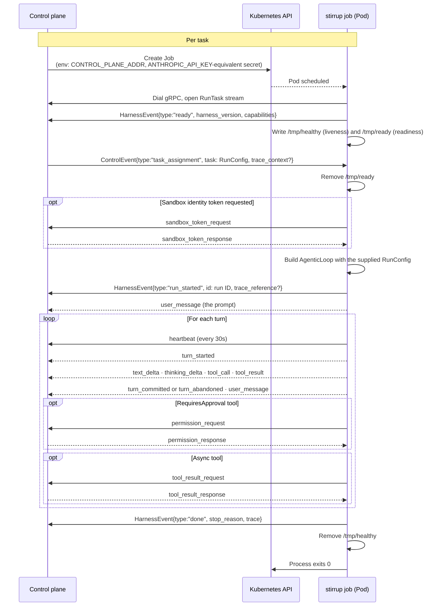

# Production deployment

Stirrup is designed to be deployed as a short-lived Kubernetes job
that talks to a long-running control plane over gRPC. This document
describes the contract between the two, the container image, and the
release process. For local development the [README](../README.md)
covers the basics.

## Architecture



The harness *connects outbound* to the control plane. There is no
inbound port to expose, no service mesh hop to configure, and no
shared filesystem with the control plane. The only inputs are the
environment variables passed at Pod creation time and whatever the
control plane sends over the bidi stream.

## Transport security posture (v0.1)

> [!WARNING]
> The gRPC transport is plaintext and unauthenticated unless transport
> TLS is configured. With none of the `CONTROL_PLANE_TLS_*` variables
> set, the harness dials the control plane with insecure credentials.

v0.1 targets single-operator, self-hosted deployment. The design
assumes a trusted network path between job Pods and the control
plane unless transport TLS is configured; acceptable shapes are:

- **Same host** — control plane and harness on one machine,
  dialling over loopback.
- **Private network** — a private VPC / cluster network where the
  control-plane address is not reachable from untrusted networks.
- **Mesh-provided mTLS** — a service mesh (Istio, Linkerd) that
  transparently encrypts and authenticates Pod-to-Pod traffic
  outside the harness process.
- **Transport TLS or mutual TLS** — configured on the harness, as
  described under [Transport TLS settings](#transport-tls-settings).

Do not point `--transport-addr` / `CONTROL_PLANE_ADDR` across an
untrusted network without one of the last two: everything on the
stream — prompts, tool results, permission responses — would transit
in cleartext, and any endpoint that can reach the harness's dial
target could pose as the control plane. Secrets are less exposed than
they appear (API keys travel as `secret://` references, never raw
values, and the transport scrubs secret-shaped strings from outbound
events) — except the sandbox identity token (`ControlEvent.token`),
which is the raw signed JWT itself and receives no such protection —
but on a plaintext channel the stream contents and the control
channel itself are unprotected.

### Transport TLS settings

TLS is opt-in. `stirrup job` reads four environment variables, listed
in [Optional environment variables](#optional-environment-variables),
and `stirrup harness --transport grpc` reads the equivalent flags:

| `stirrup job` variable | `stirrup harness` flag |
|---|---|
| `CONTROL_PLANE_TLS_CA_FILE` | `--transport-tls-ca-file` |
| `CONTROL_PLANE_TLS_CERT_FILE` | `--transport-tls-cert-file` |
| `CONTROL_PLANE_TLS_KEY_FILE` | `--transport-tls-key-file` |
| `CONTROL_PLANE_TLS_SERVER_NAME` | `--transport-tls-server-name` |

These settings are environment and flag only. They are not `RunConfig`
fields and have no counterpart in the proto `RunConfig`, because the
job dials the control plane before any `RunConfig` arrives. They are
the documented exception to the rule that a `RunConfig` surface change
ships with its gRPC mirror.

The settings select one of three modes:

| Mode | Selected by | Protection |
|---|---|---|
| `plaintext` | no setting present | None. The stream is neither encrypted nor authenticated. |
| `tls` | a CA bundle, a server name, or both | TLS 1.3 minimum. The harness verifies the control plane's certificate against the CA bundle, or against the system roots when no bundle is given. |
| `mutual-tls` | a certificate and key | As `tls`, and the harness presents a client certificate. Whether the control plane requires and verifies it is the control plane's own configuration. |

The following rules apply to every mode other than `plaintext`:

- Setting any one of the four values enables TLS. There is no
  plaintext fallback.
- A variable or flag that is present but empty, such as an unrendered
  template, is a startup error rather than an unset value. The error
  names the variable or flag; unset it to use plaintext, or give it a
  value to use TLS.
- The certificate and key must be set together. A missing, unreadable
  or non-PEM file also fails startup.
- Every failure happens before the harness dials. `stirrup job` exits
  with code `1` and sends no `ready` event. For `stirrup harness`, a
  TLS flag without `--transport grpc`, a lone certificate or key, or
  an empty flag value exits with code `4`, and a file that cannot be
  loaded exits with code `3`.

At startup the harness writes one line to stderr naming the mode, the
trust source and any server-name override. File contents are never
printed:

```text
stirrup: control plane transport mode=mutual-tls ca=/etc/stirrup/tls/ca.pem server-name=control-plane.internal addr=control-plane.svc:9090
```

The `ca=` field reads `system-roots` when no bundle is configured, and
a plaintext connection logs `mode=plaintext` with only the address.

## The `stirrup job` subcommand

`stirrup job` is the K8s entrypoint. It takes no flags — everything
comes from the environment and from the `RunConfig` delivered as the
first `ControlEvent` on the stream.

### Required environment variables

| Variable | Purpose |
|---|---|
| `CONTROL_PLANE_ADDR` | gRPC target address of the control plane (e.g. `control-plane.svc:9090`). |

### Optional environment variables

| Variable | Purpose |
|---|---|
| `CONTROL_PLANE_SESSION_ID` | Session correlation ID echoed back in the initial `ready` event so the control plane can match this gRPC stream to the session that launched it. |
| `CONTROL_PLANE_TLS_CA_FILE` | Path to a PEM CA bundle that must have issued the control plane's certificate. Without it, the system roots verify the control plane. Setting any `CONTROL_PLANE_TLS_*` variable enables TLS 1.3 with no plaintext fallback. |
| `CONTROL_PLANE_TLS_CERT_FILE` | Path to a PEM client certificate presented to the control plane for mutual TLS. Must be set together with `CONTROL_PLANE_TLS_KEY_FILE`. |
| `CONTROL_PLANE_TLS_KEY_FILE` | Path to the PEM private key for the client certificate. Must be set together with `CONTROL_PLANE_TLS_CERT_FILE`. |
| `CONTROL_PLANE_TLS_SERVER_NAME` | Name the control plane's certificate is verified against, when it differs from the host in `CONTROL_PLANE_ADDR`. |
| `STIRRUP_FOLLOWUP_GRACE` | Idle seconds to keep the gRPC stream open after each run completes, so the control plane can deliver a follow-up `user_response` that starts the next run. The window restarts after every run. Capped at 3600 s; a positive `RunConfig.followUpGrace` takes precedence. |
| `STIRRUP_SESSION_DEADLINE` | Session length in seconds that the sandbox must outlive. Set it to the Job's `activeDeadlineSeconds`, and set it whenever `followUpGrace` is used with `stirrup job`. A session that outlives the value loses its sandbox: the container engine removes the container at the `sleep` deadline, and the kubelet kills the Pod at `activeDeadlineSeconds`. The value must be a positive integer number of seconds. Anything else, including a duration such as `30m`, falls back silently to the harness estimate: the primary run's `timeout` plus, when a follow-up window is configured, ten further runs each preceded by a full grace window. The sandbox lifetime is the longer of the value and `RunConfig.timeout`, plus the `postRun` hook budget, plus a 10-minute margin. The `k8s-sandbox` executor keeps a fixed 12-hour TTL instead. |
| `STIRRUP_POD_NAME`, `STIRRUP_POD_UID`, `STIRRUP_POD_NAMESPACE` | Downward-API identity of the harness Pod (`metadata.name`, `metadata.uid`, `metadata.namespace`). When all three are set and the namespace equals `executor.k8sNamespace`, the `k8s` executor makes the sandbox Pod owned by the harness Pod, so deleting the harness Pod garbage-collects the sandbox. Owner references cannot cross namespaces, so a sandbox in another namespace has none. [`examples/k8s/harness-job.yaml`](../examples/k8s/harness-job.yaml) shows the wiring. |

A `CONTROL_PLANE_TLS_*` variable that is set but empty is a startup
error, not plaintext. See [Transport TLS settings](#transport-tls-settings).

Per-provider secrets (Anthropic API key, AWS / GCP / Azure
credentials) are *not* passed via stirrup-specific env vars — they
follow the configured `secret://` references in the `RunConfig` or
the credential federation chain (IRSA, GKE Workload Identity, Azure
IMDS, GitHub Actions OIDC). See
[`credential-federation.md`](credential-federation.md).

### Lifecycle

1. **Connect.** The harness dials `CONTROL_PLANE_ADDR` over gRPC and
   opens a single `RunTask` bidi stream for the lifetime of the
   task.
2. **Ready.** The harness sends a
   `HarnessEvent{type:"ready", harness_version, capabilities}`.
   `capabilities` names the contract features the harness implements,
   so the control plane can check them before dispatching work;
   `harness_version` is informational. See
   [Compatibility](integration-guide.md#compatibility).
3. **Health probes.** Two marker files are written: `/tmp/healthy`
   (liveness — present from here until process exit) and
   `/tmp/ready` (readiness — present only while idle and waiting for
   a task). See [Health probes](#health-probes).
4. **Wait for assignment.** The harness blocks on a
   `ControlEvent{type:"task_assignment"}` carrying the `RunConfig`,
   with a 5-minute timeout. A `cancel` event received before
   assignment is honoured: the harness exits cleanly without
   running anything. Receiving the assignment removes `/tmp/ready`:
   the pod runs one task to completion rather than accepting more
   work. An optional `trace_context` (`traceparent`, `tracestate`) on
   the assignment parents the primary run's span on the control
   plane's span; an invalid one is ignored. It is read on
   `task_assignment` only and never stored in the `RunConfig`. See
   [`integration-guide.md`](integration-guide.md#joining-a-control-plane-trace-trace_context).
5. **Sandbox identity token** *(optional)*. When the run wants a
   sandbox identity token (e.g. to authenticate a git proxy such as
   Haybale), the harness sends a
   `HarnessEvent{type:"sandbox_token_request"}` and blocks, fail-closed,
   for up to 60 seconds on the matching `sandbox_token_response` —
   before any sandbox is created. See [Sandbox identity token
   issuance](#sandbox-identity-token-issuance-control-plane-implementers)
   below for the full contract, and [configuration.md's "Sandbox
   identity and git-proxy
   wiring"](configuration.md#sandbox-identity-and-git-proxy-wiring)
   for the `executor.sandboxIdentity` / `executor.gitProxy`
   `RunConfig` fields that request it.
6. **Build and run.** Once the `RunConfig` arrives, the primary run's
   wall-clock budget (`timeout`) starts, the agentic loop is built via
   `core.BuildLoopWithTransport` reusing the existing gRPC transport,
   and execution begins. A `RunConfig` that fails validation, or any
   other failure to build the loop, terminates the run here: the
   harness emits `HarnessEvent{type:"error"}` carrying the validation
   message followed by `HarnessEvent{type:"done", stop_reason:"error"}`,
   then exits non-zero. No run ever started, so that `done` carries no
   `trace` and no `RunResult` reaches the configured `resultSink`.
7. **Stream events.** After the git setup the harness first emits
   `HarnessEvent{type:"run_started"}` carrying the run ID in `id` and,
   when the run records an OTel span, the run span's `trace_reference`
   (`trace_id`, `run_span_id`, `sampled`), then a `user_message` with
   the prompt. Rule-of-Two and `continueOnError` `preRun` hook warnings
   raised during setup follow `run_started`. A run that fails setup
   sends no `run_started`, and those warnings precede its `error`. Throughout the run the harness emits a live
   transcript — `turn_started`, `text_delta`, `thinking_delta`,
   `tool_call`, `tool_result`, `turn_committed` or `turn_abandoned`, and
   `user_message` (see
   [Watching a run live](integration-guide.md#watching-a-run-live)) —
   plus `heartbeat` (every 30 s) and, depending on the permission
   policy, `permission_request` events. Tools declared in
   `tools.controlPlane` emit `tool_result_request` and block on
   `tool_result_response`; the request's `trace_context`, when
   present, is the W3C context of the call's `execute_tool` span. A
   `tool_call` is not guaranteed a matching `tool_result`: a
   cancelled, stream-faulted, stalled, or `max_tokens`-truncated turn
   can orphan one, so `done` is the terminal close for any pending
   state keyed on a `tool_call`'s `id`. See the field reference in
   [`integration-guide.md`](integration-guide.md#events-from-the-harness)
   for the untrusted-input and presented-name caveats on `tool_call`.
   A `user_response` received while the run is active is queued (up to
   16) and injected as a user message at the next turn boundary; the
   run continues past `end_turn` while input is queued. A rejected
   one (empty, or queue full) produces a `warning` echoing its
   `request_id`.

   A turn that stops at the output limit (`max_tokens`) does not end
   the run while recoveries remain, up to two per run. The harness drops
   the truncated turn's unrun tool calls, appends a synthetic
   instruction (a `user_message` with source `output_limit_recovery`)
   and emits a `warning` of the form `turn N stopped at the output
   limit of M tokens; <action> and continued the run (output-limit
   recovery K of 2)`. A control plane that tracks `tool_call` state
   treats the truncated turn's `tool_call` events as orphaned. The run
   ends with outcome `max_tokens` only after the recoveries are spent
   or on the last allowed turn.

   `tool_result.content`, `tool_call.input`, `user_message` text,
   `thinking_delta` text and `warning` messages are capped at 256 KiB
   each on the control stream, and `text_delta` is not capped. Text
   over the cap keeps its head and ends with a
   `[truncated by harness for the control stream: N of M bytes shown]`
   marker. An oversized `tool_call.input` arrives as a JSON string
   holding the head of the input followed by the same marker, so the
   field stays valid JSON.
8. **Done.** Before `done`, the harness finishes the run in a fixed
   order, each stage on its own bounded context: the deterministic git
   strategy's final checkpoint, the `postRun` hooks, command-output
   archive finalisation, the workspace export, and finally the trace.
   A stage that fails emits a `warning` (for example `git finalise: …`
   or `workspace export: …`) ahead of `done`. A run that fails during
   setup skips the git checkpoint and the `postRun` hooks, emits an
   `error` event, and still exports the workspace. A final
   `HarnessEvent{type:"done", stop_reason, trace}` then carries the
   run metrics, the run span's `trace.trace_reference` when the run
   recorded an OTel span, and the reason the run ended. The git,
   export and trace results are final when `done` arrives, so a
   control plane that expects no follow-up can close the stream on
   it. The `trace` on `done` is a summary. Besides the metrics it
   carries these fields:

   - `git`: branch, SHA, base SHA, `dirty` and `error`.
   - `workspace_export`: the export receipt, with URI, `status`,
     `bytes`, `sha256`, `files`, `required` and `error`.
   - `error`: the scrubbed, length-capped reason for any outcome other
     than `success`, or for a `success` run whose trace could not be
     persisted.
   - `structured_output`: the validated JSON document, only for a
     `success` run with `outputSchema` set.
   - `degraded_capabilities`.

   `stop_reason` is the run outcome. `success` is the success value;
   the failure values are `error`, `setup_failed`, `hook_failed`,
   `handoff_failed`, `max_turns`, `max_tokens`, `timeout`, `stalled`,
   `tool_failures`, `cancelled`, `control_stream_lost`,
   `budget_exceeded`, `context_exhausted`, `verification_failed`,
   `verification_error`, `structured_output_failed`,
   `guardrail_blocked`, `rule_of_two_violation`,
   `command_output_capture_failed` and
   `command_output_archive_failed`. `handoff_failed` reports a failed
   final git checkpoint or a failed required workspace export on a run
   that would otherwise have succeeded. `control_stream_lost` reports a
   run cancelled because the control stream ended while it was active.
   `setup_failed` reports a fatal `preRun` lifecycle hook or a failure
   to load repository guidance. A failure to build the system prompt
   or to set up the git strategy ends as `error`. These setup outcomes
   skip the `postRun` hooks. `hook_failed` reports a fatal `postRun`
   hook on a run that would otherwise have succeeded, so it is not an
   early-termination outcome. Like every other outcome, these are
   always paired with a `done` event and a `RunResult` on the
   configured `resultSink`, even though the harness process's own Go
   error return is also non-nil for them. The nested `trace.outcome`
   is the canonical terminal status for downstream analytics;
   `trace.stop_reason` mirrors it for backward compatibility. Provider
   stop reasons such as `refusal` pass through verbatim as the outcome.
   A refusal's category and explanation reach operators
   through the trace emitters (the JSONL and GCS `RunTrace`, and the
   `stop.category` attribute on the OTel `provider.stream` span) and
   the `provider refused to respond` Warn log line;
   `trace.stop_details` mirrors them on the proto.
9. **Finalise.** The run's `RunResult` is emitted on the configured
   `resultSink`; the workspace export, when `executor.workspaceExportTo`
   is set, has already run before `done`. Every run — primary and
   follow-up — is finalised this way.
10. **Follow-up grace** *(optional)*. If `followUpGrace` (or
    `STIRRUP_FOLLOWUP_GRACE`) is positive, the stream stays open for
    that many idle seconds after each run is finalised, so the control
    plane can deliver a `user_response` that starts a new run with a
    new run ID and its own `timeout` budget; `followUpHistory` decides
    whether that run continues the previous run's conversation (see
    [Follow-up turns](integration-guide.md#follow-up-turns)). Steps 7–9
    repeat for that run. See
    [Run budgets and precedence](#run-budgets-and-precedence).
11. **Exit.** The liveness probe file is removed; the process exits 0
    when the primary run succeeded or non-zero on transport / build /
    runtime failure. Before the connection closes the harness
    half-closes the stream and waits up to 2 seconds (not
    configurable) for the control plane to end `RunTask`, so a
    terminal `done` is not lost to an abrupt teardown. A control plane
    that returns from `RunTask` on `done` adds nothing to the exit; one
    that holds the stream open adds up to that window, which matters
    when sizing `terminationGracePeriodSeconds`. The wait does not
    apply on the SIGTERM path — see
    [`integration-guide.md`](integration-guide.md#terminal-semantics).

### Run budgets and precedence

Six conditions end or bound a `stirrup job` session; whichever fires
first wins.

| Limit | Scope | Effect |
|---|---|---|
| `RunConfig.timeout` | One run. The primary run's budget starts at task assignment and includes component construction; each follow-up run receives a fresh budget of the same length when its `user_response` is taken up. | The run ends with `done{stop_reason:"timeout"}`. The follow-up window still opens afterwards. |
| `followUpGrace` / `STIRRUP_FOLLOWUP_GRACE` | Idle time between runs, restarted after every run is finalised. A run in progress never consumes it. | The stream closes and the process exits with the primary run's exit code, unless a follow-up run was lost with the control stream or failed a required workspace export. |
| `cancel` ControlEvent | The session. | An active run ends with `done{stop_reason:"cancelled"}`; queued `user_response` input is discarded (each reported by a `warning`); no follow-up window opens. With no run active — between a run's `done` and the next run, or inside the grace window — the stream closes without another `done`. One `cancel` always stops the harness. |
| Control stream lost | The session. | The gRPC stream ended while the harness was still using it. An active run is cancelled and ends with outcome `control_stream_lost`. Its git finalise, `postRun` hooks, workspace export and trace finish still run under their bounded contexts (git 30 s, export 5 min, trace 90 s). The harness attempts one `done{stop_reason:"control_stream_lost"}` and exits non-zero. Loss during construction sends the same `done` with no `trace`. With no run active, the loss closes the follow-up window and leaves the last run's outcome unchanged. |
| SIGTERM / SIGINT | The process. | The first signal interrupts the active run or grace window. Git finalise, `postRun` hooks, the workspace export, result emission and trace finish still run under their own bounded contexts, and a second signal abandons that work. For `stirrup job`, the shutdown watchdog also closes the loop 5 s after the first signal, which cuts any of that work still running. `stirrup harness` has no orchestrator deadline behind it, so its watchdog arms on the second signal instead, and a single signal lets those stages run to their budgets. |
| `Job.spec.activeDeadlineSeconds` | The Pod. | The only session-wide hard cap for `stirrup job`. No `RunConfig` field bounds the number or total duration of follow-ups, so size it for `timeout` × the expected number of runs plus the grace windows between them, and set `STIRRUP_SESSION_DEADLINE` to the same value so the sandbox outlives the session. (`stirrup harness`, which has no orchestrator behind it, bounds its own session at 10 × (`timeout` + `followUpGrace`) after the primary run.) |

Exit status reports the assigned task: the process exits 0 when the
primary run succeeded, regardless of how any follow-up ended. A
follow-up's outcome is on its own `done` and `RunResult`, and a
follow-up whose run fails outright ends the session; neither changes
the exit status, so an orchestrator's retry decision is about the
assignment, not the interactive session that followed it. There are
two exceptions. A required workspace export
(`executor.workspaceExportRequired`, the default whenever
`executor.workspaceExportTo` is set) failing on any run, follow-up
included, fails the process. So does a follow-up run that ends with
outcome `control_stream_lost`.

The full event vocabulary lives in
[`proto/harness/v1/harness.proto`](../proto/harness/v1/harness.proto) —
that is the source of truth for the wire contract. The value list in
the comment on the `done` event's `stop_reason` near the top of the
file lags the outcomes above. The `RunTrace.outcome` comment is
authoritative.

### Orphaned sandboxes

A harness that exits uncleanly, through SIGKILL, node loss or an expired
`Job.spec.activeDeadlineSeconds`, can leave its sandbox behind. Every
sandbox carries labels naming its run, and every executor bounds the
sandbox's own lifetime. The run ID on the labels is the session's first
run ID, because follow-up runs reuse the sandbox. Run the commands
below only after the harness process for that run is gone, because
removing the sandbox of a live session ends it.

- **`container`.** Containers carry the labels `stirrup.sandbox=true`
  and `stirrup.run-id=<run-id>`. The container runs `sleep` for the
  sandbox lifetime with auto-remove set, so the engine removes it at the
  deadline. `podman` accepts the same commands. Listing by
  `stirrup.sandbox=true` also matches the containers of live runs, so
  it is for inspection rather than deletion.

  ```sh
  docker ps -a --filter label=stirrup.sandbox=true
  docker ps -a -q --filter label=stirrup.run-id=<run-id> | xargs docker rm -f
  ```

- **`k8s`.** The sandbox Pod and its `NetworkPolicy` carry
  `stirrup.dev/run-id=<run-id, truncated to 63 characters>`, with the
  run ID cut at the 63-character label limit and trailing separators
  trimmed, and `stirrup-sandbox=true`. The Pod has an
  `activeDeadlineSeconds` backstop, and the `NetworkPolicy` has no owner
  reference, so the labelled delete below is the only way to remove it.
  Selecting on `stirrup-sandbox=true` also matches the resources of live
  runs, so it is for inspection rather than deletion. See
  [Teardown and orphaned sandboxes](executors/k8s.md#teardown-and-orphaned-sandboxes).

  ```sh
  kubectl delete pod,networkpolicy -n <namespace> -l 'stirrup.dev/run-id=<run-id, truncated to 63 characters>'
  ```

- **`k8s-sandbox`.** The Sandbox, its Pod and its `NetworkPolicy` carry
  `stirrup.dev/run-id=<run-id, truncated to 63 characters>`. The Sandbox
  keeps a fixed 12-hour TTL.
  See
  [The controller-owned TTL GC backstop](executors/k8s-agent-sandbox.md#the-controller-owned-ttl-gc-backstop).

  ```sh
  kubectl delete sandboxes.agents.x-k8s.io,networkpolicy -n <namespace> -l 'stirrup.dev/run-id=<run-id, truncated to 63 characters>'
  ```

### Health probes

The published harness image is distroless — no shell, no `test`
binary — so an exec probe cannot run `test -f /tmp/healthy` against
it. `stirrup healthcheck` exists for this: it checks a marker file
and exits 0 (present) or non-zero (absent, or an I/O error reading an
existing-but-unreadable marker), and it can be exec'd directly since
it's the same static binary already in the image.

`stirrup job` (`harness/internal/health/probe.go`) maintains two
markers with different lifetimes:

| Marker | Meaning | Present |
|---|---|---|
| `/tmp/healthy` | Liveness — the process is alive. | From just after the control-plane connection (step 3 above) until process exit. |
| `/tmp/ready` | Readiness — idle and assignable. | Only during the assignment wait (step 4); removed the instant a `task_assignment` arrives. |

The distinction matters because a K8s Job pod does one task and
exits: liveness should hold through the whole run so a hung process
still gets restarted, but readiness should drop once a task is
assigned, since the pod is no longer available to accept more work.

```yaml
livenessProbe:
  exec:
    command: ["/usr/local/bin/stirrup", "healthcheck", "--file=/tmp/healthy"]
readinessProbe:
  exec:
    command: ["/usr/local/bin/stirrup", "healthcheck", "--file=/tmp/ready"]
```

Every CI and release workflow run also publishes a compiled
`google.protobuf.FileDescriptorSet` for that contract as the
`proto-descriptor-set` workflow artifact (`stirrup-<label>.fds.binpb`,
with a `.sha256` alongside). Clients that need the schema without
checking out the repository or installing `buf` — `grpcurl`, Envoy
gRPC-JSON transcoding, reflection-less generators — can download it
from the run's artifact list.

### Sandbox identity token issuance (control-plane implementers)

Some sandbox executors need a short-lived credential to authenticate
outbound git operations through a proxy such as
[Haybale](https://github.com/rxbynerd/haybale). The harness never
holds a signing key or a long-lived credential itself; it requests a
token from the control plane over the same `RunTask` stream used for
everything else — once before the sandbox is created, and again
ahead of each expiry the control plane reports (see Token lifetime,
below).

- **`sandbox_token_request`** (`HarnessEvent`) — sent after
  `task_assignment` and before the sandbox is created, then again on
  each refresh; at most eight per run. Carries `request_id`
  (correlation; `sbid-1`, `sbid-2`, … in issue order) and `audience`,
  the intended JWT `aud` claim (e.g. `https://haybale.internal`). The
  event deliberately carries no harness-asserted identity field: the
  control plane derives the run identity from the authenticated
  stream the task was assigned on, not from anything in the request
  body.
- **`sandbox_token_response`** (`ControlEvent`) — echoes `request_id`
  and carries `token`, the signed JWT. `token` is sensitive: the
  harness never logs, traces, or persists it, and it never enters
  `RunConfig`. A control plane that cannot issue a token responds
  with `is_error: true` and a human-readable `reason` rather than
  staying silent — the harness treats a missing or late response the
  same way it treats an explicit error.

**Transport trust boundary.** Unlike API keys, `token` is not a
`secret://` reference — it is the raw signed JWT, and it rides the
same `RunTask` stream as every other event, which is plaintext by
default (see
[Transport security posture](#transport-security-posture-v01)).
The token is a bearer credential, so it is a materially higher-value
payload than the rest of the stream. Requesting a sandbox identity
token therefore calls for either the same-host, private-network or
mesh-mTLS posture described there or transport TLS configured on the
harness (see [Transport TLS settings](#transport-tls-settings)). The
harness does not verify this: the transport posture is an operator
obligation. With
TLS, the harness verifies the control plane's certificate before the
token is delivered. The harness is authenticated to the control plane
only when it presents a client certificate (mutual TLS) or when a
mesh or the network path provides that guarantee. Do not opt a run
into the sandbox identity token flow across an untrusted network
without transport TLS configured.

A control plane implementing this contract must:

1. Mint a JWT per the consuming proxy's identity contract — for
   Haybale, its [`docs/jwt-identity.md`](https://github.com/rxbynerd/haybale/blob/main/docs/jwt-identity.md).
   The mechanism is generic ("sandbox identity token"), not
   Haybale-specific: other consumers (artifact registries, package
   proxies) can reuse the same exchange with their own token
   contract.
2. Sign with its own key and publish the corresponding JWKS at the
   URL the consuming proxy is configured to fetch from. Stirrup never
   holds a signing key.
3. Scope the `sub` claim to `run-<RunID>` (the `RunConfig.run_id` of
   the run being serviced), so the proxy's audit log correlates with
   stirrup's own tracing.
4. Validate `audience` against its own configured audience list
   before minting — the harness sends `audience` as a hint, not an
   authorization; a control plane that mints against an unvalidated
   value has no assurance the resulting token is scoped to a
   consumer it actually intends to trust.
5. Provision the per-run scope — e.g. a `policy.yaml`-style rule
   confining `run-<RunID>` to exactly the repos and verbs the run
   needs — before or as part of issuing the token. This is a
   provisioning prerequisite the control plane or operator handles;
   it is not part of the wire exchange itself.

**Fail-closed wait.** The harness blocks on the matching
`sandbox_token_response` for up to 60 seconds — the same default as
the `ask-upstream` permission-response timeout. For the initial
exchange a response that arrives late, or not at all, aborts the run
before the sandbox is created; the run ends with
`done{stop_reason:"error"}` rather than leaving a
partially-provisioned, tokenless sandbox behind. For a refresh the
same outcomes — and an explicit `is_error` — stop refreshing and
emit a `warning` event naming the expiry of the token still in the
sandbox; the run itself continues.

**Token lifetime.** Haybale recommends an `exp` of 15 minutes or
less, and the harness decouples that lifetime from the run's
wall-clock budget by refreshing: set
`sandbox_token_response.expires_at` (Unix seconds) and the harness
sends a new `sandbox_token_request` once 80% of the remaining
lifetime has elapsed, replacing the token file the sandbox's git
credential helper reads (see [`configuration.md`'s "Token file and
refresh"](configuration.md#token-file-and-refresh)). A control plane
must therefore be prepared to answer up to eight requests per stream,
each minted for the same run identity; the initial token's
environment-variable copy is never updated, only the file. Leaving
`expires_at` unset disables refresh, in which case `exp` must cover
the run's configured wall-clock budget plus slack, since nothing
inside the sandbox can recover from an expired token.

**Follow-up for `docs/CONTROL_PLANE.md`** (tracked, not part of this
change): the broader control-plane design doc lives on the unmerged
`control-plane` branch. When that branch lands, add
`sandbox_token_request` / `sandbox_token_response` as rows in its
§2.1 event table alongside the existing `permission_request` /
`tool_result_request` pairs, and note that this exchange participates
in the mutual-partial-trust posture recorded in that doc's §1.1. This
document is normative for the wire contract in the meantime.

## Container image

Releases publish two image tags to GitHub Container Registry:

- `ghcr.io/rxbynerd/stirrup:<tag>` for tagged releases (`v1.2.3`).
- `ghcr.io/rxbynerd/stirrup:main` from CI on every merge to `main`.

The image is `gcr.io/distroless/static-debian12:nonroot`-based: a
single statically-linked binary, no shell, no package manager, runs
as `nonroot` (uid 65532).

### Sandbox image

The harness image cannot serve as a sandbox. The `container`, `k8s` and
`k8s-sandbox` executors run commands inside `executor.image`, which needs:

- A POSIX shell at `/bin/sh` with the `kill` and `command -v`
  builtins, plus `tar`, `mkdir`, `readlink` and `rm` on `PATH`, a
  `sleep` that accepts fractional seconds, and an `ls` that accepts
  `-A`, `-1` and `-p`. Busybox and coreutils both qualify.
- A writable `/tmp`. Each command is wrapped so that its process group
  leader is recorded in a per-call pid file there, which lets a timed-out
  command's process tree be killed. The `container` executor mounts a
  tmpfs at `/tmp`; the `k8s` executors use the image's own `/tmp`.
- `git` when `gitStrategy` is `deterministic`. The strategy runs git
  inside the sandbox through the executor, and the system prompt's git
  status section uses it as well. The `--dry-run` step
  `git-strategy-probe` fails when `git` is missing, except for the
  `container` executor, where no container starts in a dry-run and a
  missing `git` surfaces when the run sets up.

`setsid` is optional. With it, a timed-out command's whole process group
is signalled. Without it, only the recorded shell and its descendants
that `/proc` reveals are signalled, so a readable `/proc` is needed
for that fallback.
[`Dockerfile.sandbox`](../Dockerfile.sandbox) builds an image that meets
every requirement above.

## Release process

Releases are tag-driven via `.github/workflows/release.yml`. To cut
one:

```sh
git tag -a v1.2.3 -m "Release notes"
git push origin v1.2.3
```

`workflow_dispatch` against an existing tag re-runs the workflow for
retries.

The workflow:

1. Re-runs the verify job (build + test).
2. Cross-compiles `stirrup` and `stirrup-eval` for
   `linux/{amd64,arm64}` and `darwin/{amd64,arm64}` in parallel.
3. Generates SPDX and CycloneDX SBOMs.
4. Aggregates artifacts under a single `SHA256SUMS` manifest.
5. Publishes a GitHub Release. Tags containing `-`
   (e.g. `v1.2.3-rc1`) are marked as prereleases automatically.

Artifact signing (cosign / Sigstore) is intentionally out of scope
for now; a commented-out signing seam sits in `release.yml` between
the SHA256SUMS step and the release-create step.

## Version labels

The version label baked into binaries follows this convention:

| Build origin | `stirrup --version` output |
|---|---|
| `release.yml` on a tag | `v1.2.3 (ab74b75)` |
| `ci.yml` on `refs/heads/main` | `main (ab74b75)` |
| `ci.yml` on any other ref | `dev (ab74b75)` |
| `go build` / `go run` locally | `dev` |

The labels are injected via `-ldflags` against
`github.com/rxbynerd/stirrup/types/version.{version,commit}`.

## CI

`.github/workflows/ci.yml` runs on every push, on a weekly schedule,
and on manual dispatch. It has four jobs:

- **`verify`** — `go test`, the race and fuzz passes, and binary
  builds across the workspace modules, through the reusable
  `_verify.yml` workflow. Runs on every trigger.
- **`eval-gate`** — runs the baselined suites in `eval/suites/`
  against `eval/baselines/`, pinned to a cheap model (GPT-6 Luna over
  OpenRouter), exits non-zero on regressions, and uploads results as
  artifacts. It runs on pushes to `main` and on manual dispatch only,
  to bound token spend. A stronger-model sweep (Sonnet 5, Opus 4.8)
  runs at release time via `release.yml::eval-extended`.
- **`publish-container`** and **`publish-sandbox-container`** — build
  and push the harness image and the sandbox image to GHCR after
  `verify` passes, on pushes to `main` and on the weekly schedule. The
  schedule keeps the sandbox image's packages current between merges.

The Anthropic WIF smoke test (`smoke-anthropic.yml`) is a separate
gated workflow that exercises the federation flow end-to-end.

## Operator checklist

Before deploying:

1. Decide a deployment posture using
   [`safety-rings.md`](safety-rings.md). The safe defaults for
   first-run production are: `executor.type=container`,
   `executor.runtime=runsc`, `network.mode=allowlist`,
   `permissionPolicy.type=policy-engine` with a starter policy from
   [`examples/policies/`](../examples/policies/), `codeScanner.type=patterns`,
   and Rule of Two enforcement on (the default).
   [`autonomous-preset.md`](autonomous-preset.md) describes a tested
   `RunConfig` that sets all of these.
2. Wire credentials through the credential federation layer rather
   than baking API keys into Pod env vars. See
   [`credential-federation.md`](credential-federation.md).
3. Configure observability: OTLP/gRPC to your collector or OTLP/HTTP
   to a managed gateway. See
   [`observability-cloud.md`](observability-cloud.md).
4. Set `livenessProbe`/`readinessProbe` to exec `stirrup healthcheck`
   against `/tmp/healthy` and `/tmp/ready` respectively — see [Health
   probes](#health-probes). The image has no shell or `test` binary,
   so a `["sh", "-c", "test -f ..."]` probe cannot run against it.
5. Enforce a `Job.spec.activeDeadlineSeconds` slightly larger than
   `RunConfig.timeout` so K8s reaps any stuck Pod even if the
   harness's own wall-clock timeout fails to fire. Set
   `STIRRUP_SESSION_DEADLINE` to the same value so the sandbox
   outlives the session, and wire the `STIRRUP_POD_*` downward-API
   variables so a `k8s` sandbox is garbage-collected with the harness
   Pod (see [`examples/k8s/harness-job.yaml`](../examples/k8s/harness-job.yaml)).
   [Orphaned sandboxes](#orphaned-sandboxes) lists the selectors that
   find anything left behind.
6. Either confirm the network path between job Pods and the control
   plane is trusted (private network or mesh mTLS), or configure
   transport TLS or mutual TLS. The gRPC transport is plaintext and
   unauthenticated unless `CONTROL_PLANE_TLS_*` is set, and a run that
   requests a sandbox identity token should never use a plaintext path
   across an untrusted network. See
   [Transport security posture](#transport-security-posture-v01).
7. Enable `windDown` for unattended runs. It is off by default; when
   enabled, the model receives one instruction to wrap up before a
   turn, token or time budget runs out. See
   [Wind-down warning](configuration.md#wind-down-warning).

## Embedding the harness

The public Go API surface is `harness/harnessapi/`. Everything under
`harness/internal/*` is intentionally not part of the public API.

```go
import "github.com/rxbynerd/stirrup/harness/harnessapi"

loop, err := harnessapi.BuildLoopWithTransport(ctx, runConfig, transport)
if err != nil { /* handle */ }
trace, err := loop.Run(ctx, runConfig)
```

`Run` can return a trace together with an error. A run that fails before
its first turn, such as on a failed `preRun` hook, returns its trace with
a failure outcome such as `setup_failed` and the setup error. A run that
completes but whose trace cannot be persisted returns the trace and an
error wrapping `finish trace`, and the trace's `Error` field holds the
same text when the run had no earlier failure. Callers should read the
trace's `Outcome` instead of inferring the result from the error alone.

With the `otel` trace emitter, a valid OpenTelemetry span context on
the `ctx` passed to `Run` becomes the parent of the run span, so the
run joins the caller's trace and follows its sampling decision. The
trace copies only the span context from `ctx`, never its cancellation
or deadline. To start a new trace, pass a `ctx` with no span.

Deltas reach a `harnessapi.Transport` re-chunked: `text_delta` and
`thinking_delta` fragments concatenate to the model's text with
recognised secrets redacted, and held text is emitted no later than the
next event of the model's response or the end of the stream. The harness does not scrub every other
event's string fields; the shipped transports scrub all of them, so an
embedder's transport should too. See
[`security.md`](security.md#control-stream-scrubbing).

Use this when you need the agentic loop in-process — for example, in
a single-binary tool that bundles its own control-plane logic. For
typical multi-tenant deployments, run the binary as a Job and let
the gRPC contract do the talking.
