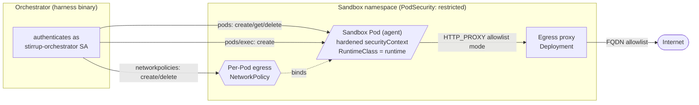

# Kubernetes executor

The `k8s` executor runs the agent inside a hardened, single-use
**sandbox Pod** rather than a local Docker/Podman container. It is the
executor for running stirrup *on* a Kubernetes cluster: an orchestrator
process (the harness binary holding a kubeconfig or in-cluster
ServiceAccount) creates one Pod per run, drives command execution and
file I/O over the `pods/exec` subresource, confines the Pod's egress
with a per-Pod `NetworkPolicy`, and deletes the Pod when the run ends.

This document is the operator reference. The reference manifests it
points at live under [`examples/k8s/`](../../examples/k8s/) and the
local development cluster under [`scripts/dev/`](../../scripts/dev/).
The executor implementation is
[`harness/internal/executor/k8s.go`](../../harness/internal/executor/k8s.go)
and [`k8s_netpol.go`](../../harness/internal/executor/k8s_netpol.go),
with the [sandbox lifecycle](#sandbox-lifecycle) in
[`k8s_readiness.go`](../../harness/internal/executor/k8s_readiness.go)
(readiness wait),
[`k8s_admission.go`](../../harness/internal/executor/k8s_admission.go)
(admission check) and
[`k8s_teardown.go`](../../harness/internal/executor/k8s_teardown.go)
(teardown and create-error reconciliation, shared with the
`k8s-sandbox` executor, whose constructor rolls back through `Close`)
and the dry-run check
[`k8s_preflight.go`](../../harness/internal/executor/k8s_preflight.go);
every flag, field, and label documented here is cross-checked against
those files.

## Contents

- [When to use it](#when-to-use-it)
- [Architecture](#architecture)
- [Sandbox lifecycle](#sandbox-lifecycle)
  - [Readiness](#readiness)
  - [Admission check](#admission-check)
  - [Diagnosing a slow or failed start](#diagnosing-a-slow-or-failed-start)
  - [Teardown](#teardown)
  - [Teardown edge cases](#teardown-edge-cases)
  - [Cleaning up retained objects](#cleaning-up-retained-objects)
- [Configuration reference](#configuration-reference)
- [Deployment recipes](#deployment-recipes)
- [Running the orchestrator in-cluster](#running-the-orchestrator-in-cluster)
  - [Shutdown timing and grace period](#shutdown-timing-and-grace-period)
- [RuntimeClass selection per run](#runtimeclass-selection-per-run)
- [Egress](#egress)
- [Safety rings on Kubernetes](#safety-rings-on-kubernetes)
- [Sandbox identity token exposure](#sandbox-identity-token-exposure)
- [Dry-run preflight](#dry-run-preflight)
- [Troubleshooting](#troubleshooting)
- [Testing the executor against a real cluster](#testing-the-executor-against-a-real-cluster)

## When to use it

| Executor | Boundary | Use when |
|---|---|---|
| `local` | none (host process) | Trusted local iteration. |
| `container` | a Docker/Podman container on the harness host | A single host with a container engine is the deployment target. |
| `k8s` | a Pod on a Kubernetes cluster | The deployment target is a cluster; multi-tenant isolation, per-tenant RuntimeClass, and cluster-native NetworkPolicy egress are required. |

The `k8s` executor is the cluster-native analogue of the `container`
executor. The two share the `image`, `network`, `resources`, and
`runtime` configuration surface; the differences are that the sandbox
is a Pod (not a host container), the runtime maps to a Pod
`RuntimeClassName` (not a host OCI runtime), and egress is enforced by
a `NetworkPolicy` plus an in-cluster proxy Deployment (not an in-process
host proxy).

### Variant: provisioning via the Agent Sandbox CRD

On a cluster running the GKE Agent Sandbox controller, the
[`k8s-sandbox` executor](k8s-agent-sandbox.md) provisions the same
hardened sandbox Pod through an `agents.x-k8s.io/v1alpha1` **Sandbox**
custom resource instead of creating the Pod directly. It reuses every
`K8s*` flag, the hardened Pod spec, and the per-Pod egress
`NetworkPolicy` documented here; it differs only in *who owns the Pod*
(the controller, not the orchestrator) and is gVisor-only. See
[`k8s-agent-sandbox.md`](k8s-agent-sandbox.md) for the deltas.

## Architecture



The pieces and their lifecycle:

- **The orchestrator** is whatever runs the harness (a CI runner, a
  controller, an operator shell). It authenticates with the cluster in
  this order (see
  [`buildRESTConfig`](../../harness/internal/executor/k8s.go)): an
  explicit kubeconfig at `executor.k8sKubeconfig` if set (it wins even
  when running in-cluster), then the in-cluster ServiceAccount, then
  `$KUBECONFIG`. It holds the RBAC the executor's lifecycle needs:
  `pods` (create/get/delete), `pods/exec` (create), and
  `networkpolicies` (create/delete). The reference Role
  ([`examples/k8s/rbac.yaml`](../../examples/k8s/rbac.yaml)) also grants
  `pods/log` (get); the executor does not use it, so it is granted only
  for operator `kubectl logs` debugging and may be dropped to tighten
  the Role to the executor's minimum.

- **The sandbox Pod** is created per run with a fixed, config-independent
  hardened `securityContext`: `allowPrivilegeEscalation: false`,
  `capabilities.drop: [ALL]`, `runAsNonRoot: true`, `runAsUser: 65532`
  (the distroless "nonroot" UID), and `seccompProfile.type:
  RuntimeDefault`. `automountServiceAccountToken` is **always** `false`,
  so the sandbox itself has no Kubernetes API access regardless of the
  ServiceAccount named. `enableServiceLinks` is `false`, so the
  namespace's Services are not listed in the sandbox environment as
  `<SERVICE>_SERVICE_HOST` and `_PORT` variables. `restartPolicy` is `Never` (one-shot), the
  container is named `agent`, and the entrypoint is `/bin/sh -c "sleep
  infinity"` — all real work runs through subsequent `exec` calls, not
  the entrypoint. The working directory `/workspace` is an `emptyDir` the
  executor mounts, with pod `securityContext.fsGroup: 65532`, so the
  workspace is writable by the non-root UID for *any* image that ships a
  shell — the image need not pre-create a writable `/workspace`, and the
  volume is wiped per Pod. (This mirrors the container executor's writable
  host bind mount; both hide any content an image bakes at that path.) A
  `sandboxIdentity`-configured run adds a second, 64 KiB `medium: Memory`
  `emptyDir` at `/run/stirrup/sandbox-identity` for the token file the
  harness delivers and refreshes over `pods/exec` stdin — see
  [Sandbox identity token exposure](#sandbox-identity-token-exposure). The
  exact spec is annotated field-by-field in
  [`examples/k8s/sample-sandbox-pod.yaml`](../../examples/k8s/sample-sandbox-pod.yaml).

- **Command execution and file I/O** both ride the `pods/exec`
  subresource. `Exec` runs `/bin/sh -c`; `ReadFile`/`WriteFile` stream a
  `tar` archive over exec, and both first resolve the real path with
  `readlink -f` and refuse anything outside `/workspace`, so a symlink
  committed into the workspace cannot pull in a file from elsewhere on
  the Pod or redirect a write there (see
  [path traversal prevention](../security.md#path-traversal-prevention));
  `ListDirectory` runs `ls -A1p`. The image must therefore ship a POSIX
  shell at `/bin/sh` plus `tar`, `ls`, `mkdir`, and `readlink` on
  `PATH` — a shell-less distroless static image will not work. Output
  and file payloads are capped at 10 MB (matching the container
  executor).

- **Egress** is enforced by a per-Pod `NetworkPolicy` the executor
  installs *before* the Pod is created (closing the window in which a
  Running Pod would otherwise have cluster-default egress). Mode `none`
  installs a deny-all egress policy; mode `allowlist` installs a policy
  permitting egress only to DNS and the in-cluster egress proxy, and
  injects `HTTP_PROXY`/`HTTPS_PROXY`/`NO_PROXY` — plus their lower-case
  spellings — into the container. See [Egress](#egress).

The label contract knits these together: every sandbox Pod carries
`stirrup-sandbox: "true"` and `stirrup.dev/pod: <pod-name>`, and the
allowlist policy selects the proxy by `app=stirrup-egress-proxy` on TCP
8080. These labels are fixed in `k8s_netpol.go`; the manifests must keep
them in sync. A run with a run ID also labels the Pod and its policy
`stirrup.dev/run-id: <run-id>`.

## Sandbox lifecycle

A normal run goes like this. Construction installs the egress policy,
creates the Pod, compares what admission returned with what was
submitted, waits up to 5 minutes for the Pod to become Ready, and, for a
runtime with guest diagnostics (`nitro-isolated`), checks the guest
before the run starts.
`Close` deletes the Pod with a 1-second grace period, reads the Pod
until it is gone, and then deletes the policy; measured on kind 1.31
this takes about 5 seconds. When `Close` returns no error, nothing is
left to clean up. Every construction failure after the policy is
installed goes through the same teardown as `Close`.

### Readiness

The executor polls the Pod once a second until it is `Running` with the
`agent` container Ready. The wait ends after **5 minutes**, or sooner
when the caller's context ends. The ceiling allows for a first sandbox
Pod that waits for a cluster autoscaler to provision a node. The wait
logs one line at info level when it starts and a progress line every 30
seconds with the Pod's phase, its `PodScheduled` condition and the last
waiting reason.

The wait fails at once, without using the remaining time, when the Pod
reaches one of these states:

- phase `Failed` (for example `DeadlineExceeded` or `Evicted`);
- phase `Succeeded` before the Pod became Ready;
- the `agent` container terminated;
- the `agent` container waiting with reason `InvalidImageName` (the
  image reference cannot be parsed) or `ErrImageNeverPull`
  (`imagePullPolicy: Never` and the image is absent from the node the Pod
  is bound to);
- the Pod is being deleted, or is not found;
- the Pod's UID, its `runtimeClassName` or a policy-selected label
  changed, or, for `nitro-isolated`, any field the whole-Pod check
  compares (see [Admission check](#admission-check));
- the API server answers `Forbidden` or `Unauthorized`.

`ErrImagePull` and `ImagePullBackOff` are retried within the same
deadline, because a registry outage can clear on its own. Every other
waiting reason (including `ContainerCreating`,
`CreateContainerConfigError` and `CreateContainerError`) is also waited
out for the full five minutes and appears as the last waiting reason in
the timeout error; its cause is in the Pod's Events (see
[Diagnosing a slow or failed start](#diagnosing-a-slow-or-failed-start)).
Other API errors from the poll (timeouts, throttling, a restarting API
server) are also retried until the deadline.

When the wait times out, the error reports the Pod's phase, its
`PodScheduled` condition (status, reason and message), the last waiting
reason of the `agent` container, and the last API error, if any. Each
cluster-supplied string is stripped of control characters, scrubbed of
credentials, and cut to 256 characters with an ellipsis appended. For
example (one line in the log, wrapped here):

```
pod stirrup-sandbox/stirrup-0123456789ab not ready within 5m0s: phase Pending;
PodScheduled False (Unschedulable: 0/3 nodes are available: 3 Insufficient cpu.):
context deadline exceeded
```

The [`k8s-sandbox`](k8s-agent-sandbox.md) executor shares only the
5-minute ceiling and the immediate failure on `Forbidden` or
`Unauthorized`. It waits on the Sandbox's `Ready` condition and has none
of the Pod states above, no progress lines and no admission check, so a
permanently broken image there waits the full five minutes.

### Admission check

The Pod that `Create` returns is the Pod after every mutating admission
webhook and admission plugin has run. The executor compares it with the
Pod it submitted; then, on every readiness poll, it compares the Pod it
observes with that `Create` response. Exactly these are compared:

- the UID: `Create` must return one, and every later observation must
  carry the same one;
- a requested `executor.runtime` must still be the Pod's
  `runtimeClassName`. When no runtime was requested, a class the cluster
  assigns is accepted, logged at info level, and must then stay
  unchanged;
- the `stirrup.dev/pod` label (which the egress policy selects on) and
  the `stirrup-sandbox` marker must be unchanged.

A Pod whose RuntimeClass, UID or policy-selected labels were rewritten
fails construction; the error names each expected and observed value
and the Pod is torn down. A UID mismatch during the wait means the Pod
was deleted and another created under its name. Ordinary API defaulting
and added labels or annotations are not mismatches.

For every runtime except `nitro-isolated`, these are not compared: the
container set, image, command, security context, volumes, environment,
service account, `hostNetwork`, `automountServiceAccountToken`,
annotations, and the NetworkPolicy object itself. A webhook that changes
those is not detected. `nitro-isolated` adds a whole-Pod comparison at
both stages, described in
[Admission prerequisites](#admission-prerequisites); the NetworkPolicy
object is not compared for any runtime. Added
labels are allowed, and because NetworkPolicies are additive, a label
added at admission can place the Pod under another policy in the
namespace that allows more egress. Controlling which policies exist in
the sandbox namespace is an operator prerequisite (see [Egress](#egress)).

The comparison stops once the Pod is Ready; a change after that is not
seen. It also runs **after** the Pod is created, so it cannot stop a Pod
with a rewritten spec from starting, and it does not undo whatever that
Pod did before the check. Keeping the Pod contract intact at admission
is the cluster operator's responsibility.

### Diagnosing a slow or failed start

The executor does not read Events, so the reference Role needs no
`events` permission. Events are separate objects that outlive the Pod
until the API server's event TTL (`--event-ttl`, one hour by default
and cluster-configurable), so after teardown an operator can still read
them with `kubectl -n <namespace> get events
--field-selector involvedObject.name=<pod>`. A Pod that is scheduled
but whose sandbox never starts records `FailedCreatePodSandBox` there
(for example a RuntimeClass whose handler is not installed on the node).
Where the reason for not adding a node is published depends on the
autoscaler: the Kubernetes Cluster Autoscaler records
`NotTriggerScaleUp` and `TriggeredScaleUp` Events on the Pod, and GKE
publishes its scale-up decisions as visibility events in Cloud Logging.

Two costs of the wait need planning:

- **It counts against the run's deadline.** In `stirrup job` the run's
  `timeout` starts at task assignment and covers component
  construction, so time spent waiting for a node is time the agent does
  not get.
- **It consumes sandbox identity token lifetime.** The token is
  exchanged before the sandbox is created. See
  [Sandbox identity token exposure](#sandbox-identity-token-exposure)
  for what the harness does when the token nears expiry during startup.

### Teardown

`Close`, and every construction failure after the policy is installed,
follow one contract. The policy is removed only after a read shows the
Pod is gone, or that its name belongs to another UID. A graceful delete
makes that happen only after the kubelet has stopped the containers.

1. Delete the Pod with a **1-second grace period** and a **UID
   precondition**, so a retry cannot delete a different Pod that reuses
   the name. With a non-zero grace period the API object stays, marked
   terminating, until the kubelet reports the containers stopped; a
   zero grace period would remove it before the kubelet confirms
   anything. One second is enough because the `sleep infinity`
   entrypoint ignores `SIGTERM` and holds no state. The Pod spec carries
   the same `terminationGracePeriodSeconds: 1`, so owner-reference
   garbage collection, `activeDeadlineSeconds` expiry and eviction also
   stop the sandbox in about a second.
2. Read the Pod until it is `NotFound` or its name belongs to a
   different UID. The delete call's own response is never taken as
   proof: a webhook or a proxy can answer `404` or `409` while the Pod
   runs.
3. Only then delete the egress `NetworkPolicy`.

Steps 1 and 2 share a 30-second bound; step 3 has its own 30-second
bound. Each step retries transient API errors within its bound and stops
at once on `Forbidden` or `Unauthorized`. All of it runs on contexts
independent of the run's, so a cancelled or timed-out run still cleans
up. The 5-second figure above is an observation on kind, not a
contract.

The executor never force-deletes the Pod. It **retains the policy**
when any of these happens:

- the Pod delete, the termination read, or the policy delete fails
  (`Forbidden` or `Unauthorized` at once; other errors once the step's
  30-second bound is spent);
- termination is not established within the bound;
- the lookup after a failed Pod create fails;
- a Pod under the run's name lacks the run's labels;
- a create whose outcome is unknown finds no Pod (see
  [Teardown edge cases](#teardown-edge-cases)).

It then logs a warning, `sandbox teardown incomplete; retaining the
egress NetworkPolicy (fail closed)`, with `namespace`, `pod`,
`networkpolicy`, `runId` and `err`, and returns an error of the form
`tear down pod <ns>/<pod> (run ID "<id>"): <cause>; retained egress
NetworkPolicy <ns>/<pod>-egress`. The `k8s-sandbox` executor logs the
same warning and returns the same form beginning `tear down sandbox`. A
later `Close` on the same executor repeats the whole teardown; after a
successful one it does nothing. Retained objects are cleaned up with
[the procedure below](#cleaning-up-retained-objects).

A `Close` error at the end of a run does not change the run's outcome:
the agentic loop joins it into its own `Close` error, which
`stirrup job` and `stirrup harness` discard once the run's result is
decided; when the shutdown watchdog is the one that closes the loop, it
prints the error to stderr as a warning. The warning log is the durable
record. When construction fails, the retained-object error is joined
onto the construction error the caller receives, as
`<build error>; cleanup: <close error>`.

### Teardown edge cases

What the read in step 2 cannot establish:

- another actor force-deleting the Pod, or the Pod garbage collector
  removing it after its Node object was deleted or tainted
  `node.kubernetes.io/out-of-service`. The object disappears without the
  kubelet confirming anything, and the executor cannot tell; the
  workload can outlive the object by up to its termination grace period
  on a reachable node, and indefinitely on a partitioned one;
- an unscheduled Pod is removed by the API server at once, which is
  safe because nothing ran;
- a Pod held by a finalizer stays terminating, so the policy is
  retained;
- a Pod of another UID under the run's name counts as termination only
  when it lacks the `stirrup.dev/pod` label; one that carries it is
  still selected by the policy, which is then retained;
- deleting the namespace removes the Pod and the policy independently,
  in no guaranteed order;
- on a CNI that does not enforce NetworkPolicy, retaining a policy
  confines nothing (see
  [the enforcement caveat](#enforcement-caveat--networkpolicy-may-be-accepted-but-not-enforced)).

On a cluster that enforces NetworkPolicy a retained policy keeps
confining a Pod that is still running and is inert once the Pod is gone.
The policy carries no owner reference to the Pod, because garbage
collection would remove it as soon as the Pod object disappears,
including after a force delete that does not wait for the workload to
stop.

Every Pod create error, whatever its status, is followed by a lookup of
the Pod under its preselected name, because a client may retry a
request whose first attempt was persisted. The lookup needs `get` on
`pods`:

| Create error | Lookup finds | Outcome |
|---|---|---|
| any | a Pod with every label the run submitted | torn down by UID as above; policy removed after |
| any | a Pod without those labels | Pod left alone; policy retained |
| any | the lookup fails, including `Forbidden` after a definitive rejection | policy retained |
| a definitive rejection: a `4xx` status other than `408`, `409` or `429` | no Pod | policy removed; the server refused the last attempt |
| anything else: a timeout, `408`, `409` (`AlreadyExists` under the run's own random name), `429`, a `5xx`, a connection error, a cancelled context | no Pod | policy retained and reported by run ID |

The last row is deliberate: a create that the API server persists after
the lookup then starts under its policy. Its retention cause reads
`pod <ns>/<pod> was not found after a create whose outcome is unknown`,
and the [cleanup procedure](#cleaning-up-retained-objects) has a step for
it. One residual is not covered: a first attempt that is still being
written when a retry is refused and the lookup runs, and that commits
only afterwards, starts an idle Pod with no policy. A policy with no Pod
can also come from a policy create whose own outcome was unknown (it
timed out but was persisted); the same procedure applies.

Leftover Pods are bounded. For every run the harness builds from a
validated `RunConfig`, `activeDeadlineSeconds` is set to the run's
`timeout` plus the post-run hook budget plus a 10-minute margin, so it
can be hours, not a short window; only an embedder that constructs the
executor with a zero `Lifecycle` sets no bound. When the harness runs
in a Pod in the sandbox namespace with the `STIRRUP_POD_NAME`,
`STIRRUP_POD_UID` and `STIRRUP_POD_NAMESPACE` downward-API variables
set, the sandbox Pod is also owned by the harness Pod and is
garbage-collected with it.

A harness killed by `SIGKILL` (for example at the end of its own
termination grace period) can leave objects behind: a running Pod and
its policy if the kill came before the Pod delete, or a terminating Pod
and its policy if it came during the wait.

### Cleaning up retained objects

A retained policy may be deleted only when its Pod is confirmed gone
and the node it ran on is healthy or confirmed terminated, or when its
Pod never started: a create with an unknown outcome whose policy is
between 10 minutes and the event TTL old and whose Pod never appeared.
Everything else keeps the policy. The steps below make those checks.

Operators own the cleanup and run these commands with their own
credentials; the reference orchestrator Role has no `list` permission.
The policy for a sandbox Pod is named `<pod-name>-egress` and selects
`stirrup.dev/pod=<pod-name>`, so the Pod name is always a route from a
policy to its Pod. The `stirrup.dev/run-id` label, when present, holds
the label-safe form of the run ID: at most 63 characters, with trailing
`-`, `_` and `.` trimmed. A follow-up run reuses the first run's
sandbox, so the label holds the first run's ID.

1. **Inventory.** List the policies with their age and run ID, and the
   Pods with their state and node:

   ```sh
   NS=stirrup-sandbox
   kubectl -n "$NS" get networkpolicies -l stirrup-sandbox=true -L stirrup.dev/run-id
   kubectl -n "$NS" get pods -l stirrup-sandbox=true -L stirrup.dev/run-id -o wide
   ```

   To narrow to one run, select on the label-safe run ID:
   `kubectl -n "$NS" get pods,networkpolicies -l stirrup.dev/run-id=<label-safe-run-id>`.

2. **Age guard.** Leave alone any policy whose `AGE` is under 10 minutes,
   and any policy whose run is still active (step 4 shows how to check
   when the Pod has an owner). A run installs its policy immediately
   before creating its Pod, so a live run has a policy with no Pod for as
   long as its create call takes, and an API server can still persist a
   create after the harness gave up on it; 10 minutes is well past any
   create call's bound. Exact creation times:

   ```sh
   kubectl -n "$NS" get networkpolicies -l stirrup-sandbox=true \
     -o 'custom-columns=POLICY:.metadata.name,RUN:.metadata.labels.stirrup\.dev/run-id,CREATED:.metadata.creationTimestamp'
   ```

3. For each remaining policy, set `POD` to its name without the
   `-egress` suffix and read the Pod's state:

   ```sh
   POD=<pod-name>
   kubectl -n "$NS" get pod "$POD" \
     -o jsonpath='{.metadata.deletionTimestamp}{" node="}{.spec.nodeName}{" finalizers="}{.metadata.finalizers}{"\n"}'
   ```

4. **Pod present and not terminating** (the first field is empty). A
   Pod in this state is also what a live run looks like. When the
   harness runs in a Pod with the downward-API variables set, the
   sandbox Pod names it as its owner; if that owner is `Pending` or
   `Running`, the run is active, so stop:

   ```sh
   kubectl -n "$NS" get pod "$POD" \
     -o jsonpath='{range .metadata.ownerReferences[*]}{.kind}/{.name}{"\n"}{end}'
   OWNER=<name from the previous command>
   kubectl -n "$NS" get pod "$OWNER" -o jsonpath='{.status.phase}{"\n"}'
   ```

   With no owner reference, confirm from the orchestrator that the run is
   over. Then delete the Pod gracefully, wait at most a minute for it to
   go, confirm it is gone, and remove the policy:

   ```sh
   kubectl -n "$NS" delete pod "$POD" --grace-period=1 --wait=false
   kubectl -n "$NS" wait --for=delete pod/"$POD" --timeout=60s
   kubectl -n "$NS" get pod "$POD"
   kubectl -n "$NS" delete networkpolicy "$POD-egress"
   ```

   The third command must report `NotFound` before the fourth runs. If
   the wait times out, the Pod is terminating: go to step 5.

5. **Pod present and terminating** (the first field is a timestamp).
   Check the node it is bound to:

   ```sh
   NODE=<node from step 3>
   kubectl get node "$NODE" -o jsonpath='{range .status.conditions[?(@.type=="Ready")]}{.status}{" heartbeat="}{.lastHeartbeatTime}{"\n"}{end}'
   kubectl -n kube-node-lease get lease "$NODE" -o jsonpath='{.spec.renewTime}{"\n"}'
   date -u +%Y-%m-%dT%H:%M:%SZ
   ```

   The node is healthy only if `Ready` is `True` **and** its Lease was
   renewed within the last 40 seconds. A kubelet renews its Lease about
   every 10 seconds, but `Ready` stays `True` for the node-monitor grace
   period (40 to 50 seconds by default) after the kubelet stops
   reporting, and the condition's `lastHeartbeatTime` is refreshed only
   every few minutes on a healthy node, so neither alone shows the node
   is reachable now. When in doubt, wait a minute and check again.

   - Healthy: the kubelet is stopping the containers. With the 1-second
     grace period this takes seconds; repeat step 3, and once the Pod is
     `NotFound`, delete the policy. A Pod still terminating after more
     than a minute on a healthy node points to a finalizer or a stuck
     container runtime.
   - Not healthy, or the node is not found: the workload may still be
     running. Keep the policy. Restore the node, or confirm from the
     infrastructure provider that its instance is terminated, before
     going on.

   Independently of the node, a non-empty `finalizers` list holds the
   Pod. Remove a finalizer only once the controller that owns it agrees,
   then wait for `NotFound`:

   ```sh
   kubectl -n "$NS" patch pod "$POD" --type=json -p='[{"op":"remove","path":"/metadata/finalizers"}]'
   kubectl -n "$NS" wait --for=delete pod/"$POD" --timeout=60s
   ```

6. **Pod absent** (`NotFound`). Read the Pod's Events:

   ```sh
   kubectl -n "$NS" get events --field-selector involvedObject.name="$POD"
   ```

   - **The Pod never started.** The harness reported the retention cause
     `pod <ns>/<pod> was not found after a create whose outcome is
     unknown` (in its warning's `err` field or its error), the policy is
     older than the 10-minute guard but younger than the event TTL (one
     hour by default), and there are no Events for the Pod. A create
     persisted late would have produced a Pod, and with it Events that
     are still listed, so nothing ran under this name. Delete the policy.
     Past the event TTL that evidence is gone, and the policy is handled
     as in the next case, so this cleanup is best done within the hour.
   - **The Pod ran.** `NotFound` alone is proof only if nobody
     force-deleted the Pod and the Pod garbage collector did not remove
     it after a node deletion or an `out-of-service` taint. Find the
     node the Pod ran on, from an earlier inventory or from its
     `Scheduled` Event while the event TTL lasts:

     ```sh
     kubectl -n "$NS" get events --field-selector involvedObject.name="$POD",reason=Scheduled \
       -o jsonpath='{range .items[*]}{.message}{"\n"}{end}'
     ```

     Delete the policy only if that node is healthy (the check in step
     5) and has not been deleted and re-added since the Pod ran (its
     `AGE` in `kubectl get node "$NODE"` is older than the policy), or if
     the node is gone and its instance is confirmed terminated. No
     `Scheduled` Event within the TTL and no other record of a node
     means the check cannot be made; keep the policy unless the
     infrastructure shows no node could have run the Pod.

   When either check passes:

   ```sh
   kubectl -n "$NS" delete networkpolicy "$POD-egress"
   ```

7. **`k8s-sandbox`.** The Sandbox object must also be `NotFound` before
   its policy is deleted: `kubectl -n "$NS" get sandboxes.agents.x-k8s.io "$POD"`.
   The Sandbox name equals the Pod name on the cold-create path, and the
   retention cause for a create with an unknown outcome begins
   `sandbox <ns>/<name> was not found`.

`kubectl delete pod --force --grace-period=0` and `kubectl delete node`
remove API objects; neither establishes that a workload stopped, so
neither is a reason to delete a policy. Whether a retained policy still
confines a workload whose Pod object is gone depends on the CNI.

## Configuration reference

The `k8s` executor is selected by `--executor k8s` /
`executor.type: "k8s"`. It draws on the shared executor fields (`image`,
`network`, `resources`, `runtime`) plus a set of `K8s*` fields. Every
flag and field below is verified against
[`runconfigflags.go`](../../harness/cmd/stirrup/cmd/runconfigflags.go),
[`harness.go`](../../harness/cmd/stirrup/cmd/harness.go), and
[`types/runconfig.go`](../../types/runconfig.go).

### Flags and fields

| CLI flag | RunConfig field | Required | Notes |
|---|---|---|---|
| `--executor k8s` | `executor.type: "k8s"` | yes | Selects the executor. |
| `--image` | `executor.image` | yes for `k8s` | Pod container image. Must ship `/bin/sh`, `tar`, `ls`, `mkdir`, and `readlink`. |
| `--k8s-namespace` | `executor.k8sNamespace` | yes for `k8s` | Namespace the sandbox Pod (and its `NetworkPolicy`) is created in. |
| `--k8s-kubeconfig` | `executor.k8sKubeconfig` | no | Path to a kubeconfig file. Empty prefers in-cluster config, then `$KUBECONFIG`. |
| `--k8s-node-selector key=value` | `executor.k8sNodeSelector` | no | Repeatable `nodeSelector` constraint, e.g. `--k8s-node-selector disktype=ssd`. Merged with any `nodeSelector` the RuntimeClass contributes. |
| `--k8s-service-account` | `executor.k8sServiceAccount` | no | ServiceAccount name for the Pod. Empty uses the namespace `default`. The token is never automounted regardless. |
| `--k8s-egress-proxy-url` | `executor.k8sEgressProxyUrl` | conditional | Egress proxy URL the Pod's `HTTP_PROXY`/`HTTPS_PROXY` point at. Required when `network.mode` is `allowlist`; rejected otherwise. |
| `--container-runtime` | `executor.runtime` | no | Runtime mapped to the Pod `RuntimeClassName`. Closed set: `runc`, `gvisor`, `kata-qemu`, `kata-fc`, `kata-clh`, `nitro-isolated`. Each value except `nitro-isolated` is also its RuntimeClass name; `nitro-isolated` selects `isolated-sandbox` (see [EKS with Nitro Sandboxes](#eks-with-nitro-sandboxes)). Empty selects the cluster-default RuntimeClass (and logs an isolation warning). |
| *(RunConfig only)* | `executor.network` | yes for `k8s` | Mode `none` or `allowlist`. A nil network is rejected at config load (fail closed). `nitro-isolated` accepts only `none`. |
| *(RunConfig only)* | `executor.resources` | no (yes for `nitro-isolated`) | CPU/memory/disk mapped onto the Pod container. See [Resource mapping](#resource-mapping). |

`--container-runtime` is shared with the `container` executor, where it
names a host OCI runtime. For `k8s` the same field names a runtime that
the executor maps to a Pod `RuntimeClassName`, which is **not** the same
namespace of values: the closed set for `k8s` is
`runc / gvisor / kata-qemu / kata-fc / kata-clh / nitro-isolated`
(`gvisor`, not the OCI runtime name `runsc`). Every value except
`nitro-isolated` is passed through as the RuntimeClass name;
`nitro-isolated` is named for the technology and maps to AWS's
`isolated-sandbox` class, so `isolated-sandbox` itself is rejected with a
pointer to `nitro-isolated`. Shell completions list the container set
only, so the `k8s` values are valid but not offered by completion.

### Validation rules

`ValidateRunConfig` enforces the following for `executor.type: "k8s"`
(see `validateK8sExecutor` / `validateK8sEgressProxy` /
`validateExecutorRuntime` in
[`types/runconfig.go`](../../types/runconfig.go)):

- `executor.image` is **required**.
- `executor.k8sNamespace` is **required**.
- `executor.workspace` is **rejected** — the Pod workspace is fixed at
  `/workspace`, not a mapped host directory.
- `executor.network` is **required** (set `mode` to `none` or
  `allowlist`). A nil network leaves egress posture undefined and is
  surfaced at config-load time rather than at runtime.
- `executor.k8sEgressProxyUrl` is **required** when `network.mode` is
  `allowlist` and **rejected** when it is not.
- `executor.runtime`, when non-empty, must be one of the closed set
  `runc / gvisor / kata-qemu / kata-fc / kata-clh / nitro-isolated`; any
  other value is rejected. `isolated-sandbox` and `confidential-sandbox`
  are rejected with a reason appended to the error.
- `executor.resources`, when set, must not carry negative values — a
  negative bound would silently map to "no limit".
- `executor.runtime: nitro-isolated` adds the requirements listed in
  [What the runtime accepts](#what-the-runtime-accepts): network mode
  `none`, positive `cpus` and `memoryMb`, no `diskMb`, and no
  `sandboxIdentity` or `gitProxy`. The rules are
  `types.K8sRuntimeRequirementErrors`, the one function both validation
  and the executor constructor apply.

### Resource mapping

`executor.resources` maps onto the Pod container as follows
(`resourcesToPodResources`):

| Field | Pod mapping |
|---|---|
| `cpus` | `requests.cpu` **and** `limits.cpu`. Whole cores render as an integer (`"2"`), fractional cores as milli-CPU (`"500m"`). |
| `memoryMb` | `requests.memory` **and** `limits.memory` (Mi). |
| `diskMb` | `limits.ephemeral-storage` **only** (Mi) — the eviction ceiling. No request, so the scheduler is not forced to find a node with that much free scratch. |
| `pids` | **Logged and ignored.** Per-Pod PID limits are a kubelet setting (`--pod-max-pids`), not a container resource field. |

A nil or all-zero `resources` block leaves the Pod's requirements empty
so it inherits namespace defaults. `nitro-isolated` is the exception: its
guest VM is sized from the CPU and memory requests at boot, so both are
required, and `diskMb` is rejected because an `ephemeral-storage` limit
is not an enforced quota inside the guest.

## Deployment recipes

Each recipe below is a `kind`/cluster bring-up plus the run invocation.
The standing objects (namespace, RBAC, RuntimeClasses) come from
[`examples/k8s/`](../../examples/k8s/); apply them once per cluster:

```sh
kubectl apply -f examples/k8s/namespace.yaml
kubectl apply -f examples/k8s/rbac.yaml
kubectl apply -f examples/k8s/runtimeclass.yaml   # registered handlers only
```

Register only the RuntimeClasses whose handlers are actually installed
on the nodes. A RuntimeClass whose handler is missing on a node still
lets the Pod schedule there, but its sandbox never starts: the Pod
stays `ContainerCreating` until the 5-minute readiness wait ends. The
recipes set `--mode execution` and a network mode;
fill in the provider/model and prompt as for any run.

### kind + runc (manifest-shape smoke test)

A stock `kind` cluster runs every Pod under `runc` and does **not**
enforce `NetworkPolicy` (its default CNI, kindnet, accepts policy objects
but ignores them). This recipe proves the executor can create, exec
into, and tear down a Pod — it does **not** prove egress confinement.

```sh
./scripts/dev/kind-up.sh        # or: just kind-up
kubectl config use-context kind-stirrup-sandbox

stirrup harness \
  --executor k8s \
  --image ghcr.io/rxbynerd/stirrup-sandbox:latest \
  --k8s-namespace stirrup-sandbox \
  --mode execution \
  --prompt "..."
# network.mode comes from a RunConfig; use "none" for the smoke test.
```

### kind + gVisor (sandboxed runtime, unenforced egress)

`scripts/dev/kind-up.sh` installs gVisor (`runsc` + the containerd shim)
into the kind node and registers a `gvisor` RuntimeClass, so a Pod can
schedule onto a kernel-isolated runtime. Egress is still unenforced on
kindnet — combine gVisor with a real CNI for the full posture.

```sh
./scripts/dev/kind-up.sh        # installs gVisor + RuntimeClasses
./scripts/dev/smoke-test.sh     # or: just kind-smoke — verifies gVisor runs

stirrup harness \
  --executor k8s \
  --image ghcr.io/rxbynerd/stirrup-sandbox:latest \
  --k8s-namespace stirrup-sandbox \
  --container-runtime gvisor \
  --mode execution \
  --prompt "..."
```

Kata backends are deliberately absent from the kind dev cluster: kind
nodes are themselves containers and Kata needs nested KVM, which is not
available inside a containerised host. Exercise Kata on a real cluster.

### GKE Sandbox (gVisor on GKE) — end-to-end walkthrough

GKE is the reference managed target. GKE Sandbox runs Pods under gVisor
(no node-level install — GKE manages it) and GKE Dataplane V2 (Cilium)
enforces `NetworkPolicy`, so **both** halves of the sandbox posture —
kernel isolation *and* egress confinement — are real here, unlike on a
stock `kind` cluster. The steps below take a cluster from zero to a
verified sandbox run.

#### 1 — Cluster and Sandbox node pool

Two cluster properties are load-bearing:

- **Dataplane V2** (`--enable-dataplane-v2`, i.e. `networkConfig.
  datapathProvider: ADVANCED_DATAPATH`) so the per-Pod egress
  `NetworkPolicy` the executor installs is actually enforced. The legacy
  Calico network-policy addon is unnecessary (and mutually exclusive).
- A **GKE Sandbox node pool** (`--sandbox type=gvisor`) for the gVisor
  RuntimeClass.

```sh
gcloud container clusters create CLUSTER \
  --zone ZONE --enable-dataplane-v2

gcloud container node-pools create sandbox \
  --cluster CLUSTER --zone ZONE \
  --sandbox type=gvisor --machine-type e2-standard-4
```

GKE Sandbox node pools are **x86**, taint themselves
`sandbox.gke.io/runtime=gvisor:NoSchedule`, and GKE creates a *managed*
`gvisor` RuntimeClass (handler `gvisor`) whose `scheduling` carries the
matching `nodeSelector` and toleration. Two consequences:

- The sandbox **image must be amd64-compatible** (or multi-arch).
- `--container-runtime gvisor` targets the managed class directly; the
  Pod schedules onto the Sandbox pool with the toleration injected for
  it, so `--k8s-node-selector sandbox.gke.io/runtime=gvisor` is redundant
  (add `--k8s-node-selector` only to *further* constrain placement).

> **Do not apply this repo's `gvisor` RuntimeClass on GKE.** The `gvisor`
> entry in
> [`examples/k8s/runtimeclass.yaml`](../../examples/k8s/runtimeclass.yaml)
> describes a *self-managed* gVisor install (`handler: runsc`,
> `stirrup.dev/runtime-gvisor` nodeSelector) and conflicts with the
> GKE-managed object. On GKE apply only `namespace.yaml` and `rbac.yaml`.

#### 2 — Connect to the control plane

```sh
# Public-endpoint cluster:
gcloud container clusters get-credentials CLUSTER --zone ZONE

# Private-endpoint cluster (control plane unreachable from outside the
# VPC): register it to a fleet and reach the API server through Connect
# Gateway instead of the private endpoint.
gcloud services enable connectgateway.googleapis.com
gcloud container fleet memberships get-credentials CLUSTER
```

Both paths need the `gke-gcloud-auth-plugin` (`gcloud components install
gke-gcloud-auth-plugin`). The executor negotiates **WebSocket-first** for
the `pods/exec` stream (SPDY fallback), so exec and file I/O work through
the Connect Gateway proxy — not only against a directly-reachable API
server.

WebSocket exec is the modern default: API servers have served the
`v5.channel.k8s.io` subprotocol since v1.29, and unlike the legacy SPDY
upgrade it survives an HTTP(S) proxy or the Connect Gateway sitting in
front of the API server — both reject the SPDY upgrade outright (the
gateway returns a bare HTTP 400). SPDY is retained as a fallback so the
executor keeps working against API servers that predate the WebSocket
exec subprotocol; the fallback fires only on a genuine upgrade/proxy
failure, so a normal command error is not retried. This mirrors
`k8s.io/kubectl`'s `createExecutor`.

#### 3 — Standing objects

```sh
kubectl apply -f examples/k8s/namespace.yaml   # stirrup-sandbox, restricted PSS
kubectl apply -f examples/k8s/rbac.yaml        # orchestrator SA + Role/RoleBinding
# (skip runtimeclass.yaml on GKE — see the note in step 1)
```

#### 4 — Egress proxy (network mode `allowlist` only)

For `network.mode: allowlist`, deploy the proxy from
[`examples/k8s/egress-proxy/`](../../examples/k8s/egress-proxy/) into the
**same namespace** as the sandbox; see that directory's README for the
namespace-alignment requirement and the GKE scheduling note (the proxy
needs an amd64-or-multi-arch image and either a non-Sandbox node pool or
`runtimeClassName: gvisor` to tolerate the Sandbox-pool taint). Skip this
step entirely for `network.mode: none`.

#### 5 — Run

`network.mode` has no CLI flag; it lives in a `--config` RunConfig.
[`examples/runconfig/k8s-gvisor.json`](../../examples/runconfig/k8s-gvisor.json)
is a ready starting point (`executor.network.mode: none`); for allowlist
mode set `network.mode: "allowlist"` and `executor.k8sEgressProxyUrl`.

```sh
stirrup harness \
  --config examples/runconfig/k8s-gvisor.json \
  --k8s-kubeconfig ~/.kube/config \   # the get-credentials / Connect Gateway context
  --prompt "Create greeting.txt containing 'hello from the gvisor sandbox', then cat it."
```

Alternatively run the orchestrator **in-cluster** as a Pod/Job under the
`stirrup-orchestrator` ServiceAccount (`stirrup job` — see
[`docs/deployment.md`](../deployment.md)); leaving `executor.k8sKubeconfig`
empty then prefers the in-cluster config.

#### 6 — Verify gVisor is in force

A trivial exec confirms the sandbox actually runs under gVisor rather
than silently falling back to the host runtime: `uname -r` reports a
synthetic kernel version (observed `4.4.0`) and `dmesg` shows a `Starting
gVisor...` banner — both distinct from the host kernel.

```sh
POD=$(kubectl -n stirrup-sandbox get pod -l stirrup-sandbox=true \
  -o jsonpath='{.items[0].metadata.name}')
kubectl -n stirrup-sandbox exec "$POD" -- sh -c 'uname -r; dmesg | grep -i gvisor'
```

### Kata Containers (kata-qemu / kata-fc / kata-clh)

The three Kata backends give hardware-virtualization isolation: each Pod
runs in a lightweight VM. They are **not** interchangeable on one node —
`kata-fc` needs a devmapper snapshotter, `kata-clh` a different VMM — so
[`examples/k8s/runtimeclass.yaml`](../../examples/k8s/runtimeclass.yaml)
gives each a **distinct** `nodeSelector` label. Label each node only for
the handler(s) it actually has:

```sh
kubectl label node <node> stirrup.dev/runtime-kata-qemu=true
kubectl label node <node> stirrup.dev/runtime-kata-fc=true
kubectl label node <node> stirrup.dev/runtime-kata-clh=true
```

Then select the matching runtime per run:

```sh
# kata-qemu — broadest compatibility, needs KVM (bare metal or nested virt)
stirrup harness --executor k8s --container-runtime kata-qemu \
  --image ghcr.io/rxbynerd/stirrup-sandbox:latest \
  --k8s-namespace stirrup-sandbox --mode execution --prompt "..."

# kata-fc — Firecracker, fast boot, needs a devmapper snapshotter + KVM
stirrup harness --executor k8s --container-runtime kata-fc \
  --image ghcr.io/rxbynerd/stirrup-sandbox:latest \
  --k8s-namespace stirrup-sandbox --mode execution --prompt "..."

# kata-clh — Cloud Hypervisor, needs KVM
stirrup harness --executor k8s --container-runtime kata-clh \
  --image ghcr.io/rxbynerd/stirrup-sandbox:latest \
  --k8s-namespace stirrup-sandbox --mode execution --prompt "..."
```

Kata prerequisites are documented inline in
[`examples/k8s/runtimeclass.yaml`](../../examples/k8s/runtimeclass.yaml).
The RuntimeClass's `scheduling.nodeSelector` and any
`--k8s-node-selector` the run supplies are merged by Kubernetes into the
effective node selection.

### EKS with Nitro Sandboxes

`executor.runtime: nitro-isolated` runs each sandbox Pod in an
[AWS Nitro Sandbox](https://docs.aws.amazon.com/eks/latest/userguide/sandboxing.html):
a lightweight virtual machine that the Nitro hypervisor runs beside the
EC2 instance, selected by the `isolated-sandbox` RuntimeClass that EKS
Auto Mode provides. The executor still drives the Pod over `pods/exec`,
which a Nitro Sandbox serves over an internal vsock channel rather than
the Pod network. *Measured* on the tested recipe below, `exec` and binary
`tar` I/O worked in a guest with no network device.

**Status.** This support has not run on EKS. Statements marked
*measured* come from a spike on 2026-11-11 that ran hand-made Pods on the
tested recipe below and called the executor's exec code directly; it did
not exercise the executor constructor, its validation, the admission
check or the diagnostics in the form described here. The remaining
statements describe the implemented design or quote AWS documentation.
[Open live-validation items](#open-live-validation-items) lists what is
still unverified.

#### Tested recipe

| Item | Tested value (2026-11-11) |
|---|---|
| Cluster | EKS Auto Mode, Kubernetes 1.36, platform `eks.17`, IPv4, us-east-1 |
| Instance | `m5d.xlarge`, amd64, on-demand |
| AMI | `ami-09ef60d209279212e` (`eks-auto-standard-1.36-x86_64-20261031`) |
| Node software | Bottlerocket 2026.10.31, kubelet `v1.36.4-eks-cfb47f5`, kernel 6.18.56, containerd `2.2.9+bottlerocket`; guest kernel 6.18.54 |
| Sandbox image | `public.ecr.aws/docker/library/busybox@sha256:66a6306db78bf2dbf3487f293aa8d6990d8e506fdffab9cc43fe422becf886e4` (BusyBox 1.37.0-glibc) |
| Pod shape | 1 CPU and 1 GiB, requests equal to limits; UID 65532; all capabilities dropped; `RuntimeDefault` seccomp; no service-account token |

Other instance families, arm64, IPv6 and other regions are untested.
Pin the Auto Mode NodePool to the tested instance family and keep
`kubernetes.io/arch: amd64` in `executor.k8sNodeSelector`.
[`examples/runconfig/k8s-eks-nitro.json`](../../examples/runconfig/k8s-eks-nitro.json)
carries the RunConfig side of this recipe.

#### What the runtime accepts

`ValidateRunConfig` and the executor constructor apply the same rules
(`types.K8sRuntimeRequirementErrors`), so a caller that bypasses
validation meets them too. Each rejection names the field and the
reason.

| Setting | Rule | Why |
|---|---|---|
| `executor.type` | `k8s` only | `k8s-sandbox` stays gVisor-only. |
| `executor.network.mode` | `none` only | `allowlist` depends on NetworkPolicy enforcement, which EKS Auto Mode defaults do not provide (see [Enforcement caveat](#enforcement-caveat--networkpolicy-may-be-accepted-but-not-enforced)). |
| `executor.resources.cpus`, `memoryMb` | both positive; fractional CPU accepted | The guest VM is sized from the requests at boot. With no requests a guest boots small (AWS's sample reports about one vCPU and 130 MiB), and a build fails as out-of-memory kills. 1 CPU and 1024 MiB is a starting point, not a measured minimum. |
| `executor.resources.diskMb` | unset | *Measured:* a 128 MiB write succeeded against a 64 MiB `ephemeral-storage` limit with no eviction; the workspace was XFS mounted `noquota`. A limit would read as a quota it is not. |
| `executor.sandboxIdentity`, `executor.gitProxy` | unset (one error for both) | The runtime runs offline, so nothing in the guest could present the token to a service. |

Two RuntimeClass names are refused with a reason after the usual
`unsupported executor.runtime` error:

- `isolated-sandbox` is the RuntimeClass name; the error points at
  `nitro-isolated`, which selects it.
- `confidential-sandbox` is not supported. That mode protects the
  workload from the node operator, which is not this harness's threat,
  and its default policy denies `exec`, the executor's only channel into
  the Pod.

#### Pod shape

On top of the shared hardened spec, a `nitro-isolated` Pod carries:

- `spec.runtimeClassName: isolated-sandbox`. *Measured:* that
  RuntimeClass sets the node selector `eks.amazonaws.com/nitro-sandbox:
  "true"` and an overhead of 256 MiB plus one
  `eks.amazonaws.com/nitro-sandbox` extended resource; it has no
  toleration. The executor adds no node selector, toleration or
  architecture pin of its own.
- `sandbox.amazonaws.com/network-isolated: "true"`, which boots the
  guest with no network device. The deny-all NetworkPolicy for mode
  `none` is still installed as a second layer.
- `sandbox.amazonaws.com/log-bandwidth: "20M"`. The default 2 Mbit/s log
  throttle also throttles `exec` stdout, which carries command output,
  file reads and the workspace export, and is the only way results
  leave an offline guest. *Measured:* an 11 MiB output took 44 s at the
  default and 4.48 s at `20M`, against 3.39 s on an ordinary Pod, and a
  30-second command at the default returned a timeout instead of the
  output-cap error. `20M` is the only non-default value exercised. It is
  a fixed value, not an operator setting, and the admission check does
  not verify it, so a cluster mutating admission policy may retune it.

AWS reads these annotations once, at Pod creation.

#### Network mode `none` on this runtime

On this runtime mode `none` means **no guest IP network**, not "no
possible I/O".

*Measured* on the tested recipe with the `network-isolated` annotation:
`/proc/net/dev` listed only `lo` and `dummy0` and `/proc/net/route` was
empty; `wget` to `1.1.1.1`, the instance metadata address
`169.254.169.254` and the Pod Identity address `169.254.170.23` failed
with "Network is unreachable"; `example.com` failed to resolve; `exec`
and `kubectl logs` worked. The Pod still reported a Pod IP in its API
status, so the Pod status is not evidence of a guest network.

The residual channel is vsock. AWS documents that `exec`, logs, stdin
and stats travel over vsock, that guest processes can bind vsock ports,
and that any root process on the parent instance with access to the
Firecracker vsock socket can connect to them
([network isolation](https://docs.aws.amazon.com/eks/latest/userguide/sandboxing-network-isolation.html)).
The node and its operator are trusted in this model.

#### Admission prerequisites

On top of the [admission check](#admission-check) every runtime gets,
`nitro-isolated` compares the whole Pod at both stages: the `Create`
response against the submitted Pod, and each Pod seen during the
readiness wait against the `Create` response. Every field of the Pod
spec and the container spec is classified in one table
([`k8s_admission_strict.go`](../../harness/internal/executor/k8s_admission_strict.go))
as compared, where the value must be semantically equal (so `1Gi`
matches a submitted `1024Mi`), as owned by the platform and ignored, or
as a set that may gain entries but not lose any.

- **Owned by the platform:** `nodeName`, `overhead`, `schedulerName`,
  `priority`, `priorityClassName`, `preemptionPolicy`, `dnsPolicy`,
  the deprecated `serviceAccount`,
  `imagePullSecrets` (copied from the service account by the
  ServiceAccount admission plugin), and the container's
  `terminationMessagePath`, `terminationMessagePolicy` and
  `imagePullPolicy`.
- **May gain entries:** `nodeSelector` (the RuntimeClass merges its own)
  and `tolerations` (the default not-ready and unreachable tolerations).
- **Compared:** everything else, including exactly the submitted
  containers (no sidecar), empty `initContainers` and
  `ephemeralContainers`, image, command, arguments, environment,
  `envFrom`, volumes and mounts, the Pod and container security
  contexts, resources, the service account and
  `automountServiceAccountToken`, `terminationGracePeriodSeconds`,
  `activeDeadlineSeconds`, `enableServiceLinks` (submitted as `false`),
  `hostNetwork`, `hostPID`, `hostIPC`, `hostUsers` and the
  RuntimeClass.

In the metadata, the `network-isolated` annotation must keep its value,
every submitted label must be kept, and the owner references must be
unchanged; added labels and other annotations are allowed.
`log-bandwidth` is set but not verified.

A mismatch fails the run, emits `sandbox_runtime_diagnostic_failed` with
`check: admitted_pod`, and tears the Pod down as in
[Teardown](#teardown). The error names the first differing field with
expected and observed values, scrubbed and cut to 256 characters; a
container list is shown by container names, and an environment
difference names the variable and says whether its value or its source
changed, never the value. As for every runtime, the check runs after the
Pod is created and stops once it is Ready: it cannot stop a mutated Pod
from starting, and an ephemeral container, which can only be added after
creation, is seen only if it is added before the Pod is Ready.

Each of these fails every run by design:

- a Pod Identity association or IRSA role on the sandbox service account,
  whose webhook injects a token volume and environment variables;
- a policy engine that rewrites image references;
- a LimitRange that defaults `ephemeral-storage` or other resources;
- any sidecar injector.

The classification is a judgement for fields the 2026-11-11 read-backs
did not exercise. The passing test fixture is modelled on Pods read back
from EKS after they were Ready; no `Create` response was captured there,
so whether a field is filled in at creation or only at scheduling is
unverified on EKS. On a `kind` cluster (Kubernetes 1.31) with a
RuntimeClass named `isolated-sandbox` pointing at `runc`, the check
accepted a real `Create` response and the readiness observations, and
the run then failed the DMI diagnostic as it should; that exercises
upstream API defaulting, not EKS or its webhooks.

#### Service account

Use a dedicated sandbox namespace and a service account with no Pod
Identity association and no IRSA role (`executor.k8sServiceAccount`, or
the namespace `default`). `automountServiceAccountToken: false`, which
the executor always sets, does not by itself settle AWS credential
exposure: AWS documents that the Pod Identity and IRSA webhooks inject
credentials into Pods whose service account has an association
([metadata and credentials](https://docs.aws.amazon.com/eks/latest/userguide/sandboxing-metadata-credentials.html)).
*Measured:* with `network-isolated` the Pod Identity address was
unreachable from the guest, but that sample does not cover a Pod with an
association; the admission check rejects the injected volume and
environment regardless.

#### Readiness on a cold node

Auto Mode provisions a capable node on demand, so the first Pod can wait
for a node within the [readiness](#readiness) ceiling. *Measured:*
warm-node Pods reached Ready 5.8 to 7.8 s after the wait began; a Pod on
a clean cold node took 43.84 s. These are samples, not ceilings. See
[Diagnosing a slow or failed start](#diagnosing-a-slow-or-failed-start)
for where the reason a node was not provisioned is recorded and what
the wait costs the run.

#### Runtime diagnostics

After the Pod is Ready and the admission check has passed, and before
the executor is returned to the run, the executor reads three files
inside the guest in one `exec`, bounded by the 60-second file I/O
timeout, using only shell builtins (`read`, `printf`, `[`):

1. `/sys/class/dmi/id/product_name` must end in `.enclave`
   (*measured:* `m5d.enclave` on `m5d.xlarge`; `m5d.xlarge` on an
   ordinary Pod on the same node).
2. `/proc/net/dev` may list no interface other than `lo` and `dummy0`.
   `/proc/net` follows the network namespace of the reading process,
   which `/sys/class/net` does not.
3. `/proc/net/route` must have no route entries.

A missing or unreadable file, malformed output or a failed `exec` fails
the same way as a failed check. Any failure deletes the Pod and fails
the run; there is no opt-out.

What the diagnostics do not prove:

- They are configuration diagnostics, not attestation. The image
  supplies the shell that reads the files, so a hostile image can print
  whatever passes.
- They are a single sample taken after readiness. They say nothing about
  the guest before that moment or later in the run.
- They do not look for vsock listeners, and they do not show that the
  cluster enforces NetworkPolicy.
- `/proc/net/route` lists IPv4 routes only; IPv6 routes are not read.
  The interface check is what rules out a non-loopback device.
- The DMI string has been seen on `m5d` only. A family that reports
  another string fails every run until the check is updated, and so
  does a guest kernel that adds an interface (for example a fallback
  tunnel device) until the allow-list is updated.

The diagnostics have not run on a Nitro guest in this form; the spike
read the same files with `cat` over `kubectl exec`. The exact shell text
has run under BusyBox `ash` and Debian `dash` on a `kind` cluster, where
the DMI check failed as it should on a Pod that is not a Nitro guest.

Security events, scrubbed like every other
[security event](../security.md#runtime-diagnostics-on-kubernetes):

- `sandbox_runtime_diagnostic_passed` (info, after every diagnostic
  passes) — `{runtime, observed}`.
- `sandbox_runtime_diagnostic_failed` (error, when a diagnostic or the
  admission check fails) — `{runtime, observed, check, reason}`, where
  `check` is `dmi_product_name`, `network_interfaces`, `route_table`,
  `diagnostic_exec` (the `exec` failed or exited non-zero),
  `diagnostic_output` (the output was malformed or too large) or
  `admitted_pod`.

`observed` holds what the guest reported: `dmiProductName`, `interfaces`
(comma-separated, in file order) and `routeEntries` (a count). Each value
comes from the image, so it is scrubbed and cut to 256 bytes before it is
emitted, and the event name says *diagnostic* rather than *verified*.

#### Run

```sh
kubectl apply -f examples/k8s/namespace.yaml
kubectl apply -f examples/k8s/rbac.yaml
# skip runtimeclass.yaml: Auto Mode provides isolated-sandbox

stirrup harness \
  --config examples/runconfig/k8s-eks-nitro.json \
  --k8s-kubeconfig ~/.kube/config \
  --prompt "..."
```

A `--dry-run` reads the `isolated-sandbox` RuntimeClass when the
credentials can read RuntimeClasses; it does not start a sandbox, so it
does not exercise any of the checks above.

#### Troubleshooting on Nitro

| Symptom | Likely cause | Fix |
|---|---|---|
| `RuntimeClass "isolated-sandbox" does not exist` (dry run) or `was rejected by the cluster` (run) | The cluster is not EKS Auto Mode on Kubernetes 1.36 or later. | Use a supported cluster; standard node groups need a custom AMI. |
| Pod Pending with `FailedScheduling` | Auto Mode is provisioning a node, or the NodePool cannot provide a capable instance. | Wait or inspect Events with `kubectl describe pod`; check the NodePool's instance families. |
| `runtime diagnostics ... failed: dmi_product_name` | The Pod is not running in a Nitro Sandbox, or the instance family reports another DMI string. | Confirm `runtimeClassName` on the admitted Pod; check the family against the tested recipe. |
| `runtime diagnostics ... failed: network_interfaces` or `route_table` | The guest has a network device: the `network-isolated` annotation was stripped or not honoured, or a guest kernel added a device. | Check admission policies that edit Pod annotations; compare the observed interfaces with the allow-list. |
| An admission mismatch naming a field | A webhook, policy engine or LimitRange changed the Pod. | Remove the mutation for the sandbox namespace; see [Admission prerequisites](#admission-prerequisites). |

#### Open live-validation items

Closing these needs a paid EKS run:

- the executor end to end on the tested recipe, including mode `none`
  confinement and teardown;
- guest workspace capacity when no `ephemeral-storage` is declared (the
  executor declares none for this runtime; *measured* guest disks
  followed the declaration, about 385 MiB at 64 MiB and about 909 MiB
  at 1 GiB);
- the diagnostics in their implemented form, and the DMI string on
  instance families other than `m5d`;
- the admission check against a real `Create` response;
- graceful-delete teardown timing on a Nitro guest.

## Running the orchestrator in-cluster

The orchestrator (the process running `stirrup harness`) and the sandbox
Pod are distinct: the orchestrator resolves provider credentials and drives
the run; the sandbox only executes tools. Where the orchestrator runs
determines which provider credential sources are reachable.

The metadata-server credential sources — `gcp-workload-identity` /
`gcp-default` for Vertex AI Gemini, and `anthropic-wif` with the
`gke-metadata` token source for Anthropic — read from
`metadata.google.internal`, reachable **only from inside the cluster**.
Driving them from a laptop fails fast (`not running on GCE`). To use GKE
Workload Identity for provider auth, run the orchestrator in-cluster as a
`Job` under a ServiceAccount bound to a GCP service account via Workload
Identity. This holds under the `gvisor` RuntimeClass: a gVisor-sandboxed
orchestrator reaches the metadata server and mints both GCP access tokens
and Google OIDC identity tokens normally.

A standalone in-cluster `Job` running `stirrup harness` (no control plane)
is the lightest shape — the executor falls back to the in-cluster
ServiceAccount, so no kubeconfig is mounted. The `stirrup job` +
control-plane shape in [`deployment.md`](../deployment.md) is the
production alternative.

Two requirements are easy to miss:

- **`automountServiceAccountToken: true` on the orchestrator Pod.** The
  reference orchestrator ServiceAccount sets `automountServiceAccountToken:
  false` on the SA object
  ([`rbac.yaml`](../../examples/k8s/rbac.yaml)), so a Pod that does not
  re-enable it has no projected token and the executor's in-cluster REST
  config fails with `open
  /var/run/secrets/kubernetes.io/serviceaccount/token: no such file or
  directory`. Set the field on the orchestrator Pod spec. The sandbox Pod
  the executor creates still runs with its token un-mounted — that is
  enforced separately and unaffected.
- **Scheduling onto an amd64 / RuntimeClass-appropriate node.** On a GKE
  Sandbox cluster the only amd64 nodes are the gVisor pool, so the
  orchestrator Pod needs `runtimeClassName: gvisor` (which injects the pool
  toleration) or a dedicated untainted pool.

Provider auth is **orthogonal to sandbox egress**. The orchestrator's
provider call (to Anthropic / Vertex / an OpenAI-compatible endpoint) is
made from the orchestrator Pod, not the sandbox, so a sandbox
`network.mode: allowlist` that omits the provider host does not block the
run — the allowlist constrains only the sandbox Pod's own traffic. (When
the orchestrator Pod is itself subject to a namespace egress
`NetworkPolicy`, it needs its own allowances for the provider endpoint, the
metadata server, DNS, and the in-cluster API server.)

### Shutdown timing and grace period

Kubernetes sends one SIGTERM on Pod deletion, eviction or scale-down,
then SIGKILL after the Pod's `terminationGracePeriodSeconds` (30 seconds
when the field is unset). Stirrup's signal handler
(`harness/cmd/stirrup/cmd/root.go::setupSignalHandler`) cancels the run's
context on the first signal, so the agentic loop stops. Post-run work
(git finalise, `postRun` hooks, the workspace handoff and the trace
finish) runs on a context detached from the run with its own bounded
budget, and stops early only on a second signal. When executor teardown
starts depends on the command:

| Command | Teardown starts | Worst case after SIGTERM, no OTLP export | Recommended `terminationGracePeriodSeconds` |
|---|---|---|---|
| `stirrup job` | 5 s after the signal: the shutdown watchdog, armed on the first signal, closes the loop even if `Run()` has not returned, cutting post-run work short | 5 (watchdog) + 5 (refresher) + 30 (Pod) + 30 (policy) = 70 s | at least 90 s, plus 30 s per OTLP exporter |
| `stirrup harness` | when `Run()` and its post-run work return; the watchdog arms only on a second signal, which Kubernetes does not send, so a long `postRun` hook delays teardown by up to its budget (at most 1830 s) | the post-run time spent after the signal, plus 5 (refresher) + 2 (transport) + 30 (Pod) + 30 (policy) = 67 s | the post-run budget plus 90 s, plus 30 s per OTLP exporter |

The watchdog starts teardown; it does not bound it. Closing the loop
closes its resources in reverse build order: the sandbox identity token
refresher (up to 5 seconds), the metrics exporter, the trace emitter,
the MCP client, the transport, the log exporter, the command output
store, and the executor last. The transport is in that list only for
`stirrup harness`, where a gRPC transport waits up to 2 seconds for the
stream to end; `stirrup job` closes its control-plane transport
separately, after the loop. [Teardown](#teardown) of the executor takes
about 5 seconds normally and at most 30 seconds for the Pod plus 30 for
the policy delete. Each configured OTLP exporter (traces, metrics, logs)
flushes on shutdown under the OpenTelemetry Go SDK's default 30-second
export timeout (trace `BatchSpanProcessor`, metric `PeriodicReader` and
log `BatchProcessor` in SDK v1.47.0; read from the SDK source, not
measured), so an unreachable collector delays executor teardown by up to
30 seconds per exporter.

When the first teardown retains the policy, the deferred close at the
end of the command reaches the executor again and repeats the teardown,
adding up to 60 seconds that the figures above do not include. A
SIGKILL during that repeat is harmless: the policy is already retained.

A SIGKILL before the Pod delete leaves a running sandbox Pod and its
policy; one during the termination wait leaves a terminating Pod and its
policy. Both fail closed and are cleaned up as described in
[Cleaning up retained objects](#cleaning-up-retained-objects). A SIGTERM
that arrives while the sandbox is still starting ends the readiness wait
at once, and the same teardown follows. A cluster with a tighter
eviction or preemption grace period should account for the same budget.

## RuntimeClass selection per run

`executor.runtime` maps to the Pod `RuntimeClassName` (the same name for
every value except `nitro-isolated`, which maps to `isolated-sandbox`),
so a multi-tenant orchestrator selects the isolation level per run by
setting the field. A cluster can register the full set and route each
tenant to the appropriate class:

- Low-trust / untrusted prompts → `gvisor`, a `kata-*` backend, or
  `nitro-isolated` on EKS for runs that need no network.
- Trusted internal workloads → `runc` (or leave empty for the cluster
  default, accepting the isolation warning the executor logs).

An empty `executor.runtime` leaves `RuntimeClassName` unset, which
selects the cluster-default RuntimeClass — often plain `runc` with no
sandbox isolation. The executor logs a warning in that case so the
opt-out is visible; a run wanting guaranteed isolation must set the
field explicitly.

Node isolation for sandbox runtimes is a `taint`/`toleration` pattern,
documented (but **not yet implemented** by the executor — it does not
inject tolerations) in
[`examples/k8s/taint-and-toleration.yaml`](../../examples/k8s/taint-and-toleration.yaml).

## Egress

The `k8s` executor's network posture comes from `executor.network.mode`,
and the matching `NetworkPolicy` is installed before the Pod exists.

NetworkPolicies are additive: a Pod selected by several policies may
send whatever any of them allows. The per-Pod policy therefore confines
the sandbox only while no other policy in the sandbox namespace selects
it with a wider egress rule. Controlling who can create NetworkPolicies
in that namespace, and which ones exist, is an operator prerequisite;
the [admission check](#admission-check) does not compare the policy set.

### Mode `none` — deny all egress

A deny-all egress `NetworkPolicy` (an `Egress` policy type with no egress
rules) selects the Pod and permits no outbound traffic. No proxy and no
proxy env vars are involved.

### Mode `allowlist` — proxy + DNS

The policy permits egress only to (a) DNS (UDP/TCP 53) and (b) the
in-cluster egress proxy (`app=stirrup-egress-proxy` on TCP 8080).
Everything else is forced through the proxy, where the FQDN allowlist
applies. The executor injects:

```
HTTP_PROXY  = <k8sEgressProxyUrl>
http_proxy  = <k8sEgressProxyUrl>
HTTPS_PROXY = <k8sEgressProxyUrl>
https_proxy = <k8sEgressProxyUrl>
NO_PROXY    = localhost,127.0.0.1,::1
no_proxy    = localhost,127.0.0.1,::1
```

Each variable is injected in both cases because libcurl — and therefore
`git` — honours only the lower-case `http_proxy` for plain-http
destinations, so a plain-http proxy URL would be ignored if only
`HTTP_PROXY` were set.

The `NO_PROXY` set (`localhost,127.0.0.1,::1`) is fixed in the executor
and not flag-configurable.

The `NetworkPolicy` intentionally does **not** encode the FQDN allowlist
— NetworkPolicy operates on IPs/ports/selectors, not hostnames. The
hostname allowlist lives in the proxy. The policy's job is the
complementary half: guarantee the Pod cannot reach the network except
via the proxy.

### The egress proxy

The proxy is the same allowlist proxy the `container` executor runs
in-process, deployed as a long-lived in-cluster Deployment many sandbox
Pods share (a Pod cannot start its own host-side proxy). Deploy it from
[`examples/k8s/egress-proxy/`](../../examples/k8s/egress-proxy/), or run
it standalone with the `stirrup egress-proxy` subcommand:

```sh
stirrup egress-proxy --listen :8080 \
  --allowlist api.anthropic.com --allowlist '*.github.com:443'
# or read the allowlist from a file:
stirrup egress-proxy --listen :8080 --allowlist-file ./allowlist.txt
```

The proxy reads its allowlist once at startup (no hot reload); roll the
Deployment to change it. During a rolling update, in-flight runs keep
routing through the old Pod (and its old allowlist) until the new Pod is
Ready; pause runs across the roll if that overlap window is
unacceptable.

**The proxy MUST run in the same namespace as the sandbox Pod.** The
allowlist policy selects the proxy by a `PodSelector` with **no**
`NamespaceSelector`, so a cross-namespace proxy is not matched: under an
enforcing CNI the sandbox then gets *no* egress at all (a silent deny,
not a bypass). Set `--k8s-namespace` and the proxy's namespace to the
same value, and point `--k8s-egress-proxy-url` at the
`<service>.<namespace>.svc` name — for example
`http://stirrup-egress-proxy.stirrup-sandbox.svc:8080`. The
top-level `examples/k8s/` manifests use `stirrup-sandbox` while
`egress-proxy/` ships `default`; align them before applying (see the
[examples README](../../examples/k8s/README.md#namespace-alignment--required-before-applying-the-egress-proxy)).

### Git-credential proxy (haybale) deployment

A run using `executor.sandboxIdentity` / `executor.gitProxy` (issue
#516, see [`configuration.md`'s "Sandbox identity and git-proxy
wiring"](../configuration.md#sandbox-identity-and-git-proxy-wiring))
routes git operations through a git-credential proxy such as
[haybale](https://github.com/rxbynerd/haybale) rather than through
`github.com` directly. Deploy haybale as its own Service beside
`stirrup-egress-proxy` — in-cluster, in the same namespace, or
otherwise reachable through the allowlist proxy — and add its
`host:port` to the run's `network.allowlist` (the FQDN matching rule
above applies identically: suffix the port when it isn't 443). See
haybale's own
[`docs/stirrup-integration.md`](https://github.com/rxbynerd/haybale/blob/main/docs/stirrup-integration.md)
("Deployment") for haybale's own deployment shape and scheduling
notes. haybale is a separate component from `stirrup-egress-proxy`,
not a replacement for it: the sandbox's outbound HTTP still transits
the egress proxy exactly as before, with haybale simply being one more
allowlisted destination on the other side of it.

### Enforcement caveat — NetworkPolicy may be accepted but not enforced

`NetworkPolicy` is enforced only by a CNI that implements it, and a
cluster can accept the objects without enforcing them. The executor
cannot tell the difference: it installs the policy either way.

- **kindnet**, the default CNI for `kind`, accepts NetworkPolicy objects
  but does not enforce them. On a stock kind cluster the deny-all and
  allowlist policies are inert, and a sandbox Pod retains
  cluster-default egress. The confinement holds only on a
  NetworkPolicy-enforcing CNI such as [Cilium](https://cilium.io/) or
  [Calico](https://www.tigera.io/project-calico/).
- **EKS Auto Mode** accepts NetworkPolicy objects without enforcing them
  until the network policy controller is enabled (the `amazon-vpc-cni`
  ConfigMap in `kube-system` sets `enable-network-policy-controller:
  "true"`); the NodeClass's `networkPolicy` setting then decides whether
  traffic no policy selects is allowed or denied
  ([Auto Mode network policy](https://docs.aws.amazon.com/eks/latest/userguide/auto-net-pol.html)).
  Enforcement can also start late: *measured* on 2026-11-11 with the
  controller enabled and a `DefaultAllow` NodeClass, three requests made
  at Pod startup escaped a policy that was installed before the Pod; a
  `DefaultDeny` node blocked the ten startup requests sampled. On these
  defaults neither the deny-all nor the allowlist policy can be relied
  on. A runtime that removes the guest network, such as
  [`nitro-isolated`](#network-mode-none-on-this-runtime) in mode `none`,
  does not depend on them.

Treat a kind-based test as proof of *manifest shape* — the objects are
created with the right selectors, ports, and env — not as proof that
egress is actually confined. This mirrors the `container` executor's
honest fail-open note around `host.docker.internal`.

## Safety rings on Kubernetes

The five [safety rings](../safety-rings.md) map onto the `k8s` executor
as follows. The full per-ring detail is in
[`docs/safety-rings.md`](../safety-rings.md#safety-rings-on-kubernetes);
the K8s-specific mapping is:

| Ring | On Kubernetes |
|---|---|
| **1 — Runtime class** | `executor.runtime` selects the Pod `RuntimeClassName`, not a host OCI runtime. `gvisor` / `kata-*` give kernel/VM isolation, and `nitro-isolated` an AWS Nitro Sandbox VM on EKS (offline only); empty selects the cluster default (warned). The hardened `securityContext` (drop ALL, runAsNonRoot, seccomp RuntimeDefault) is applied unconditionally beneath the runtime choice. |
| **2 — Egress proxy** | A per-Pod `NetworkPolicy` plus the in-cluster proxy Deployment, instead of an in-process host proxy. Enforcement depends on a NetworkPolicy-enforcing CNI. |
| **3 — Cedar policy** | Unchanged — per tool-call authorization runs in the orchestrator before the executor acts, identically across executor types. |
| **4 — Rule of Two** | Unchanged — a pre-flight invariant on the `RunConfig`. A non-`none` `network.mode` counts toward `canCommunicateExternally` exactly as for other executors. |
| **5 — Code scanner** | Unchanged — post-edit content check, executor-agnostic. |

Defence-in-depth on K8s additionally relies on cluster-level controls the
reference manifests configure: the sandbox namespace enforces the
`restricted` Pod Security Standard (pinned to a version, not `latest`),
and the orchestrator's RBAC is the minimal `pods` / `pods/exec` /
`networkpolicies` verb set the executor needs (the reference Role adds
`pods/log` get for operator debugging only; drop it to reach the
executor's exact minimum). The sandbox Pod has no API access of its own
(`automountServiceAccountToken: false`).

## Sandbox identity token exposure

**Carried forward from PR C's security review (finding
D-K8S-EXPOSURE).** On the `k8s` and `k8s-sandbox` executors, the
sandbox identity token (issue #516, see [`configuration.md`'s
"Sandbox identity and git-proxy
wiring"](../configuration.md#sandbox-identity-and-git-proxy-wiring))
is injected as a plaintext `corev1.EnvVar` on the Pod spec
(`buildSandboxPodSpec`'s `extraEnv` parameter) rather than through a
native Kubernetes `Secret` and `secretKeyRef`. The same token, and
every refreshed one, is also written to
`/run/stirrup/sandbox-identity/token` on a `medium: Memory`
`emptyDir` — never node disk — by running the write command over
`pods/exec` with the token on stdin; the exec's `command=` query
parameters, which the API server records in its audit log at the
default `Metadata` level, carry only paths and the token's byte
length. Refreshed tokens exist only in that file: the Pod env keeps
the initial token, which expires on its own schedule. The volume is
outside `/workspace` and workspace reads and writes refuse any path
that resolves outside it, so `read_file` cannot reach the file and
`write_file`/`edit_file` cannot overwrite it, even through a symlink
committed into the workspace.

The initial token's presence in the Pod spec broadens its exposure
relative to a `Secret`-backed credential:

- **A weaker RBAC bar reads it.** Any principal holding `pods`/`get`
  or `pods`/`list` in the namespace — a materially weaker bar than
  `secrets`/`get` — can read the live token with `kubectl get pod -o
  yaml`. The reference RBAC ([`rbac.yaml`](../../examples/k8s/rbac.yaml))
  already grants the orchestrator `pods`/`get` for its own lifecycle
  management — not `pods`/`list`, which the manifest withholds; the
  residual risk is any *other* principal in the namespace that holds
  either verb, and granting `pods`/`list` beyond what the reference
  manifest does would broaden that exposure further.
- **It lands in etcd in plaintext** absent cluster-wide encryption at
  rest for Pod specs, and in API audit logs if request/response body
  logging is enabled for the `pods` resource.
- **Its lifetime is whatever the control plane issues.** With
  `expires_at` set the harness refreshes the token file ahead of each
  expiry (see [`deployment.md`'s "Sandbox identity token
  issuance"](../deployment.md#sandbox-identity-token-issuance-control-plane-implementers),
  "Token lifetime"), so a control plane can honour haybale's
  recommended ≤15-minute `exp` and the env-var copy readable by the
  paths above goes stale after that. Without `expires_at` the one
  issued token must span the run's whole wall-clock budget, and the
  exposure window widens with it.
- **Sandbox startup consumes its lifetime.** The token is exchanged
  before the Pod is created, and [readiness](#readiness) can take up to
  5 minutes. Before writing the token file (and so before any lifecycle
  hook), the harness checks the token against the same refresh point
  the refresher uses (80% of the token's remaining lifetime, measured
  from when the harness received it). A token past that point, or
  expired, is re-exchanged and the fresh token is delivered; the
  refresher then schedules from the fresh token's expiry. A failed
  re-exchange, or a fresh token that has already expired, fails
  construction and tears the sandbox down under the
  [teardown](#teardown) rules. A fresh token that expires seconds
  later is delivered, and the refresher then asks for another within
  seconds. The Pod's environment variable still
  carries the first token, which may already be past its refresh
  point.

Operators running `sandboxIdentity`-configured jobs should scope
`pods`/`get` and `pods`/`list` in the affected namespace as tightly as
`secrets`/`get` is normally scoped — treat Pod read access as
token-equivalent access for the duration of the run.

**Not a current guarantee — a possible v2 hardening.** A future
revision could have the harness create a short-lived, per-run
`Secret` and mount the token via `EnvFrom.SecretKeyRef` instead,
deleting the `Secret` alongside the Pod at teardown. That would move
the token behind the `secrets`/`get` RBAC bar and out of the Pod spec
in etcd, at the cost of the harness needing `secrets` create/delete
RBAC it does not need today. This is tracked as future work, not
something the current implementation provides.

## Dry-run preflight

`stirrup harness --dry-run` (see *Dry-run preflight* in the
[configuration reference](../configuration.md#dry-run-preflight)) never
constructs the `k8s` or `k8s-sandbox` executor. Construction creates an
egress NetworkPolicy and a sandbox Pod (or Sandbox custom resource) and
waits for readiness, which a dry run must not do. The `executor` step
reports that nothing was constructed, and the `executor-probe` step runs a
read-only access check that creates, updates and deletes nothing. The check
is implemented in
[`harness/internal/executor/k8s_preflight.go`](../../harness/internal/executor/k8s_preflight.go).

The check asks the API server, through `SelfSubjectAccessReview`, whether
the configured credentials hold each permission the executor uses in
`executor.k8sNamespace`. This table is the authoritative list for both
executors:

| Executor | Permissions checked |
|---|---|
| `k8s` | `pods`: `create`, `get`, `delete`; `pods/exec`: `create`; `networkpolicies`: `create`, `delete` |
| `k8s-sandbox` | `sandboxes.agents.x-k8s.io`: `create`, `get`, `delete`; `pods`: `get` (teardown reads the controller-created Pod until it is gone); `pods/exec`: `create`; `networkpolicies`: `create`, `delete` |

Every denied permission is listed in one failure, with the API server's
reason in parentheses when it gives one. Holding Pod-create permission does
not satisfy the `k8s-sandbox` check. The list matches what the executors
call, and a test pins it to the reference Roles
([`rbac.yaml`](../../examples/k8s/rbac.yaml),
[`rbac-agent-sandbox.yaml`](../../examples/k8s/agent-sandbox/rbac-agent-sandbox.yaml)):
the permissions those Roles grant beyond the list (`pods/log` `get`;
`sandboxes` `list` and `watch`) are not used by the executors and are not
checked.

`pods/exec` is checked as `create`, which is correct on every Kubernetes
version: SPDY exec is a POST authorised as `create`, and the WebSocket path
falls back to SPDY when its upgrade is refused. On Kubernetes 1.31 with
kubectl (whose fallback is built on the same client-go fallback executor
the executor uses), a Role granting `pods/exec` `create` without `get` had the
WebSocket upgrade refused with "cannot get pods/exec" and the SPDY request
then succeeded. From Kubernetes 1.35 the WebSocket upgrade is also
authorised against `create` (feature gate
`AuthorizePodWebsocketUpgradeCreatePermission`, Beta and enabled by default
from 1.35). The check is conservative: a Role granting only `get` on
`pods/exec` may work at run time on versions before 1.35, but fails the dry
run.

Three reads are attempted in addition. The credentials need not be able to
perform them: a read that is refused or fails is reported as `not checked`
in the step detail, and a definitive negative fails the step.

- The target namespace is read. A namespace that does not exist fails the
  step, naming it. The reference Roles grant no `namespaces` read, so `not
  checked` is the normal outcome with them. A namespaced Role cannot exist
  in a missing namespace, so with credentials that cannot read namespaces a
  misspelled `executor.k8sNamespace` reads as a permission denial.
- The RuntimeClass the Pods will request (the class `executor.runtime`
  maps to, such as `isolated-sandbox` for `nitro-isolated`, or `gvisor`
  for `k8s-sandbox`) is read from `node.k8s.io`. A missing RuntimeClass
  fails the step; a refused read is `not checked`. With `executor.runtime`
  empty no RuntimeClass is read.
- For `k8s-sandbox`, API discovery confirms the `agents.x-k8s.io/v1alpha1`
  group serves `sandboxes`. A group or resource that is not served fails the
  step; a discovery request that cannot be made is `not checked`.

A `not checked` outcome does not change the step status, which stays `ok`:
the reference Roles cannot read RuntimeClasses or namespaces, so a warning
would appear on every dry run of the recommended setup. The step detail
must be read to see what was and was not checked:

```text
[OK  ] executor-probe: 6 required permissions granted in namespace "stirrup-sandbox"; namespace "stirrup-sandbox" not checked (the credentials may not read namespaces); RuntimeClass "gvisor" not checked (the credentials may not read runtimeclasses)
[FAIL] executor-probe: credentials lack permission in namespace "stirrup-sandbox": "delete networkpolicies.networking.k8s.io"
       hint: bind a Role granting the denied verbs in executor.k8sNamespace (reference: examples/k8s/rbac.yaml)
```

With `executor.type` `k8s` and `executor.runtime` empty, the Pod runs under
the cluster-default RuntimeClass, which may not be sandboxed. The dry run
records an `executor-runtime` step with status `warn` carrying the warning
the executor logs at run start. The step needs no cluster call, so it also
appears under `--no-probe-executor`.

The access review itself needs `create` on
`selfsubjectaccessreviews.authorization.k8s.io`, which the built-in
`system:basic-user` ClusterRole grants to every authenticated user and
which the reference Roles do not repeat. If a review request fails (the API
server is unreachable, the credentials are rejected, the request times out,
or the default binding was removed), the step fails with the error and a
hint about reachability and credentials. The reviews run one after another
and share the `--dry-run-timeout` budget (30 s by default).

A dry run starts no sandbox, so it does not exercise image pull,
RuntimeClass admission and scheduling, the [admission check and readiness
wait](#sandbox-lifecycle), teardown, NetworkPolicy enforcement, or the
tools inside the image (`/bin/sh`, `tar`, `git`). It
does not check that `executor.k8sServiceAccount` exists, that
`executor.k8sNodeSelector` matches a schedulable node, or admission
controls such as Pod Security, quota and webhooks. The egress proxy URL for
these executors is not probed either (the `egress` step records a skip).
The `git-strategy-probe` step records a skip because no sandbox runs. These
surface only in a real run.

`--no-probe-executor` makes the `executor-probe` step record a skip before
any client is built, so the dry run makes no cluster call at all. Without
it, the probe uses the same kubeconfig resolution as a run:
`--k8s-kubeconfig`, then in-cluster configuration, then `$KUBECONFIG`.

## Troubleshooting

| Symptom | Likely cause | Fix |
|---|---|---|
| `credentials lack permission in namespace "<ns>": "<verb> <resource>" (<reason>)` (dry run) | Every listed permission is missing in `executor.k8sNamespace`: the credentials' Role lacks the verbs, the Role is not bound there, or the namespace does not exist (credentials that cannot read namespaces see a missing namespace as a denial). | Apply [`rbac.yaml`](../../examples/k8s/rbac.yaml) (or [`rbac-agent-sandbox.yaml`](../../examples/k8s/agent-sandbox/rbac-agent-sandbox.yaml)) in that namespace, or grant the verbs; confirm the namespace name. |
| `access review for "<verb> <resource>" in namespace "<ns>" failed: ...` (dry run) | The review request itself failed: the API server is unreachable, the credentials are rejected, `create` on `selfsubjectaccessreviews` was removed, or `context deadline exceeded` because the sequential reviews used up the `--dry-run-timeout` budget (30 s by default). | Check reachability and credentials (`kubectl auth can-i create selfsubjectaccessreviews`); raise `--dry-run-timeout` for a slow API server. |
| `build kube rest config: ...` / `build kube clientset: ...` (dry run) | No usable kubeconfig or in-cluster configuration. | Set `--k8s-kubeconfig` (`executor.k8sKubeconfig`) or `$KUBECONFIG`, or run in-cluster. |
| `the Agent Sandbox API agents.x-k8s.io/v1alpha1 is not served by the cluster` (dry run, `k8s-sandbox`) | The Agent Sandbox controller and its CRD are not installed, or serve another version. | Install the controller; see [`k8s-agent-sandbox.md`](k8s-agent-sandbox.md). |
| `the cluster serves agents.x-k8s.io/v1alpha1 but not the sandboxes resource` (dry run, `k8s-sandbox`) | The group is registered without the `sandboxes` resource, usually an incomplete CRD install. | Reinstall the Agent Sandbox CRDs. |
| `namespace "<ns>" does not exist in the cluster` (dry run) | `executor.k8sNamespace` names a namespace that is absent. | Create the namespace or correct the name. Credentials that cannot read namespaces get the permission-denied row instead. |
| `RuntimeClass "<name>" does not exist in the cluster` (dry run) | The requested RuntimeClass is not registered. The real-run counterpart is the row below. | `kubectl get runtimeclass`; apply [`runtimeclass.yaml`](../../examples/k8s/runtimeclass.yaml) or pick a registered runtime. |
| `executor.network.mode must be "none" or "allowlist" for executor.type=...` (`config-validation`) | `network.mode` is empty or another value. | Set `executor.network.mode` to `none` or `allowlist`. |
| `executor.k8sNamespace is required for executor.type="k8s"` | `--k8s-namespace` / `executor.k8sNamespace` unset. | Set the namespace. |
| `executor.k8sEgressProxyUrl is required when ... "allowlist"` | `network.mode: allowlist` without a proxy URL. | Set `--k8s-egress-proxy-url`, or use `network.mode: none`. |
| `executor.k8sEgressProxyUrl is only valid when ... "allowlist"` | A proxy URL set while `network.mode` is `none`. | Remove the URL, or switch to `allowlist`. |
| `executor.network is required for executor.type="k8s"` | No `network` block. | Set `executor.network.mode` to `none` or `allowlist`. |
| `not in cluster and KUBECONFIG is unset` | No in-cluster config, no kubeconfig. | Set `--k8s-kubeconfig` or `$KUBECONFIG`, or run in-cluster. |
| `open /var/run/secrets/kubernetes.io/serviceaccount/token: no such file or directory` (in-cluster orchestrator) | The orchestrator Pod's ServiceAccount has `automountServiceAccountToken: false` (the reference SA's default), so no token is projected for the in-cluster REST config. | Set `automountServiceAccountToken: true` on the orchestrator Pod spec. See [Running the orchestrator in-cluster](#running-the-orchestrator-in-cluster). |
| `RuntimeClass "<name>" was rejected by the cluster` (real run) | The API server named the RuntimeClass in its rejection (the dry-run row above reports a missing class earlier when the credentials can read RuntimeClasses): it is not registered, or the name is invalid. Other admission rejections (a LimitRange, a quota, Pod Security, a webhook) are reported as `create pod: ...` with the API server's message stripped of control characters, scrubbed of credentials and cut to 256 characters. | `kubectl get runtimeclass`; apply [`runtimeclass.yaml`](../../examples/k8s/runtimeclass.yaml) for the handlers actually installed, or pick a registered runtime. |
| `pod <ns>/<pod> not ready within 5m0s: phase Pending; PodScheduled False (Unschedulable: ...): context deadline exceeded` | No node fits the Pod and the autoscaler (if any) did not add one in time, or the RuntimeClass's scheduling matches no node. | Read the `PodScheduled` message in the error. The Pod's Events (`kubectl -n <ns> get events --field-selector involvedObject.name=<pod>`) remain after teardown until the event TTL; where the scale-up decision is recorded depends on the autoscaler. See [Readiness](#readiness). |
| `0/N nodes available: ... had untolerated taint(s)` (Pod Pending) | The schedulable nodes are tainted (GKE Sandbox pools taint `sandbox.gke.io/runtime=gvisor:NoSchedule`; arch-dedicated pools may add `kubernetes.io/arch=...`) and the Pod tolerates none. | For the Sandbox pool, set `--container-runtime gvisor` so the managed RuntimeClass injects the toleration. For other tainted pools, add a matching `--k8s-node-selector` and ensure a toleration is available (the executor does not inject arbitrary tolerations). |
| `pod <ns>/<pod> not ready within 5m0s: phase Pending; PodScheduled True; last waiting reason ContainerCreating` | The Pod was scheduled but its sandbox never started, usually because the RuntimeClass handler is not installed on that node. | Read the `FailedCreatePodSandBox` Event: `kubectl -n <ns> get events --field-selector involvedObject.name=<pod>` (Events outlive the Pod until the event TTL). Install the handler, or restrict the RuntimeClass's `scheduling.nodeSelector` to nodes that have it. |
| `pod <ns>/<pod> not ready within 5m0s: ...; last waiting reason CreateContainerConfigError` (or `CreateContainerError`) | The kubelet could not build the container: a missing ConfigMap or Secret, an invalid `securityContext` for the image, or a runtime error. | Read the Pod's Events as above; the `Failed` Event carries the kubelet's message. |
| `pod <ns>/<pod> not ready within 5m0s: ...; last waiting reason ImagePullBackOff (...)` | The image cannot be pulled (wrong name, missing credentials, registry unreachable). | Check the image reference and pull secret; the waiting message carries the registry's answer. |
| `pod <ns>/<pod> not ready before the run context ended: <summary>: <context error>` | The run's own deadline or a cancellation ended the wait first. | In `stirrup job` raise `timeout`, which also covers sandbox startup. |
| `pod <ns>/<pod> not ready: agent container terminated (exit code 128, StartError: ... exec: "/bin/sh": stat /bin/sh: no such file or directory: unknown)` | The image lacks `/bin/sh`. The exit code and wording come from the container runtime; this is containerd with runc. | Use an image shipping `/bin/sh`, `tar`, `ls`, `mkdir`, `readlink`. |
| `pod <ns>/<pod> not ready: agent container cannot start: InvalidImageName (...)` | The image reference cannot be parsed. | Fix the image reference. |
| `pod <ns>/<pod> not ready: pod phase Failed (...)` | The Pod failed before it was Ready (eviction, `DeadlineExceeded`, a runtime error). | Read the reason in the error; check node pressure and the RuntimeClass handler. |
| `admitted pod <ns>/<pod> does not match the submitted pod: spec.runtimeClassName: expected ..., observed ...` (or a `metadata.labels[...]` entry) | An admission webhook or policy rewrote the RuntimeClass or a policy-selected label. | Exclude the sandbox namespace from that webhook, or make it preserve the fields. See [Admission check](#admission-check). |
| `pod <ns>/<pod> not ready: observed pod <ns>/<pod> no longer matches the admitted pod: metadata.uid: expected <uid>, observed <uid>` | The Pod was deleted and another created under its name during the readiness wait; no webhook acted. A label or RuntimeClass entry instead means a writer changed the Pod after admission. | Find what deleted or edited the Pod (audit log); the sandbox namespace should hold only harness-managed Pods. |
| `tear down pod <ns>/<pod> (run ID "<id>"): <cause>; retained egress NetworkPolicy <ns>/<pod>-egress` (also in the warning `sandbox teardown incomplete; retaining the egress NetworkPolicy (fail closed)`), or the same beginning `tear down sandbox` for `k8s-sandbox` | Pod termination was not confirmed within the teardown bound, the delete or the post-create lookup failed, the Pod under the name was not the run's or a replacement still carried the policy's selector label, a create with an unknown outcome found no Pod, the policy delete failed, or (for `k8s-sandbox`) the backing Pod was still present after the Sandbox was gone. The cause names which. | Follow [Cleaning up retained objects](#cleaning-up-retained-objects). |
| Exec/file I/O fails with API errors | The orchestrator lacks `pods/exec` create. | Apply [`rbac.yaml`](../../examples/k8s/rbac.yaml) (or grant the verb). |
| Egress not actually confined on `kind` or EKS Auto Mode | kindnet does not enforce NetworkPolicy; Auto Mode does not until its network policy controller is enabled. | Use a NetworkPolicy-enforcing CNI (Cilium, Calico) or enable Auto Mode enforcement; see [Enforcement caveat](#enforcement-caveat--networkpolicy-may-be-accepted-but-not-enforced). |
| Validation errors naming `executor.runtime="nitro-isolated"` | The run sets a network mode, resources, `diskMb`, `sandboxIdentity` or `gitProxy` the runtime does not accept. | See [What the runtime accepts](#what-the-runtime-accepts); Nitro-specific run failures are under [Troubleshooting on Nitro](#troubleshooting-on-nitro). |

## Testing the executor against a real cluster

The executor's own unit tests run with `just test`. A separate
**integration suite** in
[`harness/internal/executor/k8s_test.go`](../../harness/internal/executor/k8s_test.go),
gated by the `integration_k8s` build tag and `STIRRUP_TEST_KUBECONFIG`,
exercises the create→exec→file-I/O→delete lifecycle against a *live*
cluster. A stock `kind` cluster proves manifest shape only; a real
NetworkPolicy-enforcing, gVisor-capable cluster (GKE Sandbox + Dataplane
V2) is what proves the two things kind cannot — **egress is actually
confined** and **gVisor is actually in force**.

The suite is parameterized by environment so it runs against any cluster,
defaulting to the kind-friendly values when a variable is unset:

| Env var | Default | Purpose |
|---|---|---|
| `STIRRUP_TEST_KUBECONFIG` | *(unset → skip)* | Kubeconfig path; also the suite gate. |
| `STIRRUP_TEST_NAMESPACE` | `default` | Sandbox namespace (use `stirrup-sandbox` for the restricted-PSS path). |
| `STIRRUP_TEST_RUNTIME_CLASS` | *(empty)* | `executor.runtime` value for the generic tests (`gvisor` on GKE Sandbox — a no-RuntimeClass Pod is unschedulable on a fully tainted cluster). Runtime values equal RuntimeClass names except `nitro-isolated`, which the generic tests do not support; use `STIRRUP_TEST_NITRO_ISOLATED`. |
| `STIRRUP_TEST_RUNTIME_CLASSES` | `,runc,gvisor` | Comma-separated `executor.runtime` values for `TestK8sRuntimeClass_Admitted` (e.g. `gvisor` alone on GKE). |
| `STIRRUP_TEST_NITRO_ISOLATED` | *(unset → skip)* | Set to run `TestK8sNitroIsolated_EndToEnd` on an EKS cluster with Nitro Sandboxes: the Pod passes the whole-Pod admission check and the diagnostics, has no guest network, and the workspace capacity is logged. It skips everywhere else and has not yet run. |
| `STIRRUP_TEST_IMAGE` | `busybox:latest` | Sandbox image (amd64/multi-arch for the Sandbox pool; `curlimages/curl:latest` for the allowlist TLS test). |
| `STIRRUP_TEST_EGRESS_PROXY_URL` | `…default.svc:8080` | Allowlist-mode proxy URL. |
| `STIRRUP_TEST_ENFORCE_EGRESS` | *(unset → skip)* | Set to run the enforcement tests (`*_Enforced`); skipped otherwise so kindnet never produces a false negative. |

```sh
# Example: full suite against GKE Sandbox via Connect Gateway.
kubectl config view --minify --flatten \
  --context=connectgateway_PROJECT_global_CLUSTER > /tmp/gw-kubeconfig.yaml

STIRRUP_TEST_KUBECONFIG=/tmp/gw-kubeconfig.yaml \
STIRRUP_TEST_NAMESPACE=stirrup-sandbox \
STIRRUP_TEST_RUNTIME_CLASS=gvisor STIRRUP_TEST_RUNTIME_CLASSES=gvisor \
STIRRUP_TEST_ENFORCE_EGRESS=1 \
STIRRUP_TEST_EGRESS_PROXY_URL=http://stirrup-egress-proxy.stirrup-sandbox.svc:8080 \
  go test -tags integration_k8s -count=1 -timeout 30m -v -run TestK8s \
  ./harness/internal/executor/
```

Each test allows the 5-minute readiness ceiling plus a minute, so the
suite runs against a cluster that provisions nodes on demand. The orphan
test alone takes about two minutes because it waits for a 90-second
sandbox lifetime to expire; a full run on `kind` takes about six. The
example passes `-timeout 30m` because `go test`'s default of ten minutes
is tight on a slower cluster, and a `go test` timeout panics without
running cleanup and leaves Pods behind.
`TestK8sExecutor_CloseRemovesPolicyAfterPodIsGone` checks the
[teardown](#teardown) order against the live API server.

The allowlist enforcement test (`TestK8sEgress_AllowlistEnforced`)
additionally needs a real egress proxy deployed and a TLS-capable image
(`STIRRUP_TEST_IMAGE=curlimages/curl:latest`) — the proxy validates the
TLS SNI, so a raw `CONNECT` without a handshake is rejected.

`TestK8sExec_CommandOutputSpill` streams a command whose output exceeds
the 32 KiB inline limit through `ExecStream` into the command-output
store, as `run_command` does. It asserts that the combined output is over
the limit that makes `run_command` spill, that paging through the stream
with `Store.Read` (the read path behind `read_command_output`) reproduces
it byte-for-byte, and that the finalized archive is complete. The same
assertions run against a fake exec streamer in the unit tests
(`k8s_execstream_test.go`), so only the live transport is cluster-gated.

`TestK8sRuntimeDiagnostics_NitroIsolatedFailsOnNonNitroPod` runs the
`nitro-isolated` [runtime diagnostics](#runtime-diagnostics) over the
real `pods/exec` path of a Pod that is not a Nitro Sandbox and asserts
that the guest files parse and the DMI check fails. It runs on `kind`;
`STIRRUP_TEST_RUNTIME_CLASS` must not select a Nitro class.

## See also

- [`k8s-agent-sandbox.md`](k8s-agent-sandbox.md) — the `k8s-sandbox`
  variant that provisions the sandbox via the Agent Sandbox CRD.
- [`examples/k8s/`](../../examples/k8s/) — reference manifests
  (namespace, RBAC, RuntimeClasses, sample Pod, egress proxy).
- [`examples/runconfig/k8s-gvisor.json`](../../examples/runconfig/k8s-gvisor.json)
  — a runnable `k8s` executor RunConfig (gVisor, `network.mode: none`).
- [`examples/runconfig/k8s-eks-nitro.json`](../../examples/runconfig/k8s-eks-nitro.json)
  — the `nitro-isolated` RunConfig for [EKS with Nitro Sandboxes](#eks-with-nitro-sandboxes).
- [`scripts/dev/`](../../scripts/dev/) — local `kind` cluster with
  gVisor for development (`just kind-up` / `kind-smoke` / `kind-down`).
- [`docs/safety-rings.md`](../safety-rings.md) — the five-ring model.
- [`docs/configuration.md`](../configuration.md) — full CLI/RunConfig
  reference.
