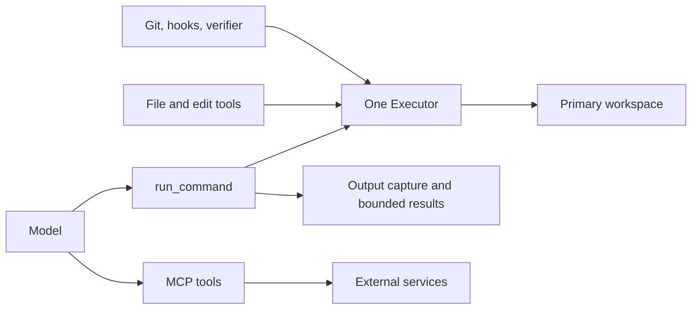
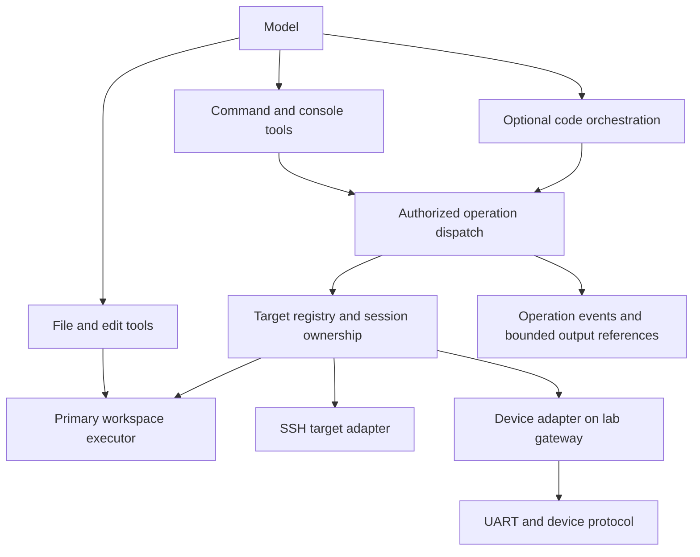

# Rethinking Stirrup's workspace and execution seam

**Status:** Research and recommendation; not an accepted architecture or implementation specification.

**Date:** 2026-10-16.

**Source baseline:** `bba2e14f4e071a823fa9c0e845fda6809e082894`.

**Audience:** Stirrup maintainers deciding whether to invest in remote execution and hardware operations.

## Assessment

The hypothesis is promising, but “Bash-like tools over multiple transports” is too narrow a description of the opportunity and too broad a promise about compatibility.

**Recommended direction: keep a primary workspace, add explicit execution targets and owned sessions, and evaluate Python as an optional orchestration interface over those capabilities.** A target may offer command execution, an interactive console, file transfer, or a Python runtime. It should not have to pretend to offer all four.

This would let Stirrup coordinate a local build, an SSH-accessible Linux device, and a UART recovery console in one task. The strongest expected benefit is reliable access to those environments with less repeated setup and recovery logic. Token savings are plausible when code filters output or replaces repetitive model turns. They are not an automatic consequence of moving SSH into the harness.

The premise that current leading models are specifically suited to Python is not established by the evidence reviewed here. There is evidence for **code as an action interface**, including Python and TypeScript implementations. There is no evidence here that every workspace should run a Python server, or that Python is the best interface for every supported model.

Start with a controlled comparison against good shell scripts, OpenSSH connection reuse, and a small device-control integration. Do not start by replacing `Executor` or designing a general plugin ecosystem.

### Evidence boundaries

- **Observed:** repository behavior inspected at the commit above; external protocols and documented implementations linked below.
- **Reported:** benchmark results and vendor experience, attributed to their authors rather than reproduced here.
- **Proposed:** the architecture, tradeoffs, and evaluation below are engineering recommendations.
- **Not measured:** no model experiments, live SSH/device operations, throughput tests, or token-saving measurements were performed for this report.

## 1. What the current seam actually provides

Stirrup already separates the model-facing command tool from execution. The missing distinction is between a workspace, an execution target, and a continuing interaction with that target.

| Area | Current source evidence | Implication |
|---|---|---|
| Workspace and execution | [`Executor`](../harness/internal/executor/executor.go) combines file reads/writes/listing, path resolution, capabilities, and `Exec(command, timeout)`. | Adding SSH as an executor is natural when the entire task lives on one remote filesystem. It is awkward when a task needs several machines and a console. |
| Command interface | [`run_command`](../harness/internal/tool/builtins/shell.go) accepts `command` and `timeout`; the tool caps timeout at 300 seconds. | There is no target selector, session handle, input continuation, or model-facing PTY control in this tool. |
| Local process state | [`LocalExecutor.ExecStream`](../harness/internal/executor/local.go) starts `sh -c` in the workspace for each call. | Files persist, but a shell's `cd`, variables, and activation state do not persist between calls. Calling this a Bash tool would overstate its shell guarantee. |
| Output handling | The shell tool uses [`commandoutput.Store`](../harness/internal/commandoutput/store.go), structured results, previews, and output references; the factory registers `read_command_output` alongside it. | The baseline already bounds model-visible output. Compare against that behavior, not a hypothetical implementation that dumps every byte into context. |
| Optional capabilities | `StreamingExecutor`, `TreeLister`, `HostPathWorkspace`, and [`WorkspaceArchiver`](../harness/internal/executor/workspacearchive.go) distinguish executor abilities. | There is precedent for capability interfaces rather than making every backend emulate a local directory. Streaming here is output capture, not a bidirectional interactive session. |
| Construction and public API | [`factory.go`](../harness/internal/core/factory.go) selects built-in implementations; [`harnessapi`](../harness/harnessapi/harnessapi.go) exposes loop construction with an injected control-plane transport, `Run`, and `Close`. | Internal Go interfaces are not yet a public third-party executor/plugin API. Such an API would need deliberate versioning and ownership rules. |
| Configuration | [`ExecutorConfig`](../types/runconfig.go) selects one executor, including local, container, Kubernetes, API-backed, and none variants. | A target registry would be a new configuration concept, not just another executor type. |
| Git and handoff | [`DeterministicGitStrategy`](../harness/internal/git/deterministic.go) runs through the executor. Workspace archives are also produced inside its boundary. | Preserve the primary workspace binding. Switching a command target must not silently move Git, edits, or final artifact export to that target. |
| Extension today | [`mcp.Client`](../harness/internal/mcp/client.go) discovers remote tools over Streamable HTTP. Factory discovery failures currently log a warning and skip that server's tools. | An external device service is feasible without a new Go plugin API. Required target availability would need stronger handling than optional discovery. |
| Replay | [`ReplayExecutor`](../harness/internal/executor/replay.go) indexes calls by tool name and canonical input in a map. | Identical polls at different times can have different results. Stateful execution needs ordered events and session identity; argument lookup alone is insufficient. |
| Conversation persistence | [`sessions-spec-draft.md`](sessions-spec-draft.md) is explicitly a draft about recording and continuing conversations. | A conversation transcript does not restore a Python heap, SSH connection, terminal state, or hardware lease. These are separate lifecycles. |

The architecture document's component table is less detailed than the current factory. This assessment uses code for the executor inventory and command behavior.

## 2. What the external evidence supports

### Code can be a useful action interface; Python superiority remains unproven

[CodeAct, 2024](https://arxiv.org/abs/2402.01030) studies executable Python actions and reports improvements over JSON/text alternatives across its evaluated models and tasks. It supports testing composable code actions. It does not isolate Python against equally capable alternative languages on today's Stirrup workloads, nor establish SSH/UART reliability.

[Anthropic's programmatic tool-calling article](https://www.anthropic.com/engineering/advanced-tool-use) describes Python code that invokes tools, processes intermediate results, and returns selected output to the model. This is relevant to repeated diagnostics and aggregation. The mechanism is avoiding unnecessary inference and intermediate context, not merely putting a Python process in a sandbox. Its examples are product/vendor evidence, not an independent Stirrup benchmark.

[Anthropic's code-execution-with-MCP article](https://www.anthropic.com/engineering/code-execution-with-mcp) demonstrates TypeScript APIs and on-demand discovery. Its reported reduction from 150,000 to 2,000 tokens concerns the illustrated tool-loading approach; it is not a forecast for Stirrup's small built-in command surface. The useful lesson is selective discovery and processing data before returning it to the model.

[Cloudflare's Code Mode](https://blog.cloudflare.com/code-mode/) also presents tools through TypeScript, executes generated code in isolated runtimes, and routes calls back to tool implementations. This is a counterexample to treating Python as a prerequisite. It also shows that useful orchestration need not retain one interpreter heap between calls.

A more recent preprint, [The Bitter Lesson of Tool Calling, August 2026](https://arxiv.org/html/2608.06370v1), reports Python programmatic calling matching or exceeding native JSON calling for 11 of 14 evaluated models. Its limitations are material: the functions return arguments rather than perform real operations; the evaluation therefore tests serialization rather than complete tool workflows. Its chaining ablation uses 1.5 times the input tokens of the JSON baseline, while high fan-out changes the tradeoff. Treat this as directional evidence, not proof of universal efficiency or operational reliability.

**Inference:** benchmark the interface and orchestration pattern separately from the language. Better function documentation, batching, and result shaping can account for gains that would otherwise be attributed to Python.

### Persistence is useful, but there are several kinds

[OpenHands' terminal tool](https://github.com/OpenHands/software-agent-sdk/blob/main/openhands-tools/openhands/tools/terminal/README.md) documents persistent shell state, tmux/subprocess PTY backends, long-running commands, interrupts, and reset. This is a concrete precedent for persistent terminals without making Python the model-facing execution language.

[Jupyter's messaging protocol](https://jupyter-client.readthedocs.io/en/stable/messaging.html) separates execution requests, replies, output, and kernel status. It also documents that background output can arrive after an idle status. A persistent interpreter therefore needs request/output correlation and lifecycle management, not just an HTTP endpoint around `exec()`.

| State | What persistence buys | What it does not buy |
|---|---|---|
| Workspace files | Artifacts, scripts, intermediate datasets | Live processes or open connections |
| SSH connection | Reused authentication and network connection | A shared working directory or shell variables across independent exec channels |
| Shell session | Working directory, environment, interactive program continuity | Reliable recovery after session loss |
| Python interpreter | Objects, imports, parsed datasets, reusable functions | Reconstructible state after a crash |
| Conversation | Prior observations and decisions | Proof that a device or remote process is still in the same state |
| Device lease | Exclusive access across competing workers | The device being healthy or in the expected boot state |

### SSH already offers a strong baseline

[OpenSSH configuration](https://man.openbsd.org/ssh_config) supports connection multiplexing with `ControlMaster`, `ControlPath`, and `ControlPersist`. A sequence of CLI calls can therefore reuse a connection. A managed backend may improve lifecycle, identity, policy, and error reporting, but avoiding repeated handshakes does not require replacing the CLI.

[RFC 4254](https://www.rfc-editor.org/rfc/rfc4254.html) distinguishes channels, command/shell requests, PTY requests, data, signals, and exit status. Exit-status reporting is recommended, not guaranteed. A connection, a channel, a shell, and a process must not collapse into one “session” concept. Dropping a connection is not evidence that a remote command was undone.

### UART needs a protocol above the byte stream

[labgrid's architecture](https://labgrid.readthedocs.io/en/latest/overview.html) is the closest precedent for the mixed-fleet use case. It separates resources, drivers, and protocols. A shell driver adds command boundaries and status over a console; an SSH driver can expose the same command protocol. It also models incompatible active states, such as bootloader versus Linux, and manages shared resources. Borrow this separation before inventing a universal terminal protocol.

[pySerial](https://pyserial.readthedocs.io/en/latest/pyserial_api.html) exposes byte I/O, timeouts, flow control, and control lines. Its documentation warns that opening a port can cause RTS/DTR transitions. Whether that resets a board depends on its wiring. “Connect” is therefore potentially a hardware action, even before the model sends a command.

[Pexpect](https://pexpect.readthedocs.io/en/stable/api/pexpect.html) supplies pattern matching, EOF, and timeout handling for interactive streams. It is a building block; matching a prompt alone does not establish that the intended operation succeeded.

[MicroPython's reset documentation](https://docs.micropython.org/en/latest/reference/reset_boot.html) and [mpremote documentation](https://www.micropython.org/resources/docs/en/latest/reference/mpremote.html) illustrate why a device REPL needs its own adapter: interrupts, raw execution, and soft resets change interpreter and boot behavior. A CPython server in the workspace is a different thing from a MicroPython interpreter on the target.

## 3. Separate the design decisions

Five independent choices are being bundled into the original hypothesis:

1. **Where files belong:** the primary workspace and any separately named remote filesystems.
2. **What the model addresses:** targets, command sessions, consoles, or runtime objects.
3. **How actions travel:** local process pipes, SSH channels, serial bytes, or service RPC.
4. **How actions are expressed:** individual structured tool calls, shell scripts, Python, or another language.
5. **Who owns continuing state:** the run, a workspace service, or an external device/session manager.

Changing all five at once would make results hard to explain. A Python server could improve process management without improving model reasoning. A target parameter could remove repeated quoting without providing persistent state. A persistent Python kernel could improve log analysis without helping UART access at all.

### Three different Python-server proposals

| Proposal | Useful capability | Main cost | Assessment |
|---|---|---|---|
| Workspace RPC service implemented in Python | Own processes, filesystem operations, output handles, and device libraries | Packaging, service authentication, version compatibility, startup and shutdown | Reasonable implementation option where Python libraries help; invisible implementation language offers no direct model-token advantage. |
| Persistent model-facing Python interpreter | Retain parsed telemetry, arrays, functions, and analysis state | Hidden mutable state, restart behavior, resource bounds, output correlation | Worth an isolated experiment for repeated analysis. Not a universal prerequisite. |
| Python orchestration over registered capabilities | Batch diagnostics, branch on results, filter data, reuse routines | Nested authorization/tracing, generated-code errors, cancellation across calls | Strongest efficiency hypothesis; test first without requiring persistent interpreter state. |

A workspace Python environment can orchestrate targets that have no Python. For a remote UART, the device-facing adapter belongs on the machine that can access the serial port, potentially a lab gateway. It need not live beside the model's source checkout.

Do not assume a service running beside agent-written code is a trusted authority. Service code and configuration must be protected from workspace edits if it enforces target access. Arbitrary Python should run in an execution boundary, with privileged target operations mediated elsewhere. Restricting Python imports is not a substitute for process isolation.

## 4. Alternatives and tradeoffs

The costs below are relative engineering estimates, not measured schedules.

| Option | Capability gain | Token/latency hypothesis | Cost and limitation | Use when |
|---|---|---|---|---|
| Existing shell plus scripts and SSH multiplexing | Reusable diagnostic routines and connection reuse | Can already batch, filter, and avoid handshakes | Low; identity, interactive lifecycle, and transcripts remain ad hoc | Establishing the baseline; occasional remote commands |
| Dedicated SSH executor | Remote files and commands behind existing tools | Less SSH boilerplate; little inherent reduction in observations | Medium; one executor still centers one workspace; file/Git/archive semantics need implementation | The whole coding task lives on one remote host |
| Add `hostname` to `run_command` | Select local versus remote command destination | Less quoting and connection setup text | Looks small, but creates target policy and result ambiguity; says nothing about serial sessions | Narrow SSH-only prototype, not the durable abstraction |
| External MCP device service | Add domain-specific operations without changing executor internals | Compact semantic operations can replace many console interactions | Medium; deployment, leases, loss recovery, and evidence are service responsibilities | Testing hardware workflows or integrating an existing lab manager |
| Managed targets with optional session capabilities | Several machines/consoles in one task; explicit lifecycle and identity | Fewer setup/recovery turns; consistent output handles | Medium–high; richer lifecycle, tracing, and ownership contracts | Repeated mixed-fleet operations justify native support |
| Python execution/orchestration service | Data processing and composed actions | May suppress intermediate output and repetitive reasoning | Medium–high; interpreter/runtime and policy mediation | Analysis and orchestration experiments show gains |
| Durable external session platform | Survive harness restarts and share long-lived infrastructure | May avoid setup across jobs | High; leases, reconnection, orphan cleanup, scheduling, and ownership transfer | Cross-run continuity becomes an actual requirement |

MCP and managed sessions are compatible choices. MCP can carry requests to a service that implements sessions; it does not automatically define their meaning. The [MCP transport specification](https://modelcontextprotocol.io/specification/2025-11-25/basic/transports) defines protocol transport and transport-session behavior, not restoration of remote shells or device state. Stirrup's current MCP path is remote HTTP, so a local stdio plugin would require additional integration.

For the first device experiment, prefer a small integration around existing labgrid functionality over reimplementing bootloader and console handling. Whether it runs behind MCP or a dedicated RPC boundary can remain an implementation decision until the experiment identifies a real deficiency. Avoid exposing hundreds of low-level driver functions to the model at startup.

## 5. Recommended architectural direction

The following is a candidate design to test, not a proposed public API freeze.

### Target identity and capabilities

Use an operator-defined target ID such as `build`, `dut-linux`, or `dut-console`, rather than allowing the model to supply an arbitrary hostname. Configuration maps IDs to endpoints, credentials, connection policy, and capability declarations. Calls and results carry the target ID so the model does not confuse local and remote observations.

The SSH and UART interfaces of one board should share a device identity and mutation lease. Otherwise two agents could legitimately acquire different connections while racing to reboot or reconfigure the same hardware.

A target may offer independent capabilities:

- **Command execution:** a bounded invocation with output and known or unknown completion status.
- **Console interaction:** an owned stream with bounded reads, writes, and protocol-specific interrupts.
- **File access/transfer:** explicit source and destination identities, where supported.
- **Code execution:** an optional interpreter with a stated lifetime and reset behavior.
- **Device operations:** explicit boot/reset/power actions when an adapter supports them.

Keep the existing workspace executor and default `run_command` behavior during an experiment. A shell target could eventually extend that tool with `target`; a console should have a distinct interface rather than accepting shell commands it cannot interpret. Do not reuse Stirrup's `Transport` name, which already means harness-to-control-plane communication.

### Sessions, completion, and recovery

An interactive session needs an opaque handle, owner, target, adapter/protocol identity, and generation. Generation changes make stale handles invalid after reset or reconnection. A connection can be reused while individual commands remain stateless. Persistent shells and interpreters should be explicit opt-ins.

Expose the difference between:

- a command that completed with a reported status;
- an operation that is still running;
- a console read that reached a pattern or its wait deadline;
- an interrupted operation whose termination was confirmed;
- a disconnected operation whose outcome is unknown.

In particular, a UART read timeout must not inherit today's `run_command` promise that the command was killed. There may be no process to signal, and writing Ctrl-C can have protocol-dependent effects. A shell marker can improve framing, but arbitrary output can imitate markers; it is evidence with a defined trust level, not a security boundary.

Default ownership should remain within the run. Close sessions and release leases on completion, cancellation, and construction failure. Reconnection should re-establish identity and inspect state before continuing. Never automatically replay a write merely because its reply was lost. Persisting sessions beyond a job is a separate feature, requiring explicit lease transfer and orphan handling.

### Policy and evidence

Current `run_command` is marked workspace-mutating and approval-requiring. Those labels are too coarse to describe external device actions: a reset mutates no repository file. Any new interface should authorize the resolved target and operation, including connection actions that affect hardware.

Code orchestration must invoke the same authorization, guard, and trace path as direct calls. Giving Python raw privileged sockets or credentials and then checking only the outer `execute_python` call would bypass per-target control. Within the interpreter's own workspace authority, file and process behavior still needs normal sandbox enforcement.

Moving SSH from a sandbox command to a harness-owned connection changes network authority. The adapter must not silently inherit the harness host's wider reach or ambient SSH credentials. Bind target access explicitly, retain host-key verification, and define whether the connection originates in the sandbox, a restricted broker, or a lab gateway. A configured target is a grant of access, not an exception inferred from a hostname. The existing workspace network policy must remain meaningful.

Bound nested operation counts, concurrency, output, and wall-clock time under the parent run budget. A single Python tool call must not create an unlimited polling loop. Serialize access to a shared shell/interpreter or console unless its adapter explicitly supports concurrency; separate SSH exec channels can have different concurrency rules. Cancellation must stop new child operations and report which remote operations could not be confirmed stopped.

Record child operations with their parent tool-call ID, target, session generation, sequence, completion evidence, and output references. Capture must happen before model-written filtering if the run requires a complete operation record. Keep bounded model previews and retrievable transcripts; explicitly indicate capture loss or truncation. Serial/PTY output may be one combined stream rather than separately attributable stdout/stderr.

Replay should consume ordered events rather than deduplicate identical inputs. Runtime reset, console transitions, and late output must be visible. Conversation resume should invalidate or revalidate execution handles, never infer a live connection from an old transcript.

### Files and delivery

Keep edits, Git checkpoints, and workspace export attached to the primary workspace unless configured otherwise. Remote installation or flashing is a separate delivery operation with its own receipt and postcondition. “The build succeeded” and “the target is running the new artifact” are distinct claims.

A file-transfer capability should identify both endpoints and verify the received artifact where possible. A UART-only device must not be assigned a fictional filesystem root. Hooks and verifiers also need an explicit target when operating away from the workspace.

### Plugin packaging

Use built-in Go adapters for the smallest native experiment. Use an external service when existing Python hardware libraries or lab ownership make that cheaper. Neither requires loading arbitrary Go shared objects into the harness.

A public plugin contract becomes justified only after at least two materially different implementations establish common requirements. Its review would then cover protocol/version negotiation, capabilities, operation identity, cancellation, output limits, lifecycle, credentials, and failure semantics. Publishing the current internal `Executor` unchanged would prematurely make filesystem assumptions part of that contract.

## 6. Concrete workflows

These illustrate proposed behavior, not tools available today.

**Remote diagnosis:** the model requests service status and selected logs from `dut-linux`. A batch routine performs independent reads, groups recurring errors, and returns a compact summary with transcript references. The model chooses the next investigation. Compare this with a well-written shell/Python script invoked through today's tool; the plugin must earn its complexity beyond scriptability alone.

**Build, install, verify:** compile in `build`, transfer the identified artifact to `dut-linux`, verify its digest, install under the target's mutation policy, and query the running version. Preserve the local build receipt and remote verification separately. A lost reply during install becomes an unknown outcome followed by inspection, not an automatic second install.

**SSH failure with UART recovery:** acquire the device lease, attach its console, observe whether it is in a bootloader, login prompt, or application console, and use the matching adapter. If the board needs a reset, request that explicit operation. A hostname parameter alone cannot represent this transition.

**Telemetry analysis:** capture bounded samples from several devices, process them in workspace Python, and report anomalies with sample counts and source references. First test a stateless script with files; add a persistent interpreter only if repeated parsing or reusable in-memory objects matter. Do not run arbitrary CPython code on a constrained target by assumption.

**Time-sensitive boot interaction:** a deterministic adapter handles a configured boot window and returns the observed transition. The model should choose a recovery strategy, not race serial characters against a short boot countdown through repeated inference calls.

## 7. Experiments that can reject the recommendation

Separate capability testing from model-efficiency testing. A useful target interface may be worth adopting for correctness even if it saves no tokens; that would support a different claim than the original efficiency hypothesis.

### Baselines and variants

| Variant | Definition | What it isolates |
|---|---|---|
| A: Current | Existing tools, output capture, ordinary SSH/scripts | Actual Stirrup baseline |
| B: Improved scripts | A plus configured SSH multiplexing, documented diagnostic scripts, and bounded summaries | Gains available without a new runtime |
| C: Managed targets | B's workload capabilities through target/session tools; no code orchestration | Identity, lifecycle, and interactive-session benefits |
| D: Stateless Python | C plus code calling the same authorized operations | Batching/filtering benefits without heap persistence |
| E: Persistent Python | D plus interpreter state across calls | Incremental value and failure cost of persistence |
| F: Language control | D's API and permissions exposed through another code runtime, such as JavaScript | Whether Python specifically improves the outcome |

Do not make B intentionally weak: allow the model to write scripts, use files for intermediate state, and batch independent calls. Give variants equivalent target access, output caps, example quality, and task information. Device tasks that A cannot express reliably should be reported as capability gaps, not buried in token averages.

### Task and fault matrix

| Scenario | Success evidence | Fault to inject |
|---|---|---|
| One SSH diagnostic command | Correct value from the intended host | Authentication/host identity failure |
| Fleet diagnostic fan-out | Correct aggregate with per-target failures retained | One slow and one disconnected target |
| Large log analysis | Correct anomaly and evidence offsets without dropping relevant errors | Oversized output and misleading benign volume |
| Stateful shell task | Correct environment and working directory | Terminal restart between actions |
| Build/install/verify | Artifact digest and running-version postcondition | Connection lost after write, before acknowledgement |
| UART boot console | Correct protocol/state identified and requested transition achieved | Prompt-like log text, fragmented bytes, late output |
| UART reconnect | Same device identity and explicit state reconciliation | USB re-enumeration and control-line reset behavior |
| MicroPython interaction | Expected value plus explicit interpreter/reset state | Soft reset and interrupted execution |
| Concurrent device work | Only the lease holder mutates the physical device | Two sessions through SSH and UART on the same board |
| Cleanup and replay | No owned resources leaked; replay preserves observations in order | Cancel, crash, repeated identical polls, interpreter reset |

Begin with a local SSH fixture and a deterministic PTY/serial simulator. Label simulator results as such: they cannot establish electrical reset behavior, USB quirks, or real boot timing. Hardware acceptance needs a separate controlled-device run.

### Measurement protocol

For an initial screening, use ten fixed task fixtures spanning the matrix, five repetitions, and two pinned model versions from different supported provider families. Run A/B first; evaluate C and D on the same fixtures before spending on E/F. Freeze prompts, tool definitions, budgets, target state, and fixture versions. Randomize variant order and reset fixtures between runs. Record exact model IDs and provider settings at execution time rather than relying on a moving “SOTA” label.

Use deterministic postconditions where possible. Record:

- Task success, wrong-target actions, duplicate writes, false completion reports, and operator interventions.
- Total provider-reported input/output tokens, cached-input accounting separately, and reasoning-token fields where supplied. Also retain model-visible tool-result size and tool-definition overhead.
- Model round trips, underlying target operations, bytes captured versus bytes shown, connection setups, and recovery attempts.
- End-to-end time, time waiting on models versus targets, runtime startup, and cold versus reused connections.
- Adapter implementation effort, dependencies, resource usage, leaked processes/connections, and cleanup failures.

Report all attempts, including failed runs; separately report cost/tokens per successful task so early failures do not look efficient. Use paired comparisons with uncertainty intervals and per-workload results. Five repetitions are screening evidence, not enough to claim rare-failure safety or universal model performance.

Suggested screening gates, chosen for this investigation rather than established product requirements:

- Advance C if it demonstrably resolves lifecycle/interactive failures that B retains, or reduces median tokens or elapsed time by at least 20% without lower observed task success.
- Advance D if it cuts median total tokens by at least 20% on the declared orchestration workloads against C, with no lower observed success. Count the code-generation and interface-documentation overhead.
- Advance E only if it adds at least 10% median token/time improvement over D on repeated-analysis tasks and passes reset/recovery scenarios. Otherwise keep state in explicit artifacts.
- Require zero observed wrong-target writes, blind replay of uncertain writes, or false success claims in the fault suite before promotion. This is a necessary test gate, not proof that such failures are impossible.
- Confirm promising results with a larger independent fixture set before changing defaults. Treat an inconclusive interval as inconclusive.

Reject or narrow the hypothesis if improved scripts match the new interface, token gains disappear after instruction overhead, success drops, recovery becomes opaque, or results occur on only one model. If Python and another runtime perform similarly, prefer the cheaper operational fit rather than asserting model-specific language superiority.

## 8. Investment sequence

1. **Establish the baseline.** Build the fixtures and compare current behavior with good SSH/scripts. Identify whether the main cost is model inference, output volume, authentication, console fragility, or missing target identity.
2. **Test one SSH target and one UART device integration.** Keep the workspace executor. Use named targets, explicit ownership, bounded output, and honest unknown outcomes. Compare a small external device service with native session support before choosing packaging.
3. **Test stateless Python orchestration.** Route its child calls through the same operation path. Reuse scripts and artifacts; do not require target-side Python or a kernel yet.
4. **Add persistence only where measured.** A long-lived connection, shell, and Python interpreter should each justify its own lifetime. Add crash and stale-state tests before relying on them.
5. **Publish an interface after the experiments.** Specify the proven common capabilities and versioning. If cross-run ownership is required, design it with the control plane or lab manager rather than silently extending a job's lifetime.

The first decision is whether explicit target/session ownership solves enough real work to justify a prototype. The evidence supports that experiment. It does not yet support replacing the workspace abstraction, making Python mandatory, or promising a universal Bash interface across SSH and UART.
